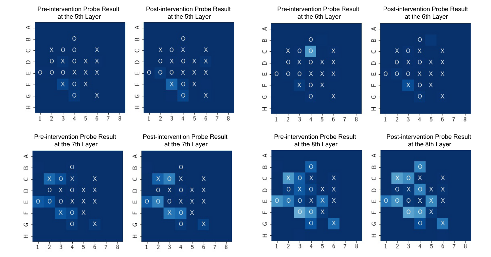

返回 [论文索引](../INDEX.MD) · 插图

# Figure 8. Board states before and after each layerwise edit

[Original figure (PDF)](../../../TeX/Othello-GPT/arXiv-2210.13382v5/figs/AppendixB_101.pdf)

The boards show predicted tile states before and after editing each layer. Color encodes confidence for the top-1 tile prediction.

See [Appendix D](../appendix/d-inter-probe-interaction.md).
