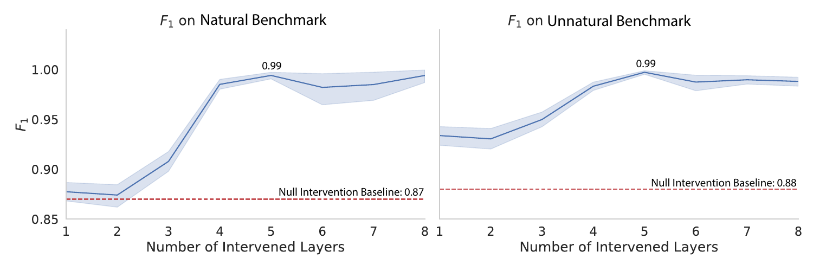

返回 [论文索引](../INDEX.MD) · 插图

# Figure 9. Intervention F₁ scores

[Original figure (PDF)](../../../TeX/Othello-GPT/arXiv-2210.13382v5/figs/intvn_res_f1.pdf)

The intervention benchmark from Figure 3, with $F_1$ in place of error.

See [Appendix F](../appendix/f-alternative-metrics.md).
