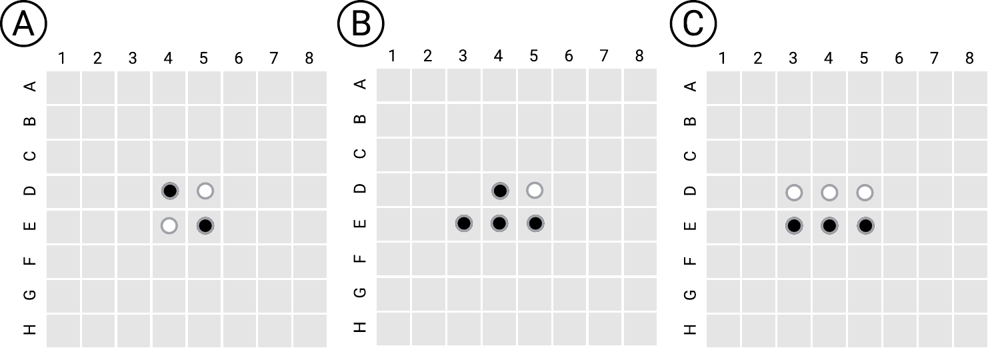
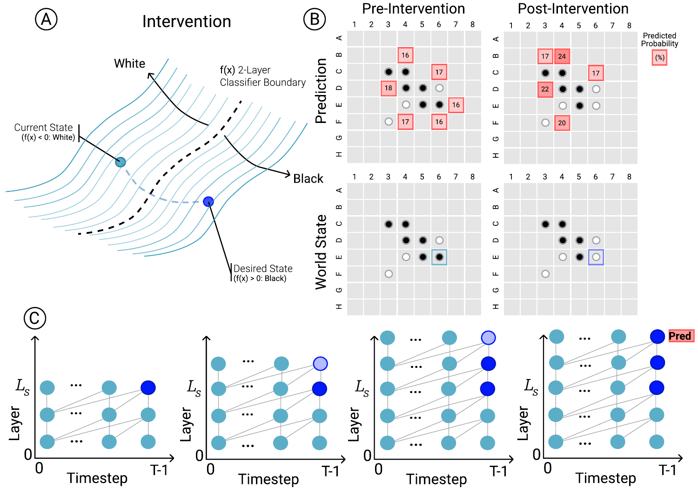
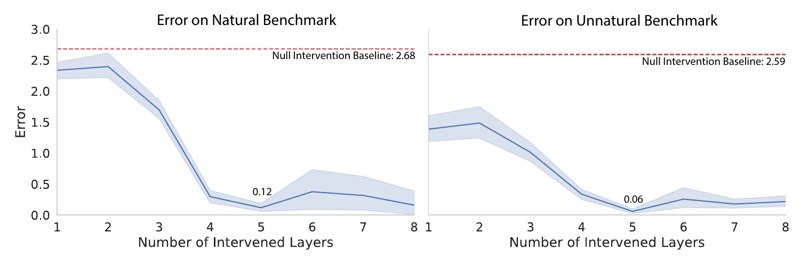
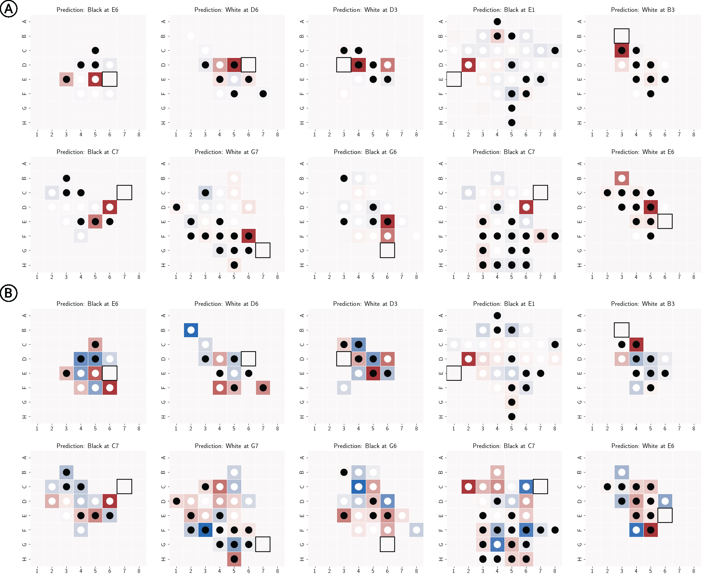
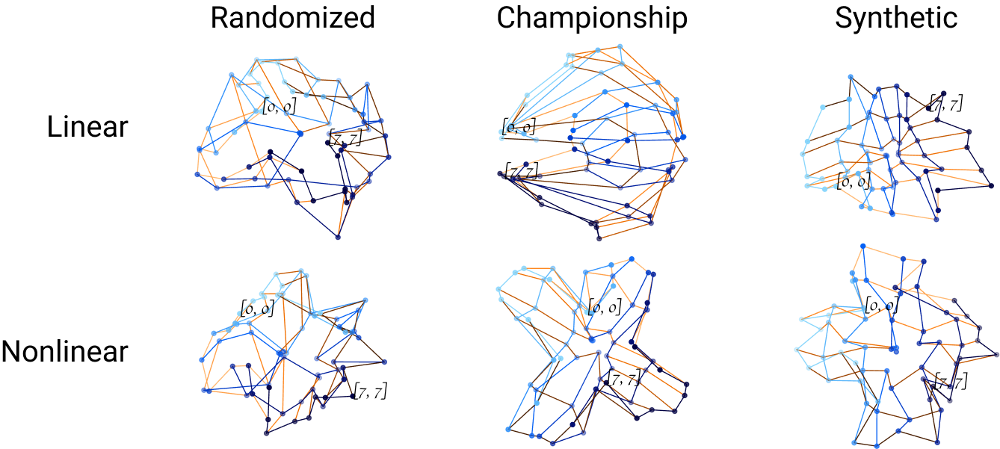
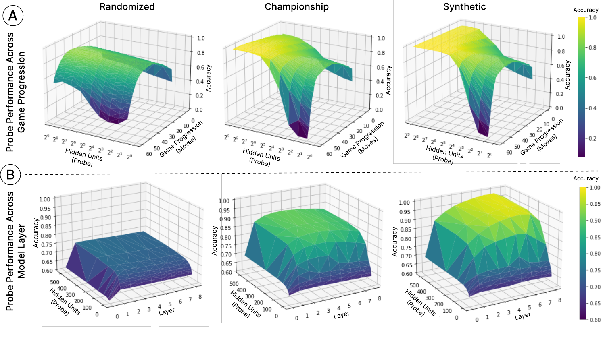
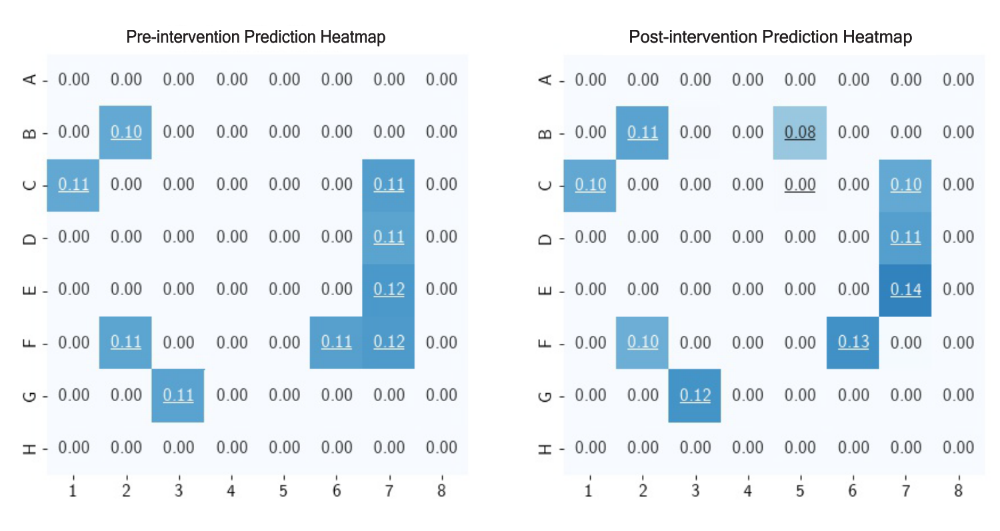
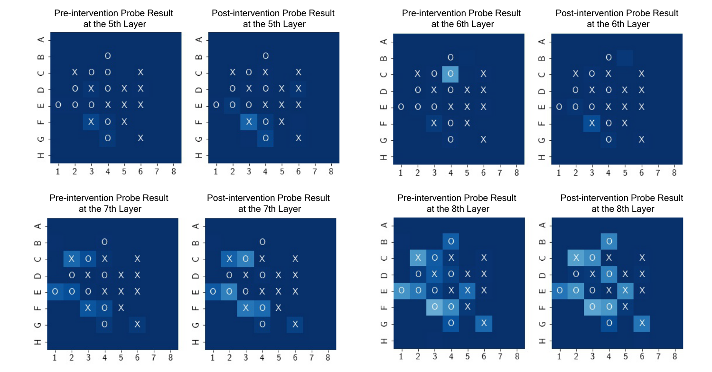
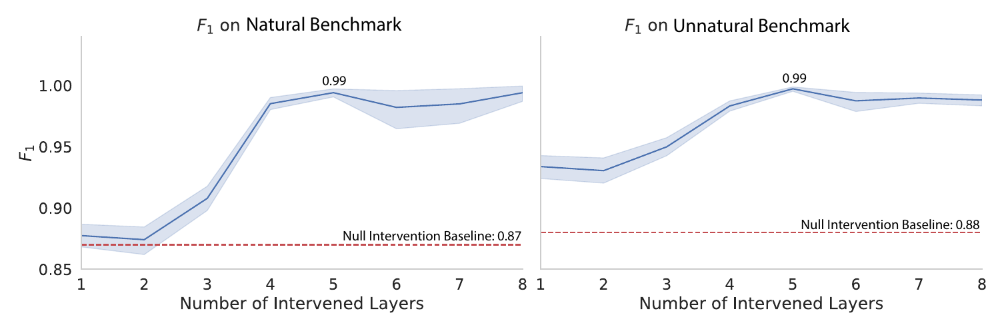
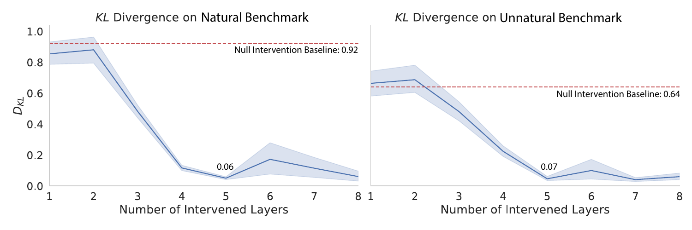

# Emergent world representations: Exploring a sequence model trained on a synthetic task

> [返回论文索引](INDEX.MD) · 英文 Markdown 连续阅读版（按源文整理，非逐字转录） · [原始 LaTeX](../../TeX/Othello-GPT/arXiv-2210.13382v5/main.tex)

## Abstract

Language models show a surprising range of capabilities, but the source of their apparent competence is unclear. Do these networks just memorize a collection of surface statistics, or do they rely on internal representations of the process that generates the sequences they see? We investigate this question in a synthetic setting by applying a variant of the GPT model to the task of predicting legal moves in a simple board game, Othello. Although the network has no a priori knowledge of the game or its rules, we uncover evidence of an emergent nonlinear internal representation of the board state. Interventional experiments indicate this representation can be used to control the output of the network. By leveraging these intervention techniques, we produce “latent saliency maps” that help explain predictions. [Code](https://github.com/likenneth/othello_world)

## Authors and affiliations

Kenneth Li (Harvard University); Aspen K. Hopkins (Massachusetts Institute of Technology); David Bau (Northeastern University); Fernanda Viégas, Hanspeter Pfister, and Martin Wattenberg (Harvard University).

Correspondence: [Kenneth Li](mailto:ke_li@g.harvard.edu). Published at ICLR 2023. Source: [arXiv:2210.13382v5](https://arxiv.org/abs/2210.13382v5), [local LaTeX](../../TeX/Othello-GPT/arXiv-2210.13382v5/main.tex). Code: [othello_world](https://github.com/likenneth/othello_world).

## 1. Introduction

Language models trained to predict the next word can solve logic puzzles and write basic code. It is unclear whether this ability comes from surface statistics or from representations of the process that generates the data. Reliance on spurious correlations can produce out-of-distribution failures. Prior work found internal information about color, direction, and boolean states; work on chess transcripts found that a language model predicts legal moves and appears to track the board, but did not investigate the form of its representation.

### 1.1 The game of Othello as testbed for interpretability

Othello provides a controlled setting: the world is the board, the data are sequences of moves, and the rules are simpler than chess. Othello-GPT is trained to continue transcripts, not explicitly to win or make strategic moves. It receives only tokens for disc placement, with no rules or board states provided during training.

The experiments ask what the model learns beyond predicting legal moves. Probes recover board state from activations; nonlinear probes outperform the tested linear probes. Counterfactual interventions test whether that information affects predictions, and latent saliency maps attribute move predictions to board positions rather than input tokens. See [the probing setup](methods/3-probe-setup.md), [intervention technique](methods/4-intervention.md), and [latent saliency maps](results/5-latent-saliency.md).

## 2–2.1. Language modeling of Othello game transcripts: Datasets

Othello is played on an 8 × 8 board. Players alternate placing black and white discs. A move must outflank opposing discs; the goal is to have the majority of the discs when play ends. The game tree is too large to memorize, yet the rules and board state are much simpler than chess. See [Figure 1](figures/figure-1-othello-rules.md).

- **Championship:** 7,605 and 132,921 games from [Live Othello](https://www.liveothello.com/) and the [French Othello Federation](https://www.ffothello.org/), respectively. The combined games were randomly split 8:2 for training and validation. Expert players presumably played strategically.
- **Synthetic:** 20 million training games and 3,796,010 validation games. The paper describes constructing this dataset by uniformly sampling leaves from the Othello game tree; it contains legal play without an explicit strategy.

Compare [next-move legality](results/1-legal-moves.md) and [latent saliency maps](results/5-latent-saliency.md) for the contrasts between data sources.

## 2.2. Model and Training

The vocabulary has 60 tokens, one for each square other than the four preoccupied central squares. A4 and H6 are the 4th and 58th words, for example. All weights, including the 60 word embeddings, start at random. No geometric prior tells the network that C4 is below B4.

The GPT variant has 8 layers, 8 attention heads, and 512-dimensional hidden activations. Let $y_0,\dots,y_{T-1}$ be a partial game, $x_t^0$ the corresponding embedding, and $x_t^l$ the activation after layer $l$ for token $t$. The causal mask restricts $x_t^l$ to attending to $x_{\leqslant t}^{l-1}$. A linear classifier on $x_{T-1}^8$ predicts logits for the move at $T$. Training minimizes cross-entropy between the true next move and the predicted logits.

See [the legality evaluation](results/1-legal-moves.md).

## 2.3. Othello-GPT Usually Predicts Legal Moves

For each step of held-out games, the authors check whether the single highest-ranked prediction is a legal move conditioned on the preceding moves. Top-1 error was **0.01%** for synthetic training, **5.17%** for championship training, and **93.29%** for the untrained model.

To test transcript memorization, the authors trained a model on 20 million games from a skewed dataset. The openings are C5, D6, E3 and F4; they excluded the C5 branch (one quarter of the game tree). Top-1 error on test sequences from the excluded branch was **0.02%**. Different sequences can still reach the same board state, so this control excludes memorization of the input transcripts, not all previously reached states.

See [datasets](methods/1-datasets.md) and [probe setup](methods/3-probe-setup.md).

## 3. Exploring Internal Representations with Probes

A probe is a classifier or regressor trained on a network's internal activations. The Othello probes use $x_t^l$, summarizing the partial sequence $y_{\leqslant t}$ at layer $l$, and predict a three-way categorical distribution $p_\theta(x_t^l)$ for a tile: black, white, or empty. Occupied versus unoccupied alone is linearly computable from the input sequence, so the authors use the harder three-way target. The current board can be computed from the rules, but it is in general a nonlinear function of the input tokens.

Activation/ground-truth state pairs are split randomly 8:2 for training and validation; the paper reports held-out error. The Section 3 text gives 52.95% for always predicting empty, whereas its Section 3.1 footnote gives 47% for a constant empty prediction. Both figures are retained as stated in the source.

See [linear probe results](results/2-linear-probes.md) and [nonlinear probe results](results/3-nonlinear-probes.md).

## 3.1. Linear Probes Have High Error Rates

The linear classifier is $p_\theta(x_t^l)=\operatorname{softmax}(Wx_t^l)$, where $W\in\mathbb{R}^{F\times3}$ in the paper's notation and $F$ is the activation dimension. No error dips below 20%; the strongest results are 20.4% on the synthetic model and 23.6% on the championship model, versus 26.7% on the randomly initialized model. The random network still preserves some information about moves, so the important comparison is between the trained and randomized networks rather than against a constant-only guess. In this black/white/empty formulation, the tested linear probes only modestly improve on the randomized model.

See [Table 1](tables/table-1-linear-probe-errors.md), [Table 4](tables/table-4-linear-standard-deviations.md), and [nonlinear probes](results/3-nonlinear-probes.md).

## 3.2. Nonlinear Probes Have Lower Error Rates

The nonlinear probe is a two-layer MLP, $p_\theta(x_t^l)=\operatorname{softmax}(W_1\operatorname{ReLU}(W_2x_t^l))$. The paper gives $W_1\in\mathbb{R}^{H\times3}$ and $W_2\in\mathbb{R}^{F\times H}$, with $H$ hidden units. The randomized network sees little improvement with the nonlinear probe. On trained models, nonlinear probe error drops to 1.7% at layer 7 for synthetic training and 9.4% at layer 4 for championship training. These results are consistent with the presence of nontrivial board-state information; decoding alone does not show causal use.

See [Table 2](tables/table-2-nonlinear-probe-errors.md), [Table 5](tables/table-5-nonlinear-standard-deviations.md), [Appendix B](appendix/b-probe-capacity.md), and [causal evaluation](results/4-causal-role.md).

## 4–4.1. Validating Probes with Interventional Experiments: Intervention Technique

For a partial game, record the next-move prediction from the original board state $B$. Modify the activations so the probe reports a counterfactual $B'$ that differs from $B$ on a single tile $s$. The set of legal moves changes. If predictions shift to the legal moves of $B'$, this provides evidence that the probed representation affects the output.

Using the probe's class score for the selected tile, optimize the activation $x$ while freezing the model and probe weights. The loss is cross-entropy against the desired state; $\alpha$ is the learning rate:

$$
x' \leftarrow x - \alpha\,\frac{\partial \mathcal{L}_{\mathrm{CE}}(p_\theta(x), B')}{\partial x}.
$$

An $L$-layer model run on $T$ tokens has an $L\times T$ grid of activations. At the last token, successively replace $x^l_{T-1}$ with its edited value from layer $L_s$ through $L$, resuming the forward calculation after each replacement. This counters the possibility that a later layer repairs an isolated edit by using untouched information from earlier positions or layers.

See [Figure 2](figures/figure-2-intervention-scheme.md), [intervention results](results/4-causal-role.md), [layer-by-layer probe interaction](appendix/d-inter-probe-interaction.md), and [hyperparameters](appendix/g-intervention-hyperparameters.md).

## 4.2. Evidence for a Causal Role for the Representation

A benchmark example gives the model a partial game, a tile, and a target state. One subset of 1,000 examples consists of natural (legally reachable) positions; a second subset of 1,000 consists of unnatural positions unreachable in legal play. These unnatural states are a stricter test because they are outside the training distribution.

For each case, let $N$ be the number of legal moves on the counterfactual board. Compare the model's top $N$ moves with this set; the score is the number of false positives plus false negatives. The null baseline scores the unchanged predictions against the same post-intervention legal move set.

| Benchmark | Null intervention | Best intervention |
|---|---:|---:|
| Natural | 2.68 | 0.12 |
| Unnatural | 2.59 | 0.06 |

The main text reports $L_s=4$ (five layers edited) for both best results. The effect at even unreachable positions supports a causal role for the representation in next-move prediction. See [Figure 3](figures/figure-3-intervention-errors.md), the [intervention protocol](methods/4-intervention.md), [counterfactual heatmaps](appendix/c-counterfactual-heatmaps.md), and [alternative metrics](appendix/f-alternative-metrics.md).

## 5. Latent Saliency Maps: Attribution via Intervention

For a given board and target move, record the predicted probability $p_0$. For each board tile $s$, edit its state with the intervention, measure the new target-move probability $p_s$, and assign saliency $S_s=p_0-p_s$. Center the scores by subtracting the board mean for visualization. The approach attributes effects to a position in the latent board, not to an input token. [Algorithm 1](methods/5-latent-saliency-algorithm.md) gives the procedure.

The paper visualizes the top-1 move for synthetic and championship models, intervening from $L_s=4$. High saliency in synthetic training concentrates on tiles needed to make the action legal. Championship training highlights legality-related tiles and also more distant or nonessential tiles, consistent with expert moves depending on global board features. The maps do not by themselves identify the exact strategy used by the championship model.

See [Figure 4](figures/figure-4-latent-saliency.md) and [Appendix E](appendix/e-saliency-limitations.md).

## Algorithm 1. Attribution via Intervention on Othello-GPT

**Inputs:** Board $B$ and a legal next move $p$ to attribute. **Output:** a sensitivity $S_s$ for each tile $s$.

1. Set $p_0\gets f_p(x_{t-1})$, the unmodified probability of $p$.
2. For each $s\in B$:
   - Set $\tilde{x}_{t-1}\gets\operatorname{Intervention}(x_{t-1},s)$, applying the [single-tile activation edit](methods/4-intervention.md).
   - Set $p_s\gets f_p(\tilde{x}_{t-1})$.
   - Set $S_s\gets p_0-p_s$.

See [the attribution results](results/5-latent-saliency.md) and [Figure 4](figures/figure-4-latent-saliency.md).

## 6. Related work

Li, Nye, and Andreas found weak evidence for state encoding in language models fine-tuned on synthetic natural language tasks. Abdou et al. found a geometric relationship between BERT activations and a perceptual color space. Patel and Pavlick grounded spatial and color vocabularies through prompting. These studies concern relatively simple worlds in language.

AlphaZero has access to game structure and rules, though it also learns interpretable strategic concepts. Toshniwal et al. find evidence of board tracking in Transformers trained on chess transcripts but do not characterize the representation itself.

The intervention also relates to plug-and-play steering in autoregressive and diffusion models. Unlike methods that balance fluency and a target attribute via repeated model evaluations, this approach works on internal representations in a single forward pass with optimization steps on activations. TCAV concept attribution uses directional derivatives, which can be seen as a linearization of the gradient-based attribution procedure.

See the [references](references/references.md).

## 7. Conclusion

The results support the conclusion that Othello-GPT maintains a representation of the game board and that the representation influences next-move predictions. The original paper interprets the linear versus nonlinear probe comparison as evidence of nonlinearity under its black/white/empty probe setup. The results do not test every possible encoding of the board. Latent saliency maps highlight differences between synthetic and championship training.

Proposed next steps include investigating more complex games, comparing these maps to saliency for an engine that receives the actual board, looking for board-state representations in language models trained on transcripts, and creating controllable natural-language worlds with tools such as bAbI, grounded environments, and TextWorld. More generally, nonlinear probes, layerwise intervention and latent saliency offer a set of tools for investigating world representations in natural language models.

## Acknowledgments

The authors thank the Visual Computing Group and the Insight + Interaction Lab at Harvard for early discussion and feedback, especially Aoyu Wu for help with figures and suggestions. Support came from Harvard SEAS Fellowship (Kenneth Li), Siebel Fellowship (Aspen K. Hopkins), Open Philanthropy and FTX Future Fund Regrant Program (David Bau), and NSF grant IIS-1901030.

## A. Visualizing the Geometry of Probes

For a linear probe, take the normal of the separating hyperplane. For the nonlinear probes, take the second MLP layer as a linear classifier and apply the same idea. This associates each tile with a vector. The authors display PCA projections and connect vectors for neighboring squares. Relative to the randomized GPT baseline, trained models show more recognizable board geometry. Even the randomized baseline has nonrandom structure, consistent with some board information surviving random projections of move tokens. The paper points to supplementary toggleable 3-D plots.

See [Figure 5](figures/figure-5-probe-geometry.md).

## B. Ablation on Nonlinear Probe Accuracies

The authors vary the number of MLP hidden units $H$ and the source layer $l$. More capacity generally improves decoding and intermediate or later-middle layers decode better than the ends. The "what-how-where" analysis replaces training stage in the earlier "what-when-where" plots with probe capacity.

They also bin validation examples by how many steps a tile has been in its current state. With moderately sized nonlinear probes, accuracy shows an inverted-U pattern: concepts are better decoded after they have persisted for some time, but not too long. The paper interprets this as consistent with delayed updating and later forgetting.

See [Figure 6](figures/figure-6-probe-capacity.md) and [nonlinear probe results](results/3-nonlinear-probes.md).

## C. Prediction heatmaps of counterfactual board states

In the pictured synthetic-model example, the intervention changes the set of legal moves. Both before and after editing, the predictions have zero errors against the corresponding legal move set. The paper describes a random subset of 100 cases in the supplementary materials.

See [Figure 7](figures/figure-7-counterfactual-heatmaps.md), [inter-probe interaction](appendix/d-inter-probe-interaction.md), and [systematic evaluation](results/4-causal-role.md).

## D. Inter-probe Interaction

In the same case as Appendix C, editing C4 at the fifth layer changes the probed tile to black. At the sixth layer, before another edit is applied, the model has already corrected the change. Repeating the edit at later layers eventually preserves the counterfactual state. The supplementary material is described as containing 100 matched examples. The fifth-layer example is distinct from the main benchmark's reported $L_s=4$ optimum.

See [Figure 8](figures/figure-8-layerwise-probe-interaction.md) and [counterfactual heatmaps](appendix/c-counterfactual-heatmaps.md).

## E. Discussion of Latent Saliency Maps

Single-tile interventions may not highlight every flipped disc. Altering another disc on a line can still leave the move legal. The map works well for the conjunction on a single line: there must be opposing discs in between and a same-color disc closing the line. In the full rule, a move can be legal if any one of eight lines can be flipped. Changing one line alone need not remove legality if another line still satisfies the rule. Recovering these higher-order relationships is left for future work.

See [latent saliency results](results/5-latent-saliency.md) and [Figure 4](figures/figure-4-latent-saliency.md).

## F. Alternative Metrics for the Intervention Experiment

The legal move set changes by an average set difference of 2.12 tiles. Top-1 legality is nearly saturated for the synthetic model, so the paper reports multi-label $F_1$ as well as the error count. It also measures KL divergence between the predicted move distribution and a discrete uniform distribution over the legal moves. These are averages over 1,000 individual cases rather than a single score on pooled predictions. All three metrics show similar trends as the starting layer changes.

See [Figure 9: F₁](figures/figure-9-intervention-f1.md), [Figure 10: KL divergence](figures/figure-10-intervention-kl.md), and the [primary benchmark](results/4-causal-role.md).

## G. Ablations on Intervention Hyper-parameters

The activation optimization is reported to be robust to choices of optimizer, learning rate $\alpha$, and number of steps. Because all 64 tile states are encoded in the same activation, an edit can change unintended tiles. The regularized loss penalizes departures from the original classifications of non-target tiles:

$$
\sum_{s:B(s)\ne B'(s)}\mathcal L_{\mathrm{CE}}(p_\theta^s(x),B'(s))
+\beta\sum_{s:B(s)=B'(s)}\mathcal L_{\mathrm{CE}}(p_\theta^s(x),B(s)).
$$

The natural benchmark sweep in [Table 3](tables/table-3-beta-sweep.md) uses $L_s=5$ as stated in Appendix G; there is no clear benefit from the regularization. Starting too early touches layers without reliable world-state information; starting too late leaves too little computation to adapt predictions to the changed board. See [Figure 3](figures/figure-3-intervention-errors.md) and [Figure 6](figures/figure-6-probe-capacity.md).

## H. Standard Deviation of Probe Accuracy

The same experiment is run 100 times with different random seeds. The standard deviations of the error rates are small compared with the differences between probe types and between models.

See [Table 4: Linear probes](tables/table-4-linear-standard-deviations.md) and [Table 5: Nonlinear probes](tables/table-5-nonlinear-standard-deviations.md).

## Table 1. Linear probe error rates

Error rates (%) after layers $x^1$ through $x^8$.

| Model | $x^1$ | $x^2$ | $x^3$ | $x^4$ | $x^5$ | $x^6$ | $x^7$ | $x^8$ |
|---|---:|---:|---:|---:|---:|---:|---:|---:|
| Randomized | 26.7 | 27.1 | 27.6 | 28.0 | 28.3 | 28.5 | 28.7 | 28.9 |
| Championship | 24.2 | 23.8 | 23.7 | 23.6 | 23.6 | 23.7 | 23.8 | 24.3 |
| Synthetic | 21.9 | 20.5 | 20.4 | 20.6 | 21.1 | 21.6 | 22.2 | 23.1 |

See [Section 3.1](results/2-linear-probes.md).

## Table 2. Nonlinear probe error rates

Error rates (%) after layers $x^1$ through $x^8$.

| Model | $x^1$ | $x^2$ | $x^3$ | $x^4$ | $x^5$ | $x^6$ | $x^7$ | $x^8$ |
|---|---:|---:|---:|---:|---:|---:|---:|---:|
| Randomized | 25.5 | 25.4 | 25.5 | 25.8 | 26.0 | 26.2 | 26.2 | 26.4 |
| Championship | 12.8 | 10.3 | 9.5 | 9.4 | 9.8 | 10.5 | 11.4 | 12.4 |
| Synthetic | 11.3 | 7.5 | 4.8 | 3.4 | 2.4 | 1.8 | 1.7 | 4.6 |

See [Section 3.2](results/3-nonlinear-probes.md) and [standard deviations](tables/table-5-nonlinear-standard-deviations.md).

## Table 3. Regularization weight sweep

Average number of errors for different $\beta$ at $L_s=5$ on the natural benchmark.

| $\beta$ | 0.0 | 0.1 | 0.2 | 0.3 | 0.4 | 0.5 | 0.6 | 0.7 | 0.8 | 0.9 |
|---|---:|---:|---:|---:|---:|---:|---:|---:|---:|---:|
| Error | 0.22 | 0.31 | 0.77 | 0.19 | 0.51 | 0.65 | 0.42 | 0.45 | 0.46 | 0.55 |

See [Appendix G](appendix/g-intervention-hyperparameters.md).

## Table 4. Linear probe error standard deviations

Standard deviations of error rates (%) over 100 runs.

| Model | $x^1$ | $x^2$ | $x^3$ | $x^4$ | $x^5$ | $x^6$ | $x^7$ | $x^8$ |
|---|---:|---:|---:|---:|---:|---:|---:|---:|
| Randomized | 0.04 | 0.04 | 0.05 | 0.06 | 0.06 | 0.06 | 0.09 | 0.06 |
| Championship | 0.05 | 0.04 | 0.06 | 0.07 | 0.06 | 0.06 | 0.06 | 0.06 |
| Synthetic | 0.06 | 0.06 | 0.07 | 0.06 | 0.05 | 0.04 | 0.06 | 0.08 |

See [Appendix H](appendix/h-probe-standard-deviations.md) and [Section 3.1](results/2-linear-probes.md).

## Table 5. Nonlinear probe error standard deviations

Standard deviations of error rates (%) over 100 runs.

| Model | $x^1$ | $x^2$ | $x^3$ | $x^4$ | $x^5$ | $x^6$ | $x^7$ | $x^8$ |
|---|---:|---:|---:|---:|---:|---:|---:|---:|
| Randomized | 0.05 | 0.06 | 0.07 | 0.04 | 0.04 | 0.03 | 0.04 | 0.03 |
| Championship | 0.05 | 0.09 | 0.08 | 0.06 | 0.05 | 0.05 | 0.10 | 0.06 |
| Synthetic | 0.07 | 0.09 | 0.04 | 0.06 | 0.06 | 0.09 | 0.05 | 0.05 |

See [Appendix H](appendix/h-probe-standard-deviations.md) and [Section 3.2](results/3-nonlinear-probes.md).

## Figure 1. Othello rules

[Original figure (PDF)](../../TeX/Othello-GPT/arXiv-2210.13382v5/figs/othello_rules.pdf)

(A) Play starts with four discs in the center, two of each color. (B) Black moves first. A move outflanks and flips at least one opponent disc. (C) The opponent repeats the process. When there are no legal moves, the game ends.

See [datasets and rules](methods/1-datasets.md).

## Figure 2. Counterfactual board intervention

[Original figure (PDF)](../../TeX/Othello-GPT/arXiv-2210.13382v5/figs/intervention_explanation.pdf)

(A) Edit the probed state of E6 from white to black. (B) The bottom boards show the inferred positions; the top boards show next-move predictions before and after the intervention. (C) The edit is applied at the last token from a chosen layer onward. Light blue marks untouched activations; dark blue marks affected activations. Each replacement is followed by computation through the next layer, which can partially undo the edit.

See [intervention technique](methods/4-intervention.md) and [results](results/4-causal-role.md).

## Figure 3. Intervention errors by starting layer

[Original figure (PDF)](../../TeX/Othello-GPT/arXiv-2210.13382v5/figs/intvn_res_err.pdf)

Red dashed lines are null baselines: the pre-intervention prediction evaluated against post-intervention ground truth. Shading is a 95% confidence interval.

See [causal evaluation](results/4-causal-role.md) and [starting-layer ablation](appendix/g-intervention-hyperparameters.md).

## Figure 4. Latent saliency maps

A black box marks the top-1 predicted tile. Red indicates higher saliency and blue lower saliency, after subtracting the board mean. A tile contributes more when changing its state makes the predicted move less likely. (A) The synthetic model emphasizes legality; (B) the championship model assigns saliency more broadly, consistent with strategic play.

See [attribution via intervention](results/5-latent-saliency.md) and [limitations](appendix/e-saliency-limitations.md).

## Figure 5. Geometry of probe weights

Top: linear probes. Bottom: second-layer weights of nonlinear probes. Columns: random GPT, championship GPT, and synthetic GPT. Dots are board tiles, adjacent tiles are connected, and the top-left and bottom-right corners are labeled.

See [Appendix A](appendix/a-probe-geometry.md).

## Figure 6. Probe capacity, layer, and game progression

[Original figure (PDF)](../../TeX/Othello-GPT/arXiv-2210.13382v5/figs/whw.pdf)

(A) Probe accuracy across game progression. (B) Probe accuracy across layers. The plots compare random initialization, championship training, and synthetic training, while varying nonlinear-probe capacity.

See [Appendix B](appendix/b-probe-capacity.md) and [nonlinear probes](results/3-nonlinear-probes.md).

## Figure 7. Counterfactual move probability heatmaps

[Original figure (PDF)](../../TeX/Othello-GPT/arXiv-2210.13382v5/figs/AppendixA_101.pdf)

Synthetic Othello-GPT with a nonlinear intervention. Legal moves for each board are underlined; the left and right panels are before and after the edit respectively.

See [Appendix C](appendix/c-counterfactual-heatmaps.md).

## Figure 8. Board states before and after each layerwise edit

[Original figure (PDF)](../../TeX/Othello-GPT/arXiv-2210.13382v5/figs/AppendixB_101.pdf)

The boards show predicted tile states before and after editing each layer. Color encodes confidence for the top-1 tile prediction.

See [Appendix D](appendix/d-inter-probe-interaction.md).

## Figure 9. Intervention F₁ scores

[Original figure (PDF)](../../TeX/Othello-GPT/arXiv-2210.13382v5/figs/intvn_res_f1.pdf)

The intervention benchmark from Figure 3, with $F_1$ in place of error.

See [Appendix F](appendix/f-alternative-metrics.md).

## Figure 10. Intervention KL divergence

[Original figure (PDF)](../../TeX/Othello-GPT/arXiv-2210.13382v5/figs/intvn_res_kl.pdf)

The same benchmark measured by KL divergence between predictions and a uniform distribution over legal moves.

See [Appendix F](appendix/f-alternative-metrics.md).

## References

[Complete typeset bibliography source (.bbl)](../../TeX/Othello-GPT/arXiv-2210.13382v5/main.bbl) · [BibTeX library](../../TeX/Othello-GPT/arXiv-2210.13382v5/iclr2023_conference.bib)

References central to the experimental design:

- Abdou et al. (2021). [Can language models encode perceptual structure without grounding? A case study in color](https://arxiv.org/abs/2109.06129).
- Alain and Bengio (2016). [Understanding intermediate layers using linear classifier probes](https://arxiv.org/abs/1610.01644).
- Belinkov (2016 in the paper bibliography). Probing classifiers: Promises, shortcomings, and advances. *Computational Linguistics*.
- Conneau et al. (2018). [What you can cram into a single vector: Probing sentence embeddings for linguistic properties](https://arxiv.org/abs/1805.01070).
- Hewitt and Manning (2019). [A structural probe for finding syntax in word representations](https://aclanthology.org/N19-1419/).
- Kim et al. (2018). [Interpretability beyond feature attribution: Quantitative testing with concept activation vectors (TCAV)](https://proceedings.mlr.press/v80/kim18d.html).
- Li, Nye, and Andreas (2021). [Implicit representations of meaning in neural language models](https://arxiv.org/abs/2106.00737).
- McGrath et al. (2021). [Acquisition of chess knowledge in AlphaZero](https://arxiv.org/abs/2111.09259).
- Patel and Pavlick (2022). [Mapping language models to grounded conceptual spaces](https://openreview.net/forum?id=gJcEM8sxHK).
- Toshniwal et al. (2021). [Learning chess blindfolded: Evaluating language models on state tracking](https://arxiv.org/abs/2102.13249).
