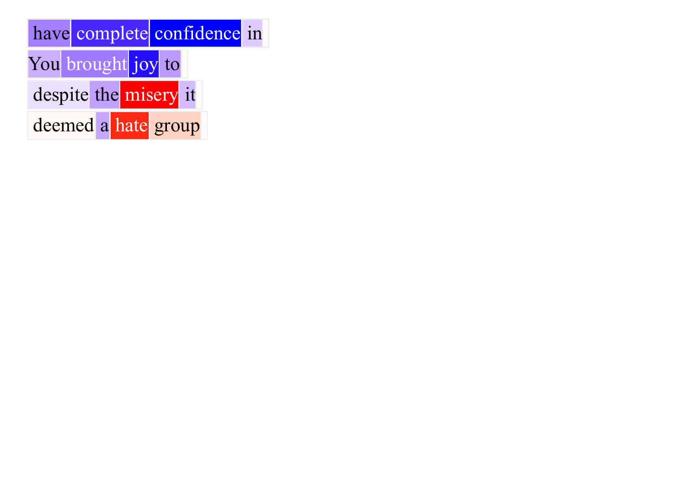
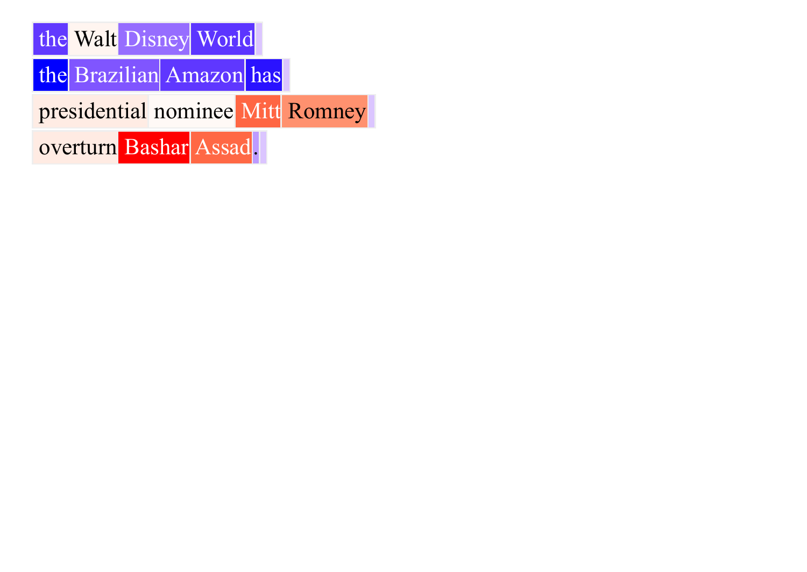
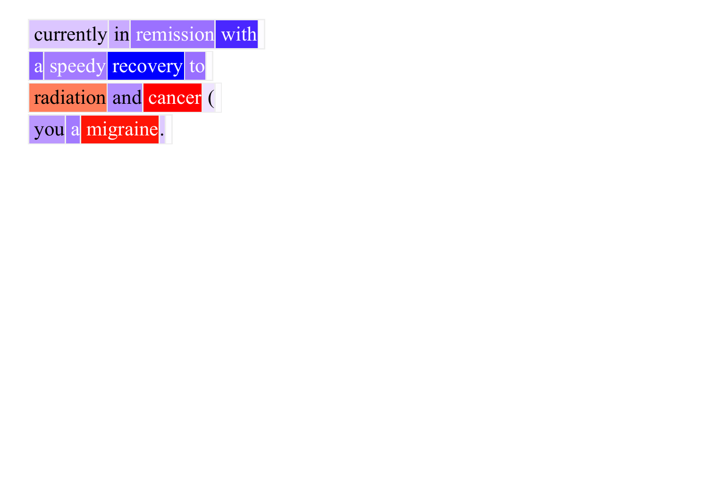
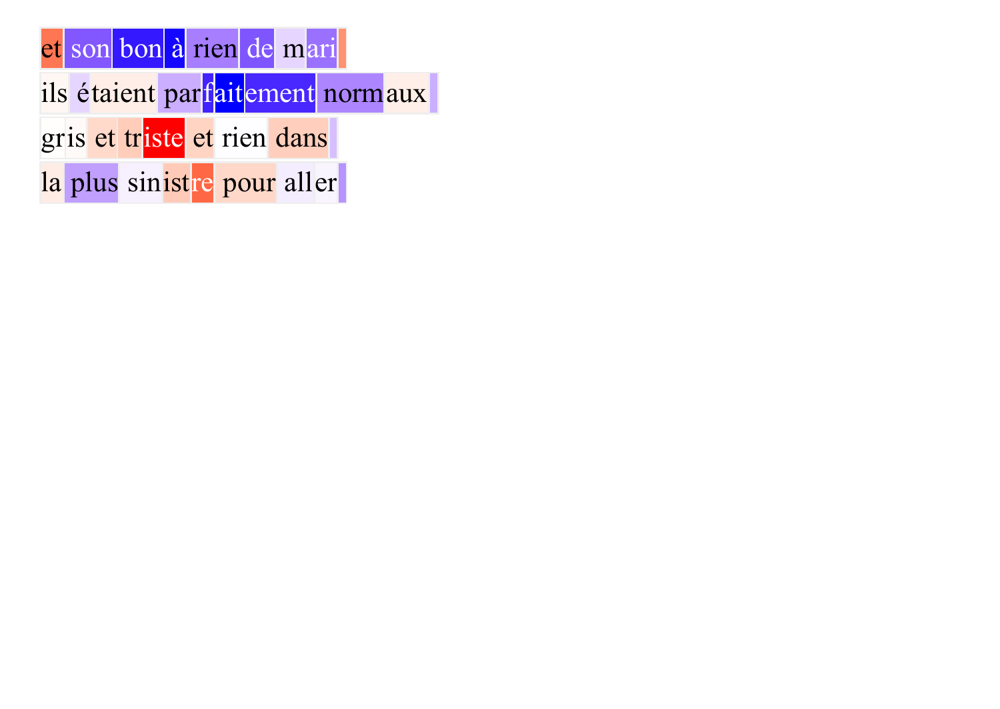

返回 [论文索引](../INDEX.MD) · 插图

# Figure 1. Sentiment projections in varied text

[Original figure (PDF)](../../../TeX/Othello-GPT/arXiv-2310.15154v1/figures/neuroscope_nouns.pdf)

[Original figure (PDF)](../../../TeX/Othello-GPT/arXiv-2310.15154v1/figures/neuroscope_proper_nouns.pdf)

[Original figure (PDF)](../../../TeX/Othello-GPT/arXiv-2310.15154v1/figures/neuroscope_medical.pdf)

[Original figure (PDF)](../../../TeX/Othello-GPT/arXiv-2310.15154v1/figures/french_short_text.pdf)

Blue is positive and red is negative. The first three panels project OpenWebText examples along the first-layer GPT2-small $K$-means direction. The French extract from *Harry Potter* uses the seventh layer of Pythia-1.4B.

See [introduction](../introduction/introduction.md) and [direction comparison](../results/1-direction-comparison.md).
