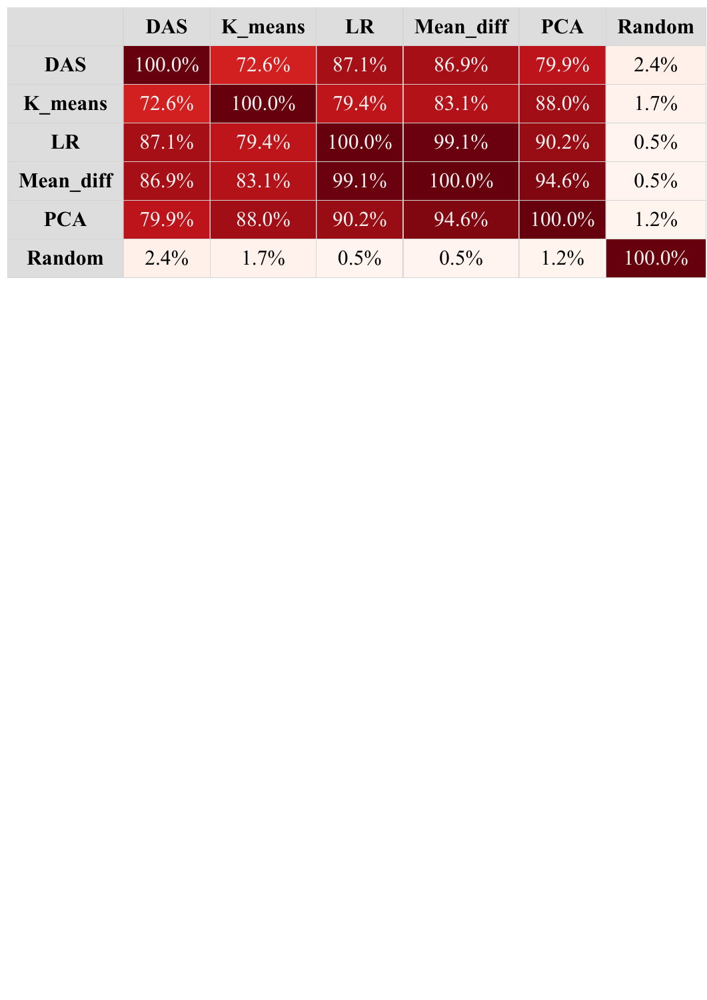

返回 [论文索引](../INDEX.MD) · 插图

# Figure 2. Cosine similarity of direction estimates

[Original figure (PDF)](../../../TeX/Othello-GPT/arXiv-2310.15154v1/figures/direction_similarities.pdf)

The directions are learned from ToyMovieReview adjective activations in the first layer of GPT2-small.

See [methods](../methods/2-direction-finding.md) and [comparison](../results/1-direction-comparison.md).
