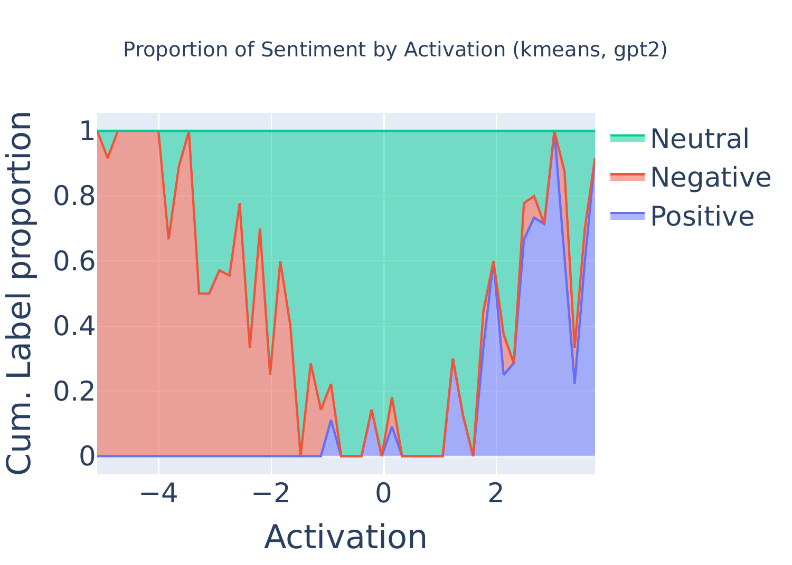

返回 [论文索引](../INDEX.MD) · 插图

# Figure 3. Sentiment activation bins in OpenWebText

[Original figure (PDF)](../../../TeX/Othello-GPT/arXiv-2310.15154v1/figures/kmeans_simple_train_ADJ_layer1_bin_proportions.pdf)

GPT-4 labels OpenWebText samples by first-layer GPT2-small activations. The associated [classification table](../tables/table-figure-3-classification-accuracy.md) uses the top and bottom 0.1% of activations to distinguish positive and negative tokens.

See [correlational evaluation](../results/2-correlational-evaluation.md).
