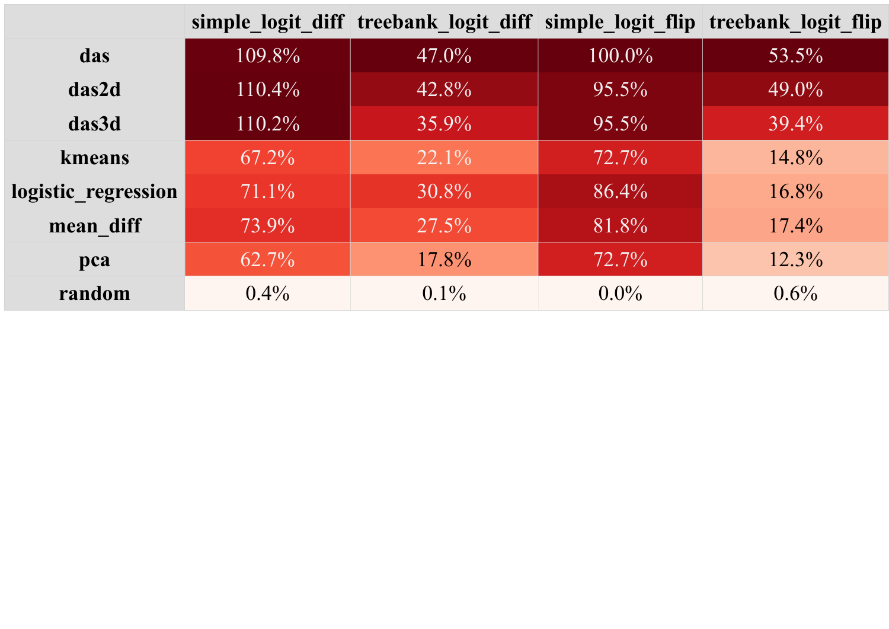

返回 [论文索引](../INDEX.MD) · 插图

# Figure 4. Directional patching in Pythia-1.4B

[Original figure (PDF)](../../../TeX/Othello-GPT/arXiv-2310.15154v1/figures/direction_patching_resid_simple.pdf)

Best observed layer for each comparison; columns cover ToyMovieReview and SST, reporting mean logit difference and the fraction of flipped logit differences.

See [causal evaluation](../results/3-causal-evaluation.md).
