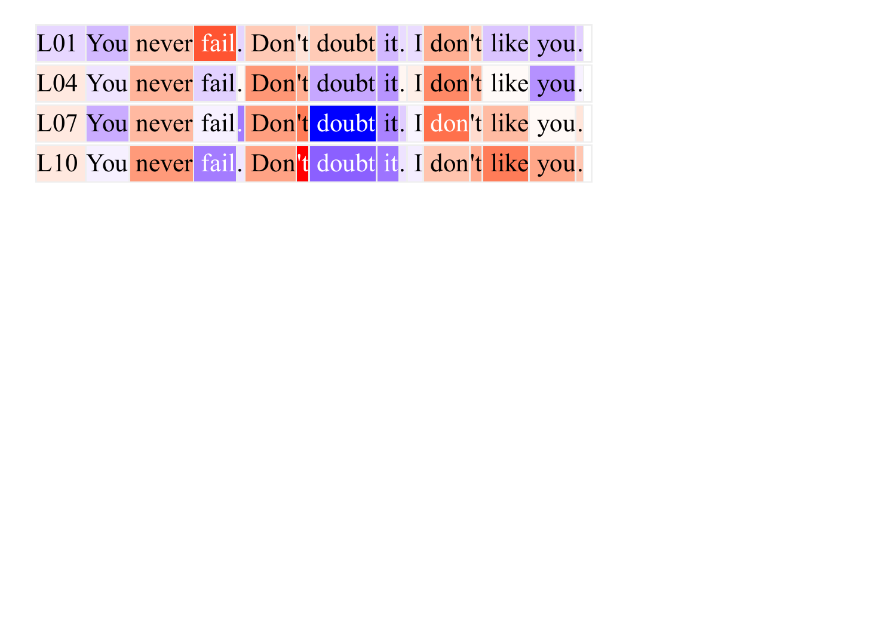

返回 [论文索引](../INDEX.MD) · 插图

# Figure 5. Sentiment under negation

[Original figure (PDF)](../../../TeX/Othello-GPT/arXiv-2310.15154v1/figures/neuroscope_negations.pdf)

Twenty-seven negation examples compare projections at the negated token between layers 1 and 10 of GPT2-small. The [quantitative table](../tables/table-figure-5-negation-experiment.md) lists the flip proportions and median sizes centered at the mean activation.

See [correlational evaluation](../results/2-correlational-evaluation.md).
