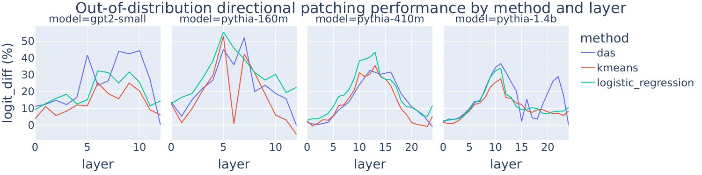

返回 [论文索引](../INDEX.MD) · 插图

# Figure 6. Directional patching transfer by layer

[Original figure (PDF)](../../../TeX/Othello-GPT/arXiv-2310.15154v1/figures/direction_patching_logit_diff_resid_gpt2_facet_plot.pdf)

Directions fitted on toy data and tested on SST tend to transfer best in middle layers. The prompt suffix is `Overall the movie was very`; the plotted metric is the mean percentage change in logit difference between `good` and `bad`.

See [causal evaluation](../results/3-causal-evaluation.md).
