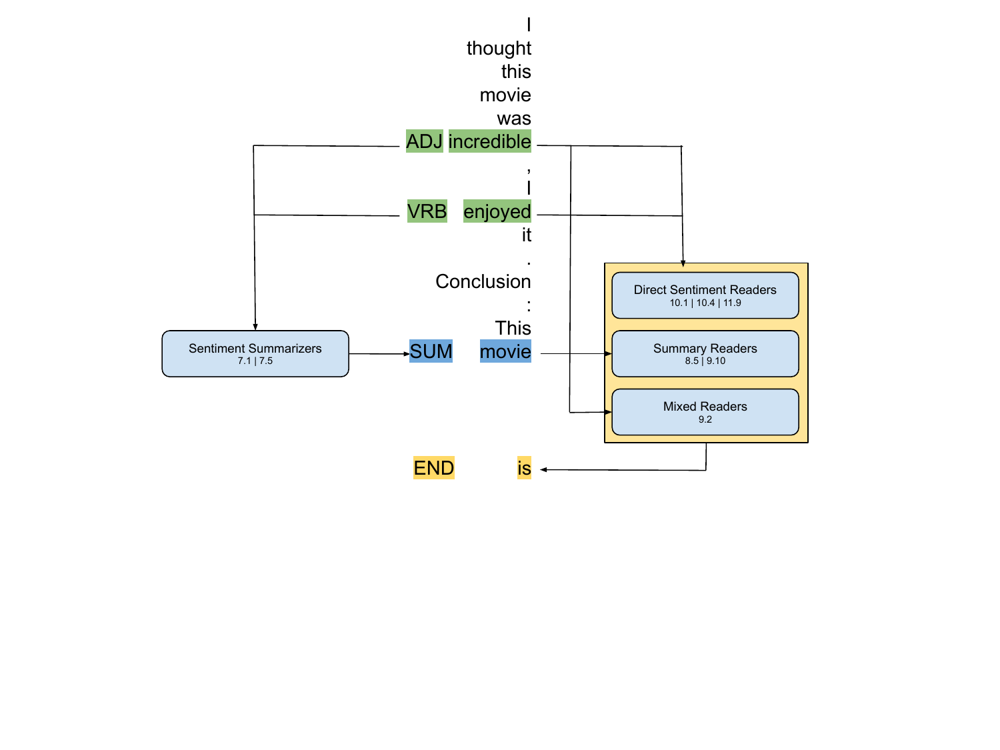

返回 [论文索引](../INDEX.MD) · 插图

# Figure 7. GPT2-small sentiment circuit

[Original figure (PDF)](../../../TeX/Othello-GPT/arXiv-2310.15154v1/figures/gpt-2_sentiment_circuit.pdf)

The circuit uses direct reads from valenced tokens and an indirect path through `SUM`. Heads 7.1 and 7.5 write to `SUM`, causally affecting the contribution of the summary readers at `END`.

See [circuit analysis](../results/4-circuit-analyses.md) and [Appendix A.3](../appendix/a3-detailed-circuits.md).
