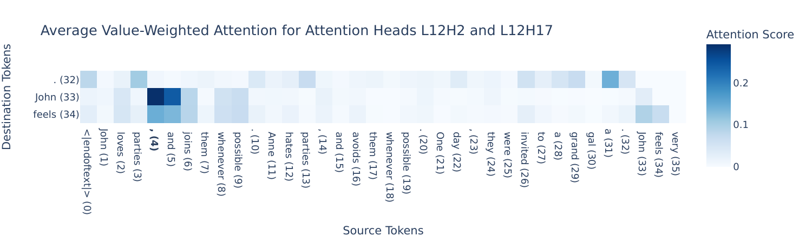

返回 [论文索引](../INDEX.MD) · 插图

# Figure 8. Value-weighted attention to comma positions

[Original figure (PDF)](../../../TeX/Othello-GPT/arXiv-2310.15154v1/figures/pythia-2.8b-comma_attn_heatmap.pdf)

Top heads in the Pythia-2.8B ToyMoodStories summarization subcircuit, writing to the repeated name and `feels`, attend heavily to the queried subject's comma. Attention weights are scaled by the norm of each position's value vector.

See [circuit analysis](../results/4-circuit-analyses.md) and [Appendix A.3](../appendix/a3-detailed-circuits.md).
