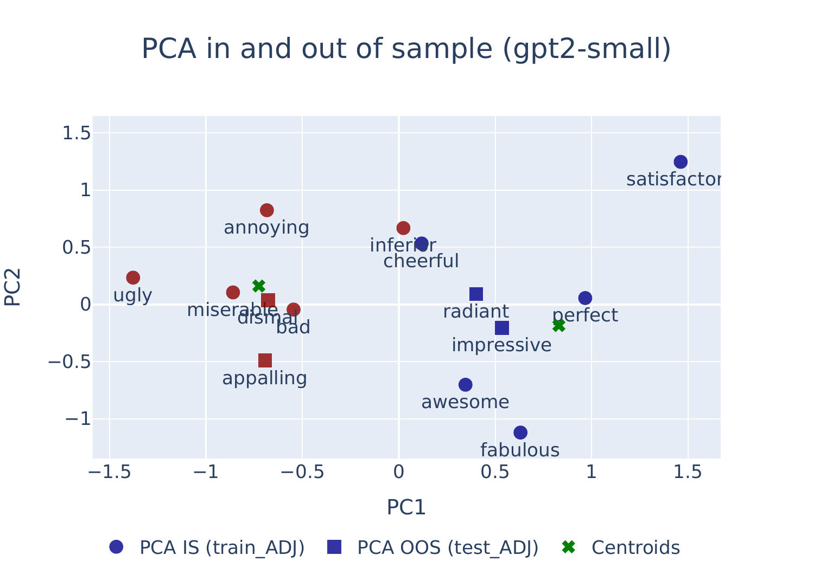
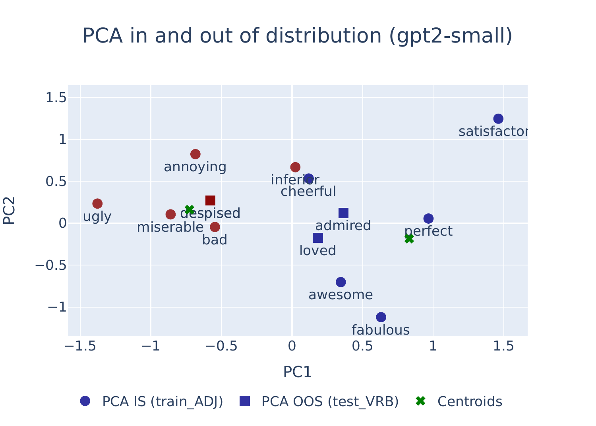

返回 [论文索引](../INDEX.MD) · 插图

# Figure A.1. PCA of adjectives and verbs

[Original figure (PDF)](../../../TeX/Othello-GPT/arXiv-2310.15154v1/figures/pca_train_test_adjectives_layer_0.pdf)

[Original figure (PDF)](../../../TeX/Othello-GPT/arXiv-2310.15154v1/figures/pca_train_adjectives_test_verbs_layer_0.pdf)

Two-dimensional PCA of GPT2-small token embeddings.

See [Appendix A.1.1](../appendix/a1-1-clustering.md).
