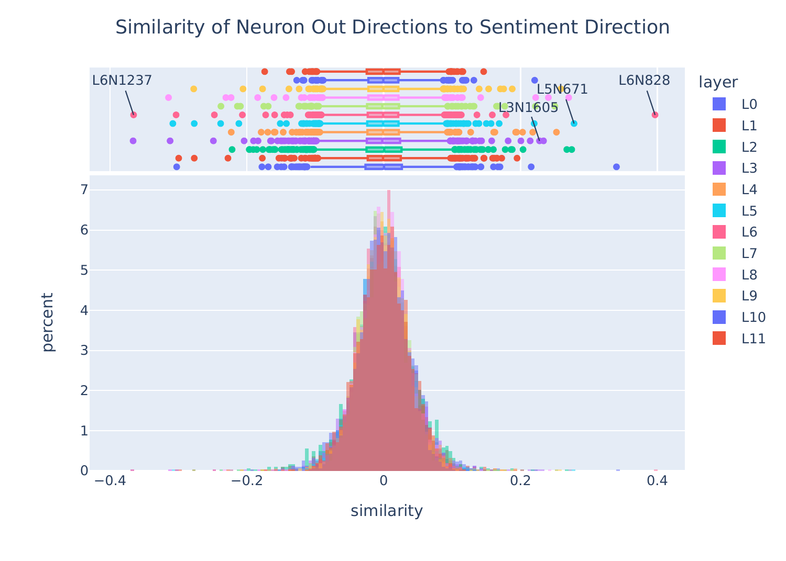

返回 [论文索引](../INDEX.MD) · 插图

# Figure A.10. Neuron output directions and sentiment

[Original figure (PDF)](../../../TeX/Othello-GPT/arXiv-2310.15154v1/figures/neuron_out_similarities.pdf)

The similarity distribution for GPT2-small has heavy tails.

See [Appendix A.5](../appendix/a5-neurons.md).
