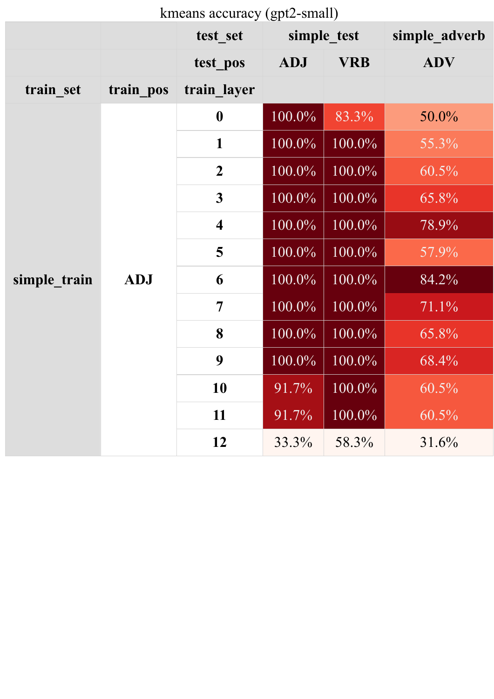
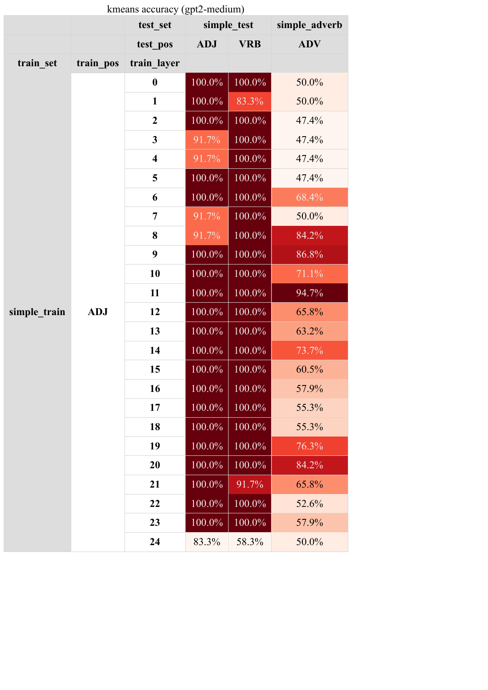
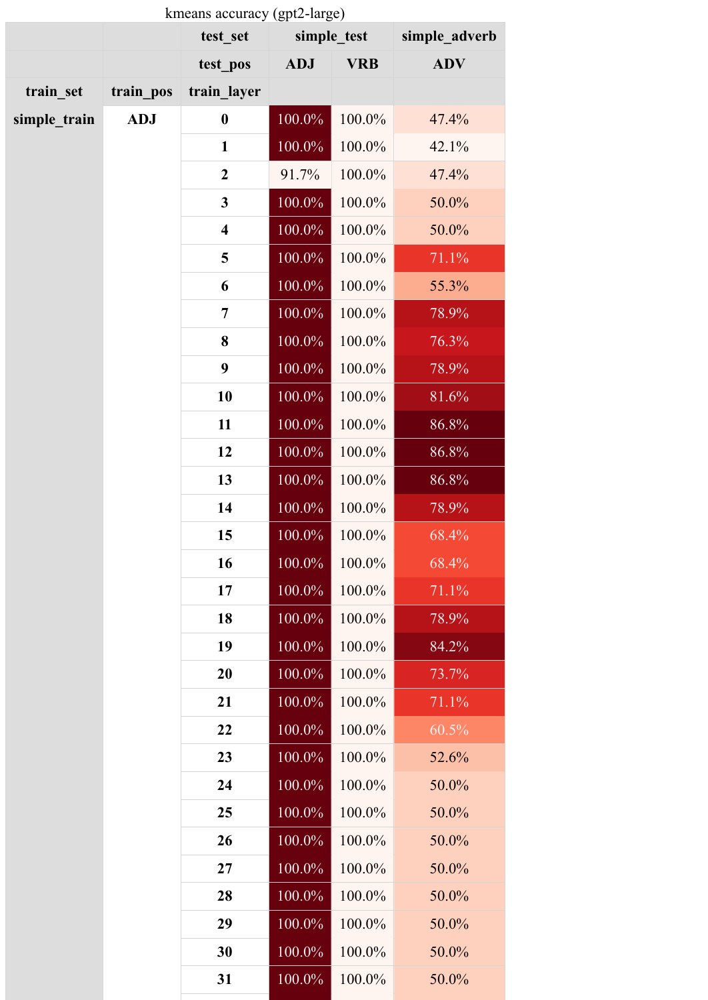
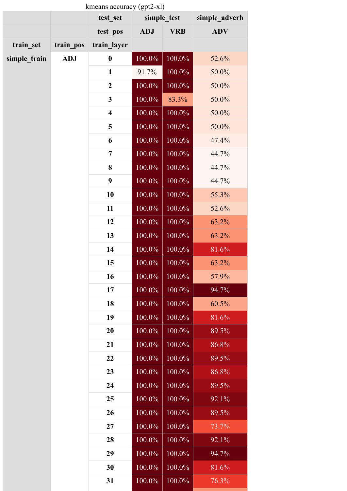

返回 [论文索引](../INDEX.MD) · 插图

# Figure A.2. Two-means classification across GPT-2 models

[Original figure (PDF)](../../../TeX/Othello-GPT/arXiv-2310.15154v1/figures/kmeans_accuracy_gpt2_small.pdf)

[Original figure (PDF)](../../../TeX/Othello-GPT/arXiv-2310.15154v1/figures/kmeans_accuracy_gpt2_medium.pdf)

[Original figure (PDF)](../../../TeX/Othello-GPT/arXiv-2310.15154v1/figures/kmeans_accuracy_gpt2_large.pdf)

[Original figure (PDF)](../../../TeX/Othello-GPT/arXiv-2310.15154v1/figures/kmeans_accuracy_gpt2_xl.pdf)

Classification accuracy by layer, showing up to 24 layers.

See [Appendix A.1.1](../appendix/a1-1-clustering.md).
