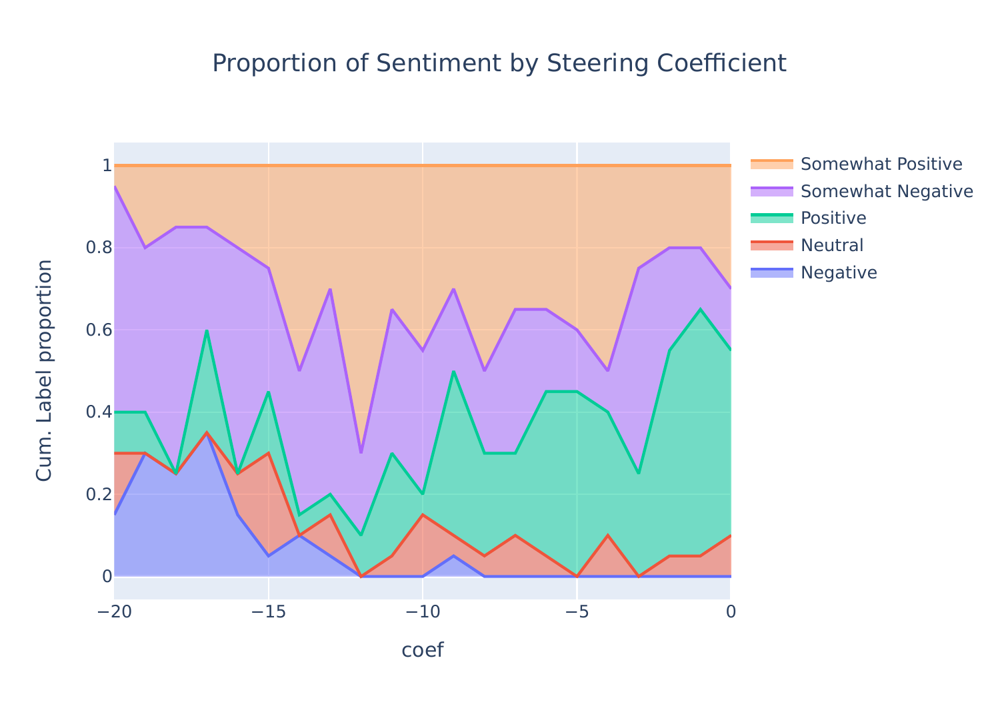

返回 [论文索引](../INDEX.MD) · 插图

# Figure A.3. Activation addition and output sentiment

[Original figure (PDF)](../../../TeX/Othello-GPT/arXiv-2310.15154v1/figures/steering_bin_proportions.pdf)

Continuations for one positive movie-review prompt under first-layer steering of GPT2-small, labeled by GPT-4.

See [Appendix A.1.2](../appendix/a1-2-activation-addition.md) and [causal evaluation](../results/3-causal-evaluation.md).
