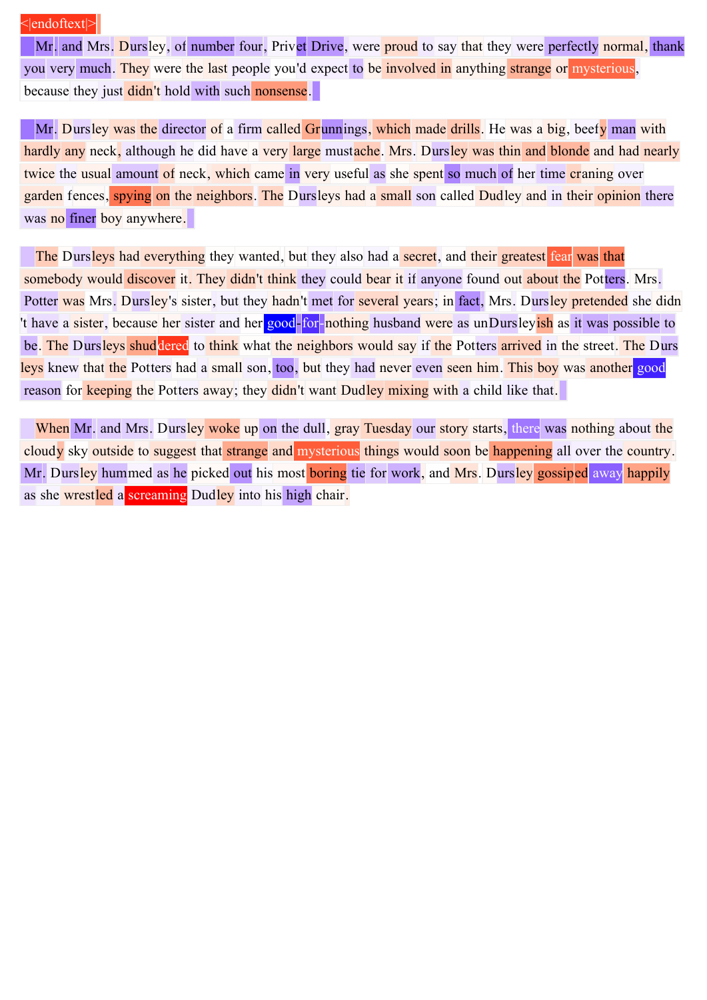
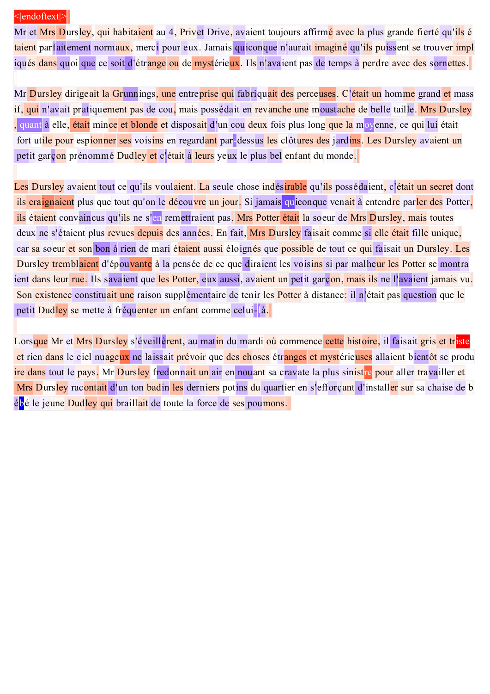

返回 [论文索引](../INDEX.MD) · 插图

# Figure A.4. English and French sentiment projections

[Original figure (PDF)](../../../TeX/Othello-GPT/arXiv-2310.15154v1/figures/harry_potter_neuroscope.pdf)

[Original figure (PDF)](../../../TeX/Othello-GPT/arXiv-2310.15154v1/figures/harry_potter_fr_neuroscope.pdf)

Sentiment projections on the opening of *Harry Potter* using Pythia-2.8B.

See [Appendix A.1.3](../appendix/a1-3-multilingual.md).
