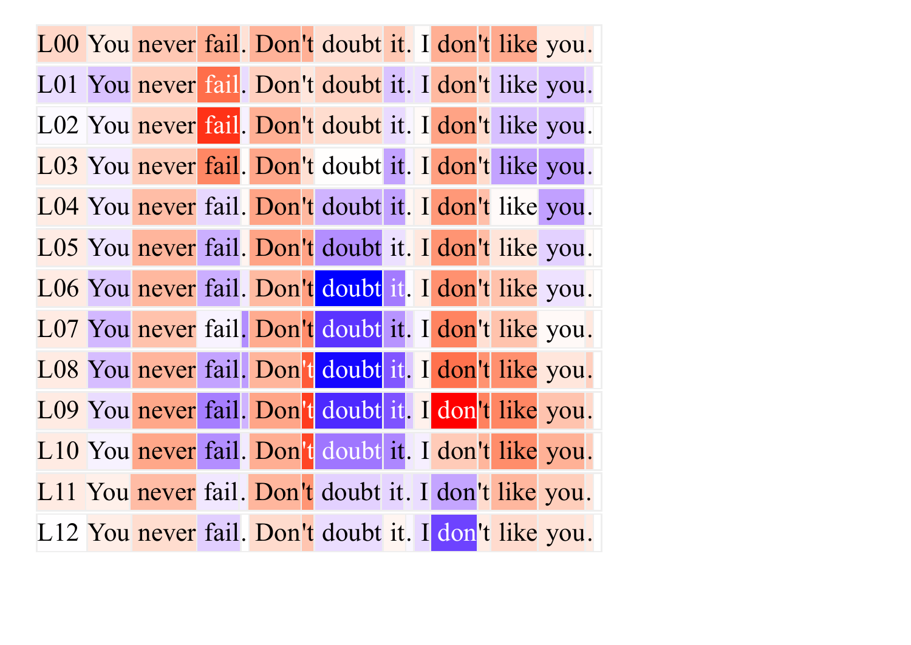

返回 [论文索引](../INDEX.MD) · 插图

# Figure A.5. Negation across layers

[Original figure (PDF)](../../../TeX/Othello-GPT/arXiv-2310.15154v1/figures/negation.pdf)

Red is negative and blue is positive. Rows are GPT2-small residual layers, starting at the top. The three sentences are a single prompt; separate prompts yield a similar pattern.

See [Appendix A.1.4](../appendix/a1-4-negations.md).
