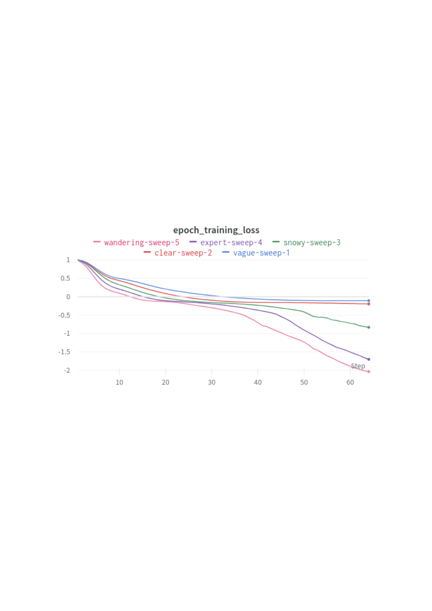
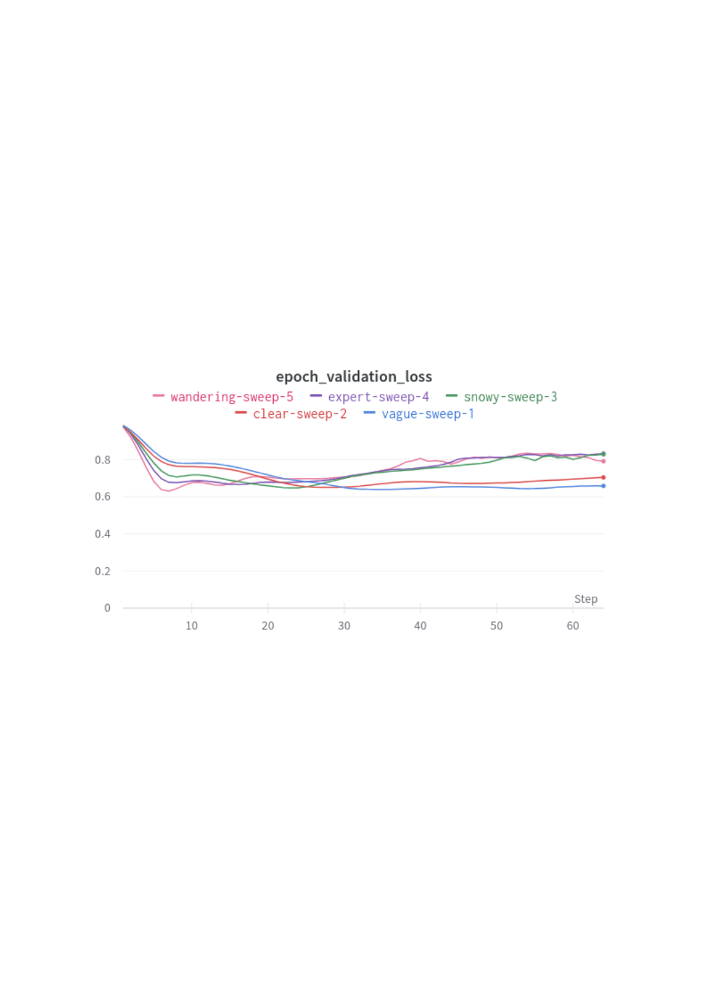

返回 [论文索引](../INDEX.MD) · 插图

# Figure A.6. DAS subspace dimension sweep

[Original figure (PDF)](../../../TeX/Othello-GPT/arXiv-2310.15154v1/figures/das_sweep_train_loss.pdf)

[Original figure (PDF)](../../../TeX/Othello-GPT/arXiv-2310.15154v1/figures/das_sweep_val_loss.pdf)

GPT2-small runs are indexed by $n$ where the subspace has dimension $2^{n-1}$. Loss is one minus the patching metric.

See [Appendix A.2](../appendix/a2-das-dimensions.md).
