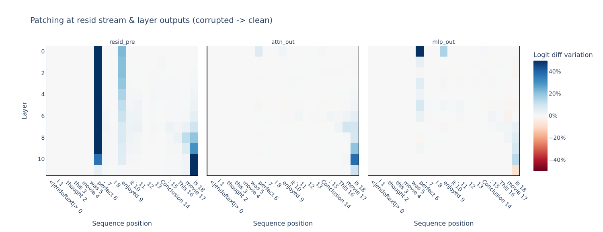

返回 [论文索引](../INDEX.MD) · 插图

# Figure A.7. Residual and layer-output patching

[Original figure (PDF)](../../../TeX/Othello-GPT/arXiv-2310.15154v1/figures/gpt2-simple_sentiment-act_patching_at_resid_stream_and_layer_outputs.pdf)

The GPT2-small ToyMovieReview circuit recovers logit difference when patched with original activations in a flipped run. Attention output matters at `SUM`; residual effects appear at layers 8 and 9 for the summary readers and also at the `ADJ` and `VRB` positions.

See [Appendix A.3](../appendix/a3-detailed-circuits.md).
