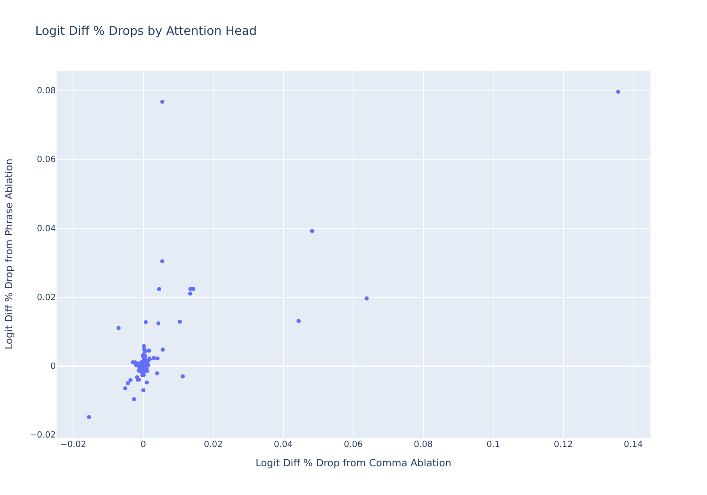

返回 [论文索引](../INDEX.MD) · 插图

# Figure A.8. Heads affected by comma or phrase patching

[Original figure (PDF)](../../../TeX/Othello-GPT/arXiv-2310.15154v1/figures/pythia-2.8b-mood_stories-comma_vs_phrase_logit_diff_drops.pdf)

Pythia-2.8B heads show different logit-difference drops when commas or pre-comma phrases are patched.

See [Appendix A.4](../appendix/a4-additional-summarization.md).
