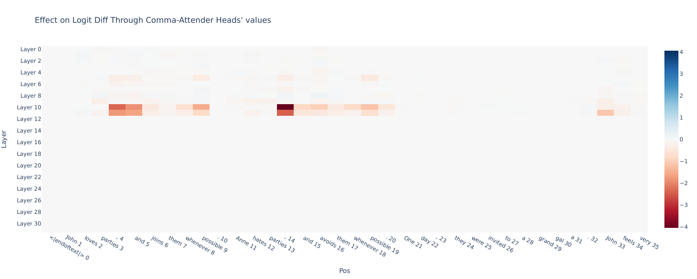

返回 [论文索引](../INDEX.MD) · 插图

# Figure A.9. Path patching to summary heads

[Original figure (PDF)](../../../TeX/Othello-GPT/arXiv-2310.15154v1/figures/pythia-2.8b-char_path_patch_mid_de_cm_pos.pdf)

Pythia-2.8B heads L12H2 and L12H17 writing to the repeated name and `feels` are the receivers. Paths from the commas show the largest loss in performance.

See [Appendix A.4](../appendix/a4-additional-summarization.md) and [circuit results](../results/4-circuit-analyses.md).
