# Linear Representations of Sentiment in Large Language Models

> [返回论文索引](INDEX.MD) · 英文 Markdown 连续阅读版（按源文整理，非逐字转录） · [原始 LaTeX](../../TeX/Othello-GPT/arXiv-2310.15154v1/iclr2024.tex)

## Abstract

Sentiment is a pervasive feature in natural language text, yet it is an open question how sentiment is represented within Large Language Models (LLMs). In this study, we reveal that across a range of models, sentiment is represented linearly: a single direction in activation space mostly captures the feature across a range of tasks with one extreme for positive and the other for negative. Through causal interventions, we isolate this direction and show it is causally relevant in both toy tasks and real world datasets such as Stanford Sentiment Treebank. Through this case study we model a thorough investigation of what a single direction means on a broad data distribution.

We further uncover the mechanisms that involve this direction, highlighting the roles of a small subset of attention heads and neurons. Finally, we discover a phenomenon which we term the summarization motif: sentiment is not solely represented on emotionally charged words, but is additionally summarised at intermediate positions without inherent sentiment, such as punctuation and names. We show that in Stanford Sentiment Treebank zero-shot classification, 76% of above-chance classification accuracy is lost when ablating the sentiment direction, nearly half of which (36%) is due to ablating the summarized sentiment direction exclusively at comma positions.

## Authors and affiliations

- Curt Tigges — EleutherAI Institute.
- Oskar John Hollinsworth — SERI MATS.
- Atticus Geiger — Stanford University; Pr(Ai)²R Group.
- Neel Nanda — Independent.

Tigges and Hollinsworth are equal primary authors, with ordering randomized. Source: [arXiv:2310.15154v1](https://arxiv.org/abs/2310.15154v1) · [local LaTeX](../../TeX/Othello-GPT/arXiv-2310.15154v1/iclr2024.tex). Code: [eliciting-latent-sentiment](https://github.com/curt-tigges/eliciting-latent-sentiment).

## 1. Introduction

Can a language model infer hidden variables of the data-generating process rather than just model co-occurrences? Othello-GPT is evidence for a world representation in a controlled setting. Sentiment is a corresponding feature of natural language, with tasks in which both correlations and causal effects can be measured.

The paper studies sentiment through causal mediation. It finds a direction in activation space that separates positive and negative sentiment across datasets, supporting the linear representation hypothesis in this case. The direction is also used by identifiable circuits. The proposed summarization motif is that instead of sentiment moving directly from valenced tokens to the output, intermediate tokens such as commas, periods, and some nouns can aggregate sentiment and relay it later. This resembles a naturally arising classification token or partial information bottleneck, not ordinary NLP summarization.

[Figure 1](figures/figure-1-sentiment-across-texts.md) visualizes direction projections in text. See [direction finding](methods/2-direction-finding.md) and [circuit analysis](results/4-circuit-analyses.md).

## 2.1. Datasets and Models

- **ToyMovieReview:** `I thought this movie was ADJECTIVE, I VERBed it. Conclusion: This movie is`. Adjective and verb agree in sentiment, with 85 adjectives (55 train / 30 test) and 8 verbs. Score the continuation over selected frequent positive and negative descriptors, such as `great` and `terrible`.
- **ToyMoodStory / ToyMoodStories:** `NAME1 VERB1 parties, and VERB2 them whenever possible. NAME2 VERB3 parties, and VERB4 them whenever possible. One day, they were invited to a grand gala. QUERYNAME feels very`. Compare logits for `excited` and `nervous`.
- **Stanford Sentiment Treebank (SST):** 10,662 single-sentence reviews with human annotations for their phrases.
- **OpenWebText (OWT):** source of random text for correlation tests, and GPT-2's pretraining dataset as described in the paper.
- **Models:** GPT-2 and Pythia, decoder-only transformers spanning 85M to 2.8B parameters for the experiments described here. GPT2-small is used for continuation, Pythia-1.4B for classification, Pythia-2.8B for multi-subject tasks.

See [Appendix A.7: exact prompts and vocabulary](appendix/a7-toy-datasets.md) and [metrics](appendix/a6-metrics.md).

## 2.2. Finding Directions

Let $\mathcal P$ and $\mathcal N$ be positive and negative ToyMovieReview inputs. For $x$ in either set, $\mathbf a_x^L$ and $\mathbf v_x^L$ denote the residual-stream vector at layer $L$ at the adjective and verb respectively. The verb vectors are held out. Let $p$ and $n$ denote the positive and negative completions.

| Method | Direction estimate |
|---|---|
| Mean Difference (MD) | Positive mean minus negative mean, $\frac{1}{\lvert\mathcal P\rvert}\sum_{x\in\mathcal P}\mathbf a_x^L-\frac{1}{\lvert\mathcal N\rvert}\sum_{x\in\mathcal N}\mathbf a_x^L$ (the norms of the sets denote their counts). |
| $K$-means (KM) | Centroid difference $\mathbf c_1-\mathbf c_0$ from two clusters fitted to the adjective vectors. |
| Linear Probing (LR) | Normalized logistic-regression weights, $\mathbf w/\lVert\mathbf w\rVert$, where the model predicts $1/(1+\exp(-\mathbf w\cdot\mathbf a_x^L))$. |
| Distributed Alignment Search (DAS) | Learn a direction $\theta$ using an objective based on the logit difference after directional patching. |
| Principal Component Analysis (PCA) | First principal component of the adjective vectors. |

The DAS objective in the paper is written as:

$$
\sum_{x\in\mathcal P}[\operatorname{logit}_\theta(x;p)-\operatorname{logit}_\theta(x;n)]
+\sum_{x\in\mathcal N}[\operatorname{logit}_\theta(x;n)-\operatorname{logit}_\theta(x;p)].
$$

See [Figure 2](figures/figure-2-direction-similarities.md), [causal methods](methods/3-causal-interventions.md), [direction comparison](results/1-direction-comparison.md), and the [DAS dimension sweep](appendix/a2-das-dimensions.md).

## 2.3. Causal Interventions

**Activation patching:** Pair original and sentiment-flipped prompts of the same length and format, e.g. “This movie was great” versus “This movie was terrible.” Capture the original activations, then replace one component's activation at a time in the flipped run. If the replacement restores the original behavior, the component has a causal effect in the experiment.

**Directional activation patching:** Replace only the activation projected onto a unit vector $\mathbf d$ with the projection from the counterpart input. For a recipient $\mathbf o$ and donor $\mathbf o'$, this is $\mathbf o+[(\mathbf o'-\mathbf o)\cdot\mathbf d]\mathbf d$. Equivalently, patch a single coordinate after rotating the basis. Measure the logit difference or the fraction of examples whose predicted sentiment flips.

**Ablation:** Remove a component's contribution by setting output to zero or a dataset mean. For directional ablation remove only the component along a specified direction. **Path patching:** restrict patching to the paths from selected senders to receivers, holding the rest of the upstream network fixed.

See [metrics](appendix/a6-metrics.md), [causal evaluation](results/3-causal-evaluation.md), and [SST summarization ablations](results/6-sst-summarization.md).

## 3.1. Visualizing and Comparing the Directions

Project a token's residual stream at a given layer onto the fitted direction to get its sentiment activation. The five methods yield directions with high cosine similarities. They are not sparse in the residual stream's standard basis. Results are broadly similar across direction estimates, consistent with noisy estimates of one direction.

Neuroscope-style visualization encodes negative scores in red and positive scores in blue. A two-means direction fitted without labels to a set of 30 positive and 30 negative English adjectives yields interpretable extremes in diverse contexts, including French text. This is qualitative and is tested more systematically with correlation and intervention.

See [Figure 1](figures/figure-1-sentiment-across-texts.md), [Figure 2](figures/figure-2-direction-similarities.md), [clustering](appendix/a1-1-clustering.md), and [multilingual examples](appendix/a1-3-multilingual.md). The authors share [GPT2-small directions](https://github.com/curt-tigges/eliciting-latent-sentiment/tree/main/data/gpt2-small).

## 3.2. Correlational Evaluation

**Lexical sentiment.** Bin first-layer GPT2-small OpenWebText token projections into 20 equal-width buckets, sampling 20 tokens from each. GPT-4 labels them positive, neutral, or negative from the token and a centered 20-token context, with a cursory human sanity check. Negative labels dominate one tail, positive labels the other, and neutral labels the middle. The authors interpret this as consistent with superposition. The top/bottom 0.1% bins distinguish positive and negative tokens with accuracies of 78–89% depending on method; consult the exact values in the [table](tables/table-figure-3-classification-accuracy.md) and the distribution in [Figure 3](figures/figure-3-openwebtext.md).

**Negation.** Using GPT2-small's first-layer $K$-means direction, “fail,” “doubt,” and “uncertain” project negatively early and positively later when negated. In the 27-example dataset the change is measured between layers 1 and 10, with direction-dependent sign-flip rates and sizes in the [table](tables/table-figure-5-negation-experiment.md) and [Figure 5](figures/figure-5-negation-experiment.md). These observations motivate further analysis of the MLPs; see [negation visualizations](appendix/a1-4-negations.md) and [neurons](appendix/a5-neurons.md).

## 3.3. Causal Evaluation

**Directional patching.** Fit directions on adjectives and test with unseen adjectives and with verbs that were not used in fitting. Unsupervised $K$-means still moves the logit difference; DAS can flip predictions. [Figure 4](figures/figure-4-direction-patching.md) reports the best layers for ToyMovieReview and SST. For transfer from the toy data to SST, the strongest effects tend to arise in intermediate layers, rather than the first or last layers ([Figure 6](figures/figure-6-intermediate-layers.md)). The authors hypothesize that these layers carry a more abstract feature than the embedding alone.

**Activation addition.** In GPT2-small, add a scaled sentiment direction to first-layer residual activations during each forward pass. Starting with “I really enjoyed the movie, in fact I loved it. I thought the movie was just very...”, increasingly negative coefficients produce increasingly negative completions without erasing coherence. See [Appendix A.1.2](appendix/a1-2-activation-addition.md) and [Figure A.3](figures/figure-a-3-activation-addition.md).

**SST validation.** Collapse labels to positive/negative, deduplicate test phrases, and exclude the 17% of examples Pythia-1.4B did not classify correctly zero-shot. Pair equal-token-length phrases, yielding 460 clean/corrupted pairs. Prompt with `Review Text: TEXT, Review Sentiment:` and compare `Positive` versus `Negative`. Patching along the toy-trained DAS direction at a single layer flips **53.5%** of outputs in this filtered set. This differs from the [comma ablations](results/6-sst-summarization.md) on Pythia-2.8B.

## 4.1. Circuit Analyses

**GPT2-small, ToyMovieReview.** Nine attention heads implement a mixture of direct reading and summarization: identify valenced words at `ADJ` and `VRB`, write a summary at the last `movie` token (`SUM`), and read from `ADJ`, `VRB`, and `SUM` to predict at `END`. Patching the full identified circuit at `ADJ`/`VRB` only along the sentiment direction yields 58.3% logit flips and a 54.8% logit-difference drop; all-direction patching at the same positions yields 97% flips and a 75% drop. This comparison quantifies how much of the circuit's effect is captured by one direction.

**Pythia-2.8B, ToyMoodStories.** The smallest tested model that could perform this task strongly attends to the comma after the queried subject's preference phrase; other words in that phrase are secondary. Heads write to the repeated name and `feels`, and later heads read these to affect `END`. Path patching shows that the comma has a causal role, in addition to behavior visible in raw and value-weighted attention. Value-weighted attention scales the pattern by the norm of the value vector at each position.

See [Figure 7](figures/figure-7-gpt2-circuit.md), [Figure 8](figures/figure-8-comma-attention.md), [Figure A.9](figures/figure-a-9-comma-path-patching.md), and the [detailed circuits](appendix/a3-detailed-circuits.md).

## 4.2. Exploring and validating summarization behavior in punctuation

**Commas are a partial bottleneck.** On ToyMoodStories, freeze attention patterns so the model cannot redirect attention away from edited commas. Patch attention-head values for the pre-comma phrases while leaving commas unflipped, or patch only the two commas. The interventions reduce logit difference by 38% and 37%, respectively, compared with 75% for the whole phrase including commas. See [Table 1a](tables/table-1a-comma-vs-phrase.md).

**Distance can increase reliance on summaries.** Insert irrelevant clauses after each preference sentence (e.g. a detail about a character's hat) before asking for their mood. Test value patching at periods versus the preceding phrases. The ratio of logit-difference change rises from 0.29 without filler to 1.15 with 22 intervening tokens: periods can become 15% more important than their phrases in this toy setting. See [Table 1b](tables/table-1b-period-distance.md) and [semi-separate circuits](appendix/a4-additional-summarization.md).

## 4.3. Validating summarization behavior in SST

Append `Review Sentiment:` to SST inputs and compare `positive` with `negative`, requiring the winning label to be in the top ten predicted tokens. Keep examples Pythia-2.8B classifies correctly with at least one comma, giving a 100% baseline on the retained subset. Commas were not selected for specifically ending sentiment phrases.

| Intervention | Logit-difference drop | Accuracy drop | Accuracy after ablation |
|---|---:|---:|---:|
| DAS sentiment direction at all tokens and layers | 71% | 38 points | 62% |
| Random directions at all tokens (control) | <1% change | <1% change | — |
| DAS sentiment direction at all comma positions | 18% | 18 points | 82% |
| Replace entire comma activation with layerwise mean | 17% | 19 points | 81% |

The 38-point drop accounts for 76% of the 50-point margin above chance. Comma-only directional ablation removes 18 points, or 36% of that above-chance margin, and nearly half of the full directional-ablation effect. The result concerns the filtered subset, not the overall accuracy on SST.

See [causal methods](methods/3-causal-interventions.md) and [related toy results](results/5-punctuation-summarization.md).

## 4.4. The big picture of summarization

Across tasks and models, non-valenced tokens can accumulate sentiment for later reuse. These tokens include commas, periods, and nouns for specific referents. This is a partial information bottleneck rather than a rule that all information goes through punctuation. Experiments establish causal relevance for toy tasks and a filtered SST subset. A toy distance manipulation suggests a possible connection to longer contexts, but the generality of that relationship is an open question.

See [circuits](results/4-circuit-analyses.md), [punctuation experiments](results/5-punctuation-summarization.md), and [SST ablations](results/6-sst-summarization.md).

## 5. Related Work

**Sentiment analysis** is a longstanding focus of deep learning and NLP benchmarks, including SST and later social-media or intervention-based datasets. **Internal representations** have been examined through mechanistic interpretability, latent-knowledge elicitation, world modeling, truth directions, and prior work on a sentiment neuron. For Othello in particular, the paper cites Li et al. for board-state probes and Nanda et al. for a linear reanalysis.

**Summarization** relates to information bottlenecks and the idea of recurring computational motifs, borrowing the term from systems biology. Other work examined linguistic representations at different frequencies and delayed storage in gender prediction. **Causal interventions** build on causal mediation analysis, activation/path patching, mean ablation, and DAS to target directions or subspaces.

See the [references](references/references.md).

## 6. Conclusion and future work

The two central findings are a causally relevant linear sentiment direction and a summarization motif that routes sentiment information through intermediate positions. Directions fit on tiny toy datasets transfer to natural text, and behavior on SST and toy circuits shows the direction is used in predictions, not merely decodable.

The paper starts with a hypothesized interpretable feature instead of learning a large dictionary first, then tests the feature across tasks and methods. Future work can search for this motif in other contexts, investigate MLPs and neurons that implement these computations, and assess whether similar tools expose other latent computations and knowledge.

See [limitations](discussion/limitations.md) and [neuron analysis](appendix/a5-neurons.md).

## 6. Limitations

- A dominant direction may capture a mixture of more specific sentiment features rather than a universal axis. Positive and negative directions are equivalent to appropriate sums/differences of a valence axis and a sentiment axis: $\mathbf p=\mathbf x+\mathbf y$, $\mathbf n=\mathbf x-\mathbf y$, or $\mathbf x=(\mathbf p+\mathbf n)/2$, $\mathbf y=(\mathbf p-\mathbf n)/2$.
- The causal abstractions do not explain all task performance. Distributed representations, superposition, self-repair, or omitted circuit components may explain the remaining performance. More diverse templates may separate task-specific machinery from sentiment processing.
- Small datasets plus many metrics and hyperparameters create a risk of overfitting. Tests on SST and other models give independent checks. DAS can overfit or induce out-of-distribution activations; simpler methods such as logistic regression provide comparisons.

See [Section 3.3](results/3-causal-evaluation.md) and [DAS dimensionality](appendix/a2-das-dimensions.md).

## Author Contributions

Curt Tigges and Oskar John Hollinsworth contributed equally. Tigges focused on circuit analysis and discovered the summarization motif; Hollinsworth investigated the direction and carried out independent tests of its causal meaning. Neel Nanda proposed the initial brief, mentored the project through SERI MATS, and performed neuron analysis. Atticus Geiger provided mentoring on causal mediation and proposed SST and the discrete accuracy metric.

## Acknowledgments

SERI MATS provided funding, lodging, and office space for two months in Berkeley, California. The authors used TransformerLens and thank Alex Tamkin, Georg Lange, Alex Makelov, and Bilal Chughtai for feedback. Atticus Geiger was supported by an Open Philanthropy grant.

## Reproducibility Statement

The paper supplies [model and dataset details](methods/1-datasets-and-models.md), [ToyMovieReview prompts and vocabulary](appendix/a7-toy-datasets.md), [direction estimation](methods/2-direction-finding.md), [intervention methods](methods/3-causal-interventions.md), and [the two circuit analyses](appendix/a3-detailed-circuits.md). GPT-2 and Pythia are publicly available. [Data generation, training, and analysis code](https://github.com/curt-tigges/eliciting-latent-sentiment) is available.

## A.1.1. Clustering

Two-dimensional PCA of GPT2-small embeddings for 30 positive and 30 negative adjectives shows clustering. Held-out adjectives and out-of-distribution verbs also fall in their expected groups. Two-means classification generalizes to held-out adjectives, verbs, and a toy adverb dataset across several GPT-2 sizes. The adverb prompt is `The traveller [adverb] walked to their destination. The traveller felt very`.

See [Figure A.1](figures/figure-a-1-pca-embeddings.md), [Figure A.2](figures/figure-a-2-gpt2-clustering.md), and [direction comparison](results/1-direction-comparison.md).

## A.1.2. Activation addition

In GPT2-small, add a multiple of the sentiment direction to the first residual-stream layer while sampling completions of one positive movie review. At coefficient −17 the continuation is extremely negative, with a gradual shift for intermediate coefficients. GPT-4 labels the samples used in the plot. See [Figure A.3](figures/figure-a-3-activation-addition.md) and [Section 3.3](results/3-causal-evaluation.md).

## A.1.3. Multi-lingual sentiment

The paper compares the opening of *Harry Potter* in English and French. At intermediate layers Pythia-2.8B yields intuitive French sentiment projections, while the pattern is not apparent in the first few layers. The authors attribute this potentially to poor French tokenization; models in the study are not strong in French. This is qualitative, not a cross-language benchmark. [Figure A.4](figures/figure-a-4-multilingual.md) shows Pythia-2.8B, while [Figure 1](figures/figure-1-sentiment-across-texts.md) separately labels its French example as Pythia-1.4B.

## A.1.4. Interpretability of negations

Input: `You never fail. Don't doubt it. I am not uncertain`. Across the 12 GPT2-small layers, projection scores at `fail`, `doubt`, and `uncertain` go from negative to positive. Treating the sentences as separate prompts gives a similar visualization. See [Figure A.5](figures/figure-a-5-negation-layers.md) and [Section 3.2](results/2-correlational-evaluation.md).

## A.2. Is sentiment really a hyperplane?

DAS can find more than one direction. In GPT2-small, increasing subspace dimension improves the in-sample patching score on movie-review adjectives but not the out-of-distribution score on a character mood dataset with varying adverbs. In [Figure A.6](figures/figure-a-6-das-dimensions.md), run index $n$ means dimension $2^{n-1}$; loss is one minus the usual patching metric. See [direction estimation](methods/2-direction-finding.md).

## A.3. Detailed circuit analysis

Set the final residual stream as the initial receiver and patch paths to identify large effects on logit difference. Examine value-weighted or ordinary attention patterns. Recursively patch to the candidate heads as receivers to trace the circuit backwards. Start with GPT-2 and use the smallest larger model that performs a given task when needed.

### A.3.1. Simple sentiment — GPT2-small

A threshold of ≥5% drop in logit difference selects heads 10.4, 9.2, 10.1, and 8.5. The first three attend to `ADJ`/`VRB`; 8.5 attends mainly to the second `movie` token, and 9.2 also attends to it. With those heads as receivers, 7.1 and 7.5 write to `movie` from `ADJ`/`VRB`, causing 7% and 4% shifts respectively when patched. That causal effect is specific to the `SUM` position. Lowering the threshold adds 9.10 (summary reading), 11.9 (direct sentiment reading), and 6.4 (summarizing), giving nine heads in total. See [Figure A.7](figures/figure-a-7-gpt2-residual-patching.md) and [Figure 7](figures/figure-7-gpt2-circuit.md).

### A.3.2. Multi-subject mood stories — Pythia-2.8B

In sentiment-flipped prompts, 17.19, 22.5, 14.4, 20.10, and 12.2 have direct effects at `END`. They read the repeated query name (`RNAME`) or `feels` (`FEEL`). At these two destinations the most attended token is often the comma ending the queried preference phrase (`COMMASUM`). Heads 14.4, 20.10, and 12.2 both read the comma to write a summary and read near-end summaries to affect the logits; different layers permit both roles. Head 17.19 instead attends to periods in addition to its primary near-end attention. Head 22.5 mostly attends to `FEEL`. Head 12.17 is the most important dedicated name-summary writer. The upstream comma writers were not fully reverse engineered. See [Figure 8](figures/figure-8-comma-attention.md) and [Figure A.9](figures/figure-a-9-comma-path-patching.md).

## A.4. Additional summarization findings

Patching commas and patching the preceding words damage different groups of heads, with some heads responding to both. This may indicate a partly separate circuit for reading stored summaries, rather than indiscriminately attending to strongly sentiment-laden tokens. For receiver heads L12H2 and L12H17 writing to the repeated name and `feels`, paths from commas give the largest drops.

See [Figure A.8](figures/figure-a-8-comma-phrase-heads.md), [Figure A.9](figures/figure-a-9-comma-path-patching.md), and [Section 4.2](results/5-punctuation-summarization.md).

## A.5. Neurons writing to the sentiment direction in GPT2-small

The cosine similarity between MLP neuron output vectors and the sentiment direction has heavy tails ([Figure A.10](figures/figure-a-10-neuron-similarity.md)). Example neurons found using Neuroscope:

- [L3N1605](https://neuroscope.io/gpt2-small/3/1605.html): “hesitate” after a negation.
- [L6N828](https://neuroscope.io/gpt2-small/6/828.html): “however” or “on the other hand” after negative text.
- [L5N671](https://neuroscope.io/gpt2-small/5/671.html): negative words after a contracted “not”.
- [L6N1237](https://neuroscope.io/gpt2-small/6/1237.html): “but” after “not bad”.

Using direct logit attribution, compare `I would not hesitate` with `I would always hesitate` for L3N1605. L1H0, L3H10, L3H11, and MLP2 account for important parts of the difference. Within MLP2, L2N1154 responds to negators; it fires at `not` in the first prompt and at `hesitate` in the second. L1H0 attends from `hesitate` to its preceding token if it is `not`, but not if it is `always`. These examples suggest sentiment-relevant components communicate via a shared direction, with possible applications to studying negation.

## A.6. Detailed description of metrics

- **Logit difference:** for positive and negative completion sets of $n$ tokens each, $\frac1n\sum_i[\operatorname{logit}(t_i^{\text{positive}})-\operatorname{logit}(t_i^{\text{negative}})]$. A normalized change between the original/counterfactual baselines is used for patching. The continuous measure captures small but important shifts even if the argmax does not change.
- **Logit flip:** proportion of interventions that reverse the sign of the logit difference.
- **Accuracy:** percentage of prompts where the logits for correct answers exceed those for incorrect answers. Usually the two sets are singletons, e.g. `Positive` and `Negative`.

See [interventions](methods/3-causal-interventions.md) and [causal evaluation](results/3-causal-evaluation.md).

## A.7. Toy dataset details

### ToyMovieReview

Prompt: `I thought this movie was ADJ, I VRB it. [NEWLINE] Conclusion: This movie is`. Each adjective produces one prompt. The logit difference averages over five positive and five negative completions. Vocabulary as specified in the source:

| Set | Words |
|---|---|
| Positive adjectives, train | perfect, fantastic, delightful, cheerful, good, remarkable, satisfactory, wonderful, nice, fabulous, outstanding, satisfying, awesome, exceptional, adequate, incredible, extraordinary, amazing, decent, lovely, brilliant, charming, terrific, superb, spectacular, great, splendid, beautiful, positive, excellent, pleasant |
| Negative adjectives, train | dreadful, bad, dull, depressing, miserable, tragic, nasty, inferior, horrific, terrible, ugly, disgusting, disastrous, annoying, boring, offensive, frustrating, wretched, inadequate, dire, unpleasant, horrible, disappointing, awful |
| Positive adjectives, test | stunning, impressive, admirable, phenomenal, radiant, glorious, magical, pleasing, lively, warm, strong, helpful, vivid, modern, crisp, sweet |
| Negative adjectives, test | foul, vile, appalling, rotten, grim, dismal, lazy, poor, rough, noisy, sour, flat, ancient, bitter |
| Positive verbs | enjoyed, loved, liked, appreciated, admired |
| Negative verbs | hated, disliked, despised |
| Positive answer tokens | great, amazing, awesome, good, perfect |
| Negative answer tokens | terrible, awful, bad, horrible, disgusting |

### ToyMoodStories

Prompt: `NAME1 VRB1.1 parties, and VRB1.2 them whenever possible. NAME2 VRB2.1 parties, and VRB2.2 them whenever possible. One day, they were invited to a grand gala. QUERYNAME feels very`.

Score `excited` versus `nervous`. The first verb of each subject is `hates` or `loves`; the second is correspondingly `avoids` or `joins`. Subjects always have opposite sentiments. Names: John, Anne, Mark, Mary, Peter, Paul, James, Sarah, Mike, Tom, Carl, Sam, Jack. The dataset includes combinations of `NAME1`, `NAME2`, and `QUERYNAME`, half querying each subject, and sometimes uses the first 16 items for tractability.

See [Section 2.1](methods/1-datasets-and-models.md).

## A.8. Glossary

- **Ablation:** remove a contribution by replacing its output with zeros or a mean. **Mean ablation** uses the mean over a suitable dataset; **directional ablation** edits only a projection.
- **Activation addition / activation steering:** add a vector to the residual stream at selected positions/layers during generation.
- **Activation patching:** replace clean or flipped activations with activations from the other forward pass and measure how output changes.
- **DAS (Distributed Alignment Search):** learn an orthonormal change of basis with gradient descent; the single-direction case patches one dimension and uses a smooth objective such as logit difference.
- **Directional activation patching / directional patching:** replace the projection of an activation along a selected direction, leaving its orthogonal component intact.
- **Logit difference:** difference between completion logits, averaged over completion sets when applicable.
- **OOD / OOS:** out of distribution (a marked distribution shift) / out of sample (distinct test set).
- **Patching metric:** statistic used to assess an activation swap; by default the percentage change in logit difference.
- **Path patching:** patch only the specified paths from senders to receivers and hold other upstream paths fixed.
- **SST:** Stanford Sentiment Treebank.

See [methods](methods/3-causal-interventions.md) and [metrics](appendix/a6-metrics.md).

## Figure 3 table. Classification accuracy at sentiment activation extremes

OpenWebText GPT2-small first-layer activations, top/bottom 0.1%, with GPT-4 labels.

| Direction | Accuracy |
|---|---:|
| $K$-means | 78% |
| PCA | 81% |
| Mean difference | 80% |
| Logistic regression | 89% |
| DAS | 86% |

See [Figure 3](figures/figure-3-openwebtext.md) and [Section 3.2](results/2-correlational-evaluation.md).

## Figure 5 table. Negation experiment

Fraction of sign flips and median flip size for 27 negation examples, between layers 1 and 10 of GPT2-small, centered around the mean activation.

| Direction | Flip percent | Median flip size |
|---|---:|---:|
| DAS | 96% | 107% |
| KM | 96% | 69% |
| MD | 89% | 45% |
| LR | 100% | 86% |
| PCA | 78% | 44% |

See [Figure 5](figures/figure-5-negation-experiment.md) and [Section 3.2](results/2-correlational-evaluation.md).

## Table 1a. Change in logit difference from interventions on attention head value vectors

| Intervention | Change in logit difference |
|---|---:|
| Patch full phrase values (including commas) | −75% |
| Patch pre-comma values (freeze commas) | −38% |
| Patch comma values only | −37% |

See [Section 4.2](results/5-punctuation-summarization.md) and [Table 1b](tables/table-1b-period-distance.md).

## Table 1b. Ratio of logit difference change for periods versus phrases after value patching

| Irrelevant tokens after preference phrase | Ratio of logit-difference change, periods versus phrases |
|---:|---:|
| 0 | 0.29 |
| 10 | 0.63 |
| 18 | 0.92 |
| 22 | 1.15 |

See [Section 4.2](results/5-punctuation-summarization.md) and [Table 1a](tables/table-1a-comma-vs-phrase.md).

## Figure 1. Sentiment projections in varied text

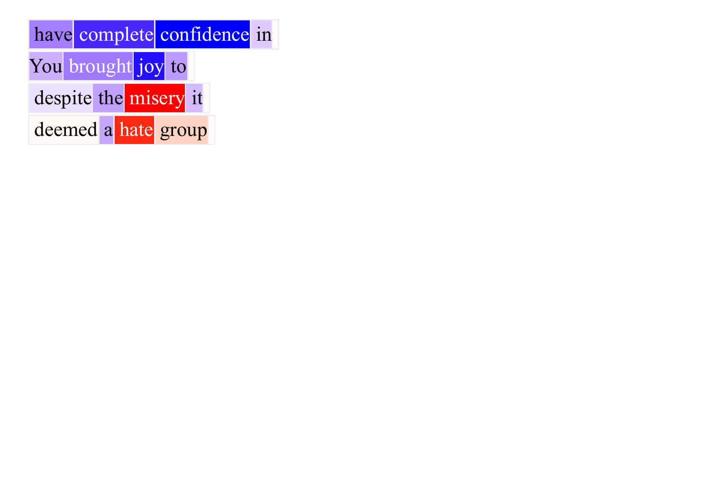

[Original figure (PDF)](../../TeX/Othello-GPT/arXiv-2310.15154v1/figures/neuroscope_nouns.pdf)

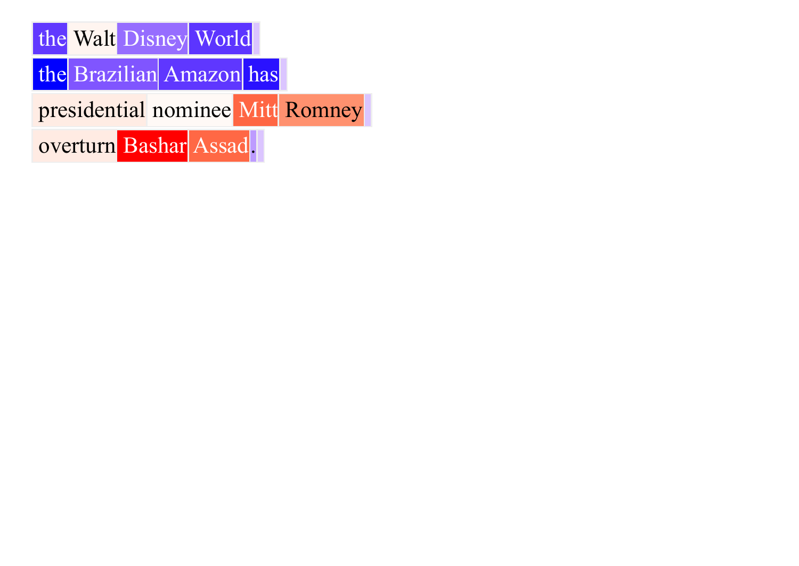

[Original figure (PDF)](../../TeX/Othello-GPT/arXiv-2310.15154v1/figures/neuroscope_proper_nouns.pdf)

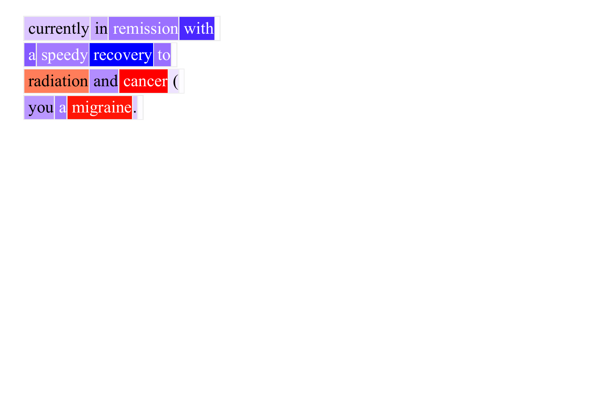

[Original figure (PDF)](../../TeX/Othello-GPT/arXiv-2310.15154v1/figures/neuroscope_medical.pdf)

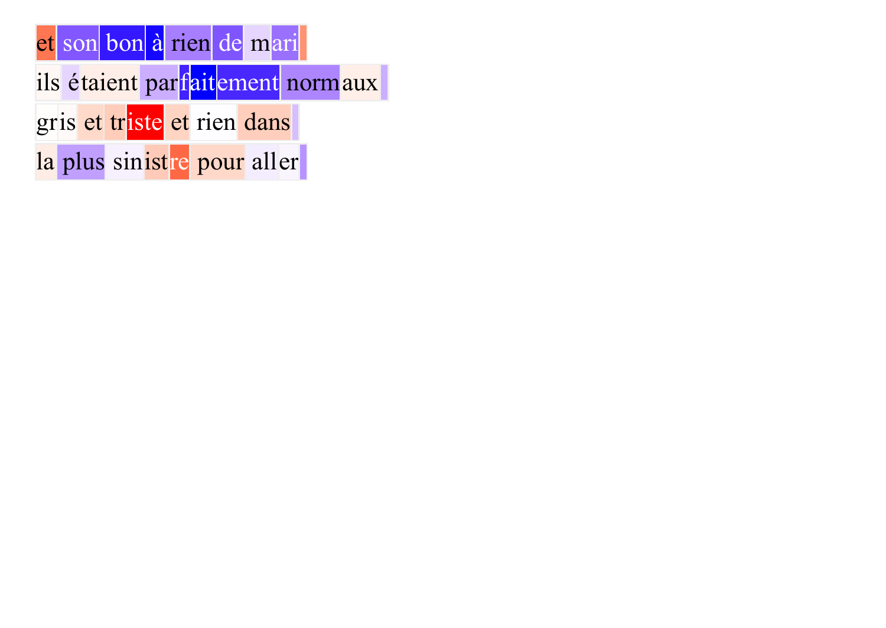

[Original figure (PDF)](../../TeX/Othello-GPT/arXiv-2310.15154v1/figures/french_short_text.pdf)

Blue is positive and red is negative. The first three panels project OpenWebText examples along the first-layer GPT2-small $K$-means direction. The French extract from *Harry Potter* uses the seventh layer of Pythia-1.4B.

See [introduction](introduction/introduction.md) and [direction comparison](results/1-direction-comparison.md).

## Figure 2. Cosine similarity of direction estimates

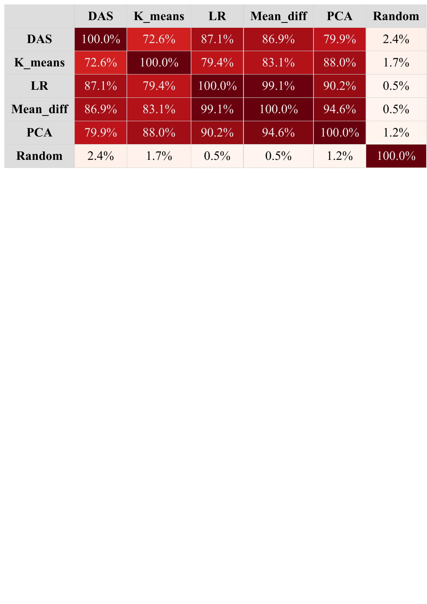

[Original figure (PDF)](../../TeX/Othello-GPT/arXiv-2310.15154v1/figures/direction_similarities.pdf)

The directions are learned from ToyMovieReview adjective activations in the first layer of GPT2-small.

See [methods](methods/2-direction-finding.md) and [comparison](results/1-direction-comparison.md).

## Figure 3. Sentiment activation bins in OpenWebText

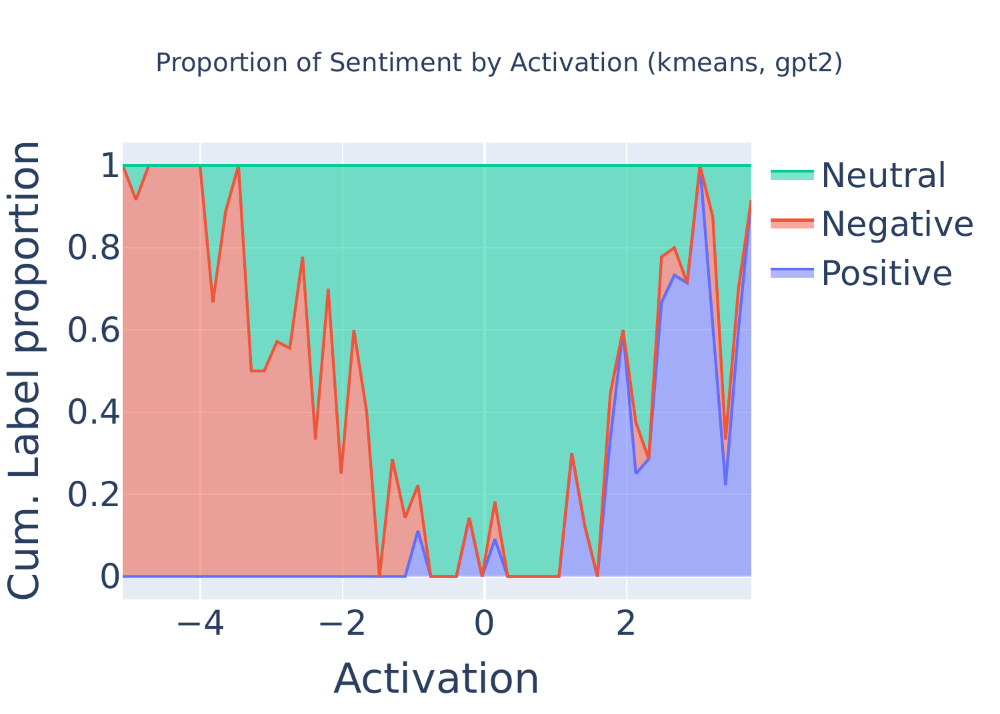

[Original figure (PDF)](../../TeX/Othello-GPT/arXiv-2310.15154v1/figures/kmeans_simple_train_ADJ_layer1_bin_proportions.pdf)

GPT-4 labels OpenWebText samples by first-layer GPT2-small activations. The associated [classification table](tables/table-figure-3-classification-accuracy.md) uses the top and bottom 0.1% of activations to distinguish positive and negative tokens.

See [correlational evaluation](results/2-correlational-evaluation.md).

## Figure 4. Directional patching in Pythia-1.4B

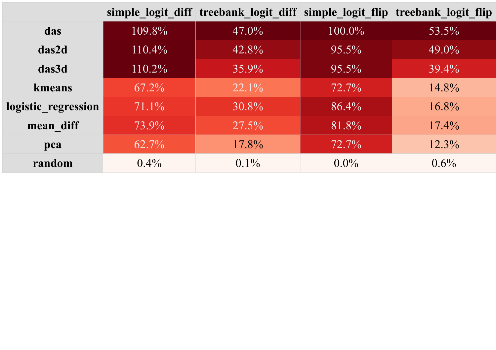

[Original figure (PDF)](../../TeX/Othello-GPT/arXiv-2310.15154v1/figures/direction_patching_resid_simple.pdf)

Best observed layer for each comparison; columns cover ToyMovieReview and SST, reporting mean logit difference and the fraction of flipped logit differences.

See [causal evaluation](results/3-causal-evaluation.md).

## Figure 5. Sentiment under negation

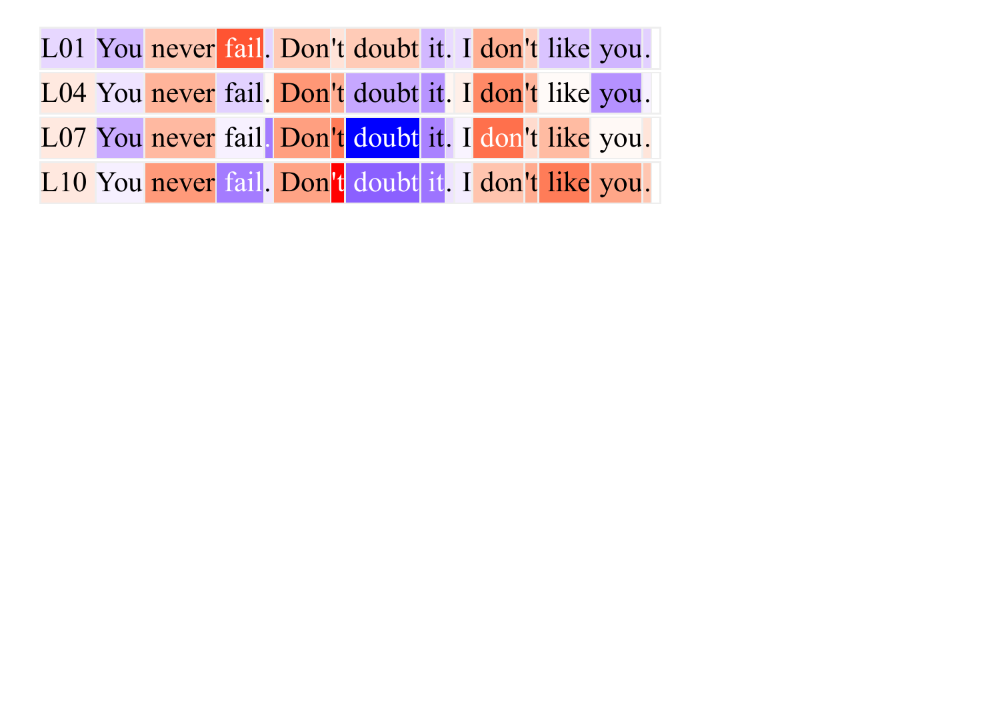

[Original figure (PDF)](../../TeX/Othello-GPT/arXiv-2310.15154v1/figures/neuroscope_negations.pdf)

Twenty-seven negation examples compare projections at the negated token between layers 1 and 10 of GPT2-small. The [quantitative table](tables/table-figure-5-negation-experiment.md) lists the flip proportions and median sizes centered at the mean activation.

See [correlational evaluation](results/2-correlational-evaluation.md).

## Figure 6. Directional patching transfer by layer

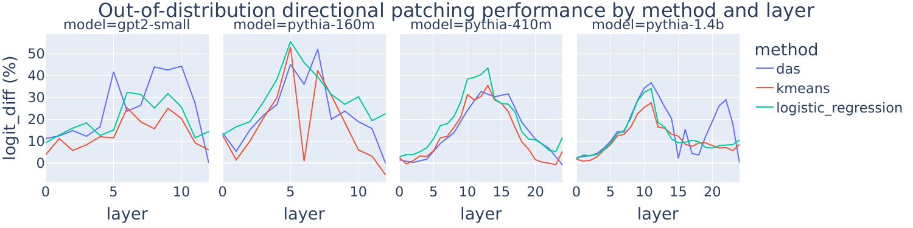

[Original figure (PDF)](../../TeX/Othello-GPT/arXiv-2310.15154v1/figures/direction_patching_logit_diff_resid_gpt2_facet_plot.pdf)

Directions fitted on toy data and tested on SST tend to transfer best in middle layers. The prompt suffix is `Overall the movie was very`; the plotted metric is the mean percentage change in logit difference between `good` and `bad`.

See [causal evaluation](results/3-causal-evaluation.md).

## Figure 7. GPT2-small sentiment circuit

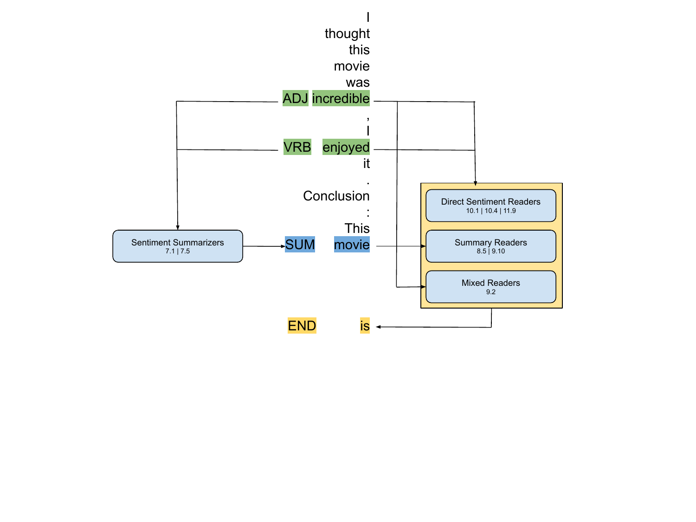

[Original figure (PDF)](../../TeX/Othello-GPT/arXiv-2310.15154v1/figures/gpt-2_sentiment_circuit.pdf)

The circuit uses direct reads from valenced tokens and an indirect path through `SUM`. Heads 7.1 and 7.5 write to `SUM`, causally affecting the contribution of the summary readers at `END`.

See [circuit analysis](results/4-circuit-analyses.md) and [Appendix A.3](appendix/a3-detailed-circuits.md).

## Figure 8. Value-weighted attention to comma positions

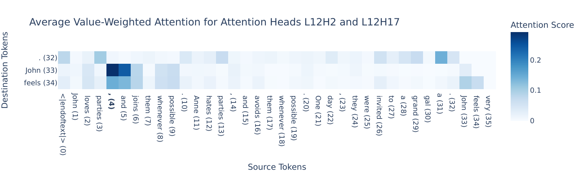

[Original figure (PDF)](../../TeX/Othello-GPT/arXiv-2310.15154v1/figures/pythia-2.8b-comma_attn_heatmap.pdf)

Top heads in the Pythia-2.8B ToyMoodStories summarization subcircuit, writing to the repeated name and `feels`, attend heavily to the queried subject's comma. Attention weights are scaled by the norm of each position's value vector.

See [circuit analysis](results/4-circuit-analyses.md) and [Appendix A.3](appendix/a3-detailed-circuits.md).

## Figure A.1. PCA of adjectives and verbs

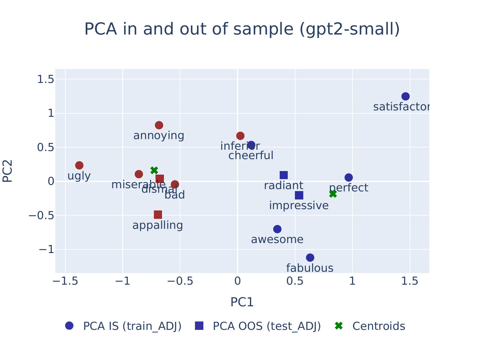

[Original figure (PDF)](../../TeX/Othello-GPT/arXiv-2310.15154v1/figures/pca_train_test_adjectives_layer_0.pdf)

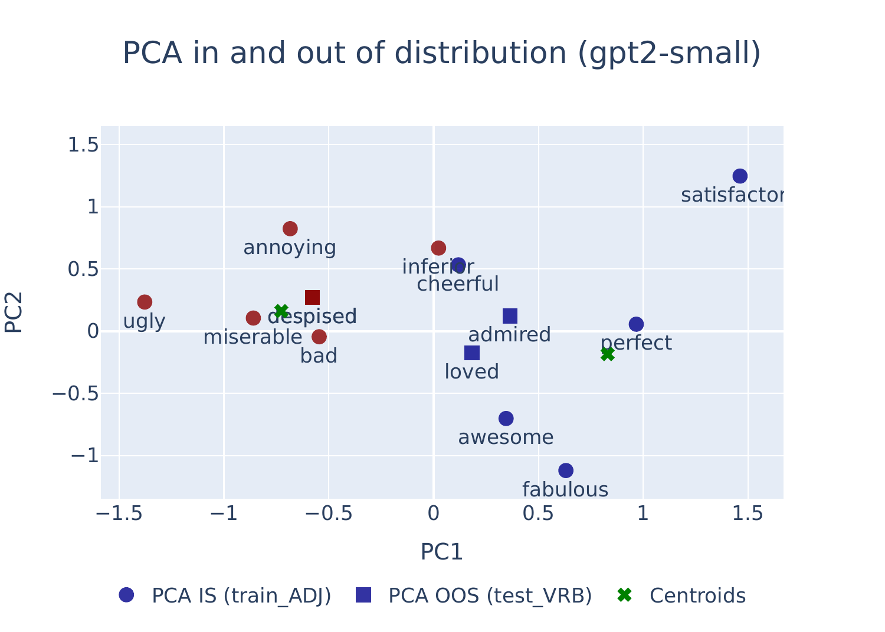

[Original figure (PDF)](../../TeX/Othello-GPT/arXiv-2310.15154v1/figures/pca_train_adjectives_test_verbs_layer_0.pdf)

Two-dimensional PCA of GPT2-small token embeddings.

See [Appendix A.1.1](appendix/a1-1-clustering.md).

## Figure A.2. Two-means classification across GPT-2 models

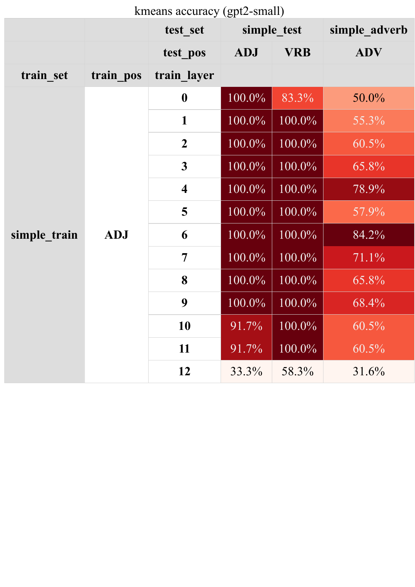

[Original figure (PDF)](../../TeX/Othello-GPT/arXiv-2310.15154v1/figures/kmeans_accuracy_gpt2_small.pdf)

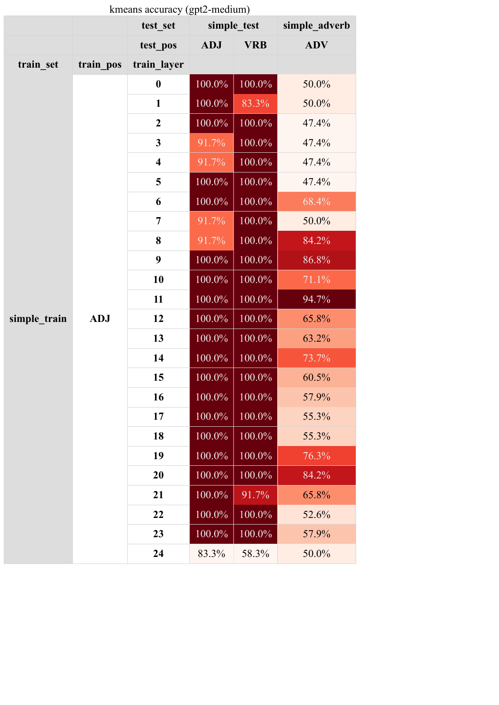

[Original figure (PDF)](../../TeX/Othello-GPT/arXiv-2310.15154v1/figures/kmeans_accuracy_gpt2_medium.pdf)

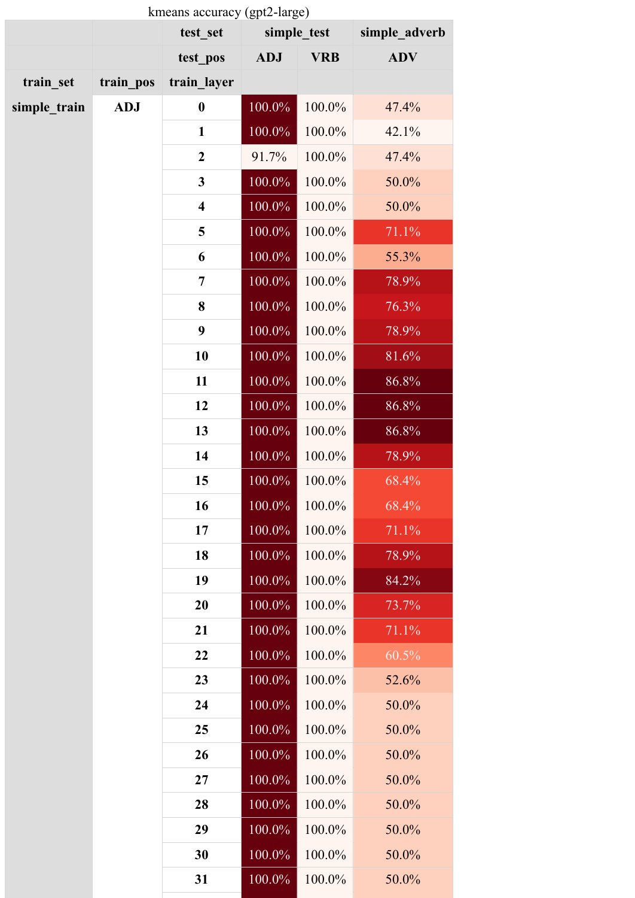

[Original figure (PDF)](../../TeX/Othello-GPT/arXiv-2310.15154v1/figures/kmeans_accuracy_gpt2_large.pdf)

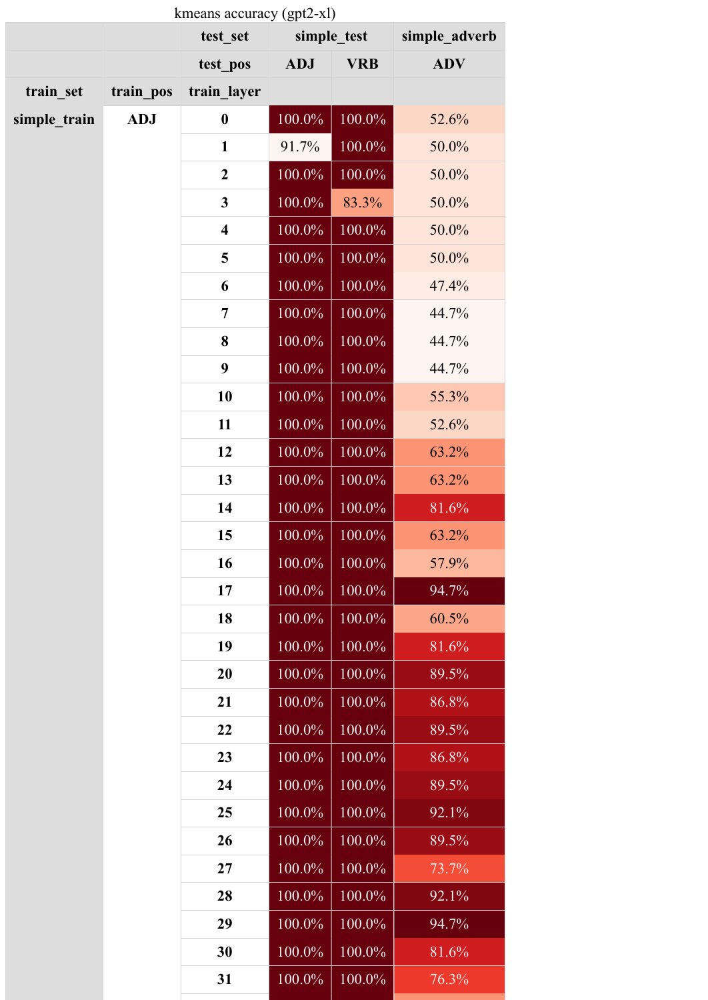

[Original figure (PDF)](../../TeX/Othello-GPT/arXiv-2310.15154v1/figures/kmeans_accuracy_gpt2_xl.pdf)

Classification accuracy by layer, showing up to 24 layers.

See [Appendix A.1.1](appendix/a1-1-clustering.md).

## Figure A.3. Activation addition and output sentiment

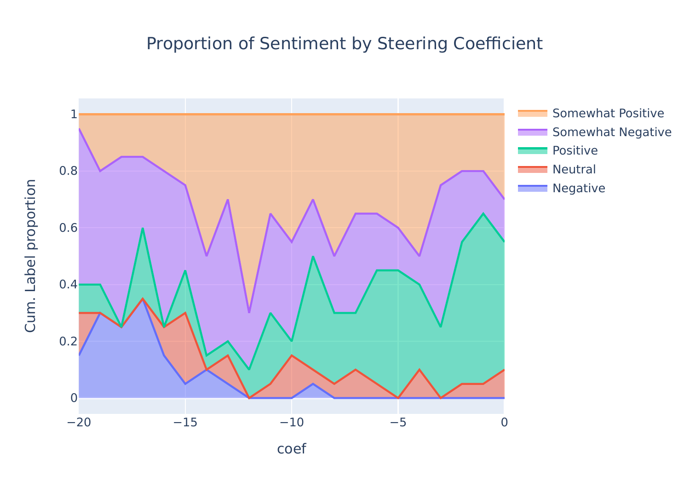

[Original figure (PDF)](../../TeX/Othello-GPT/arXiv-2310.15154v1/figures/steering_bin_proportions.pdf)

Continuations for one positive movie-review prompt under first-layer steering of GPT2-small, labeled by GPT-4.

See [Appendix A.1.2](appendix/a1-2-activation-addition.md) and [causal evaluation](results/3-causal-evaluation.md).

## Figure A.4. English and French sentiment projections

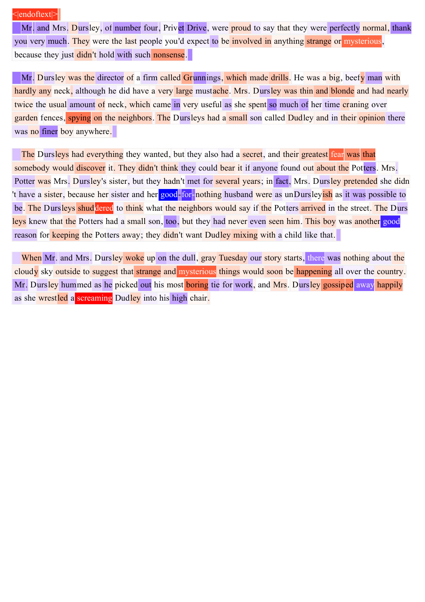

[Original figure (PDF)](../../TeX/Othello-GPT/arXiv-2310.15154v1/figures/harry_potter_neuroscope.pdf)

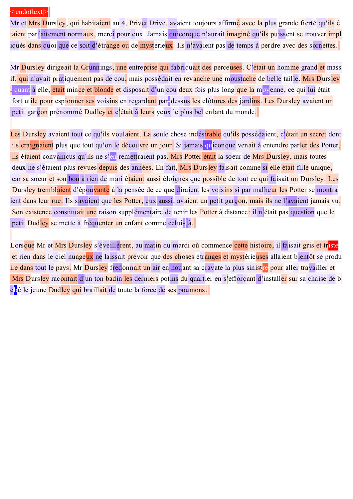

[Original figure (PDF)](../../TeX/Othello-GPT/arXiv-2310.15154v1/figures/harry_potter_fr_neuroscope.pdf)

Sentiment projections on the opening of *Harry Potter* using Pythia-2.8B.

See [Appendix A.1.3](appendix/a1-3-multilingual.md).

## Figure A.5. Negation across layers

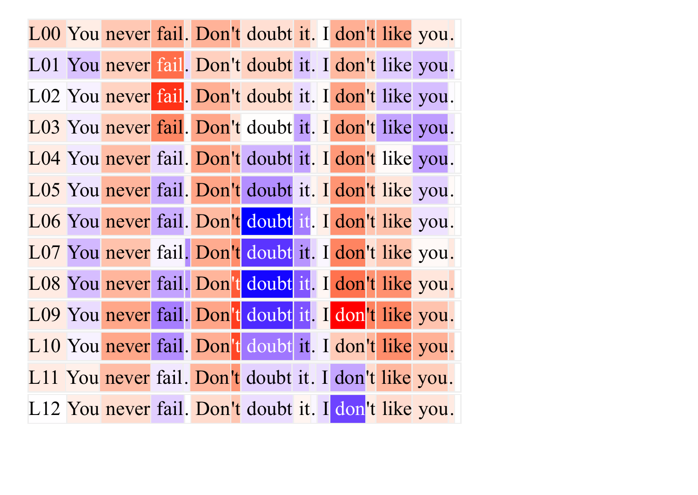

[Original figure (PDF)](../../TeX/Othello-GPT/arXiv-2310.15154v1/figures/negation.pdf)

Red is negative and blue is positive. Rows are GPT2-small residual layers, starting at the top. The three sentences are a single prompt; separate prompts yield a similar pattern.

See [Appendix A.1.4](appendix/a1-4-negations.md).

## Figure A.6. DAS subspace dimension sweep

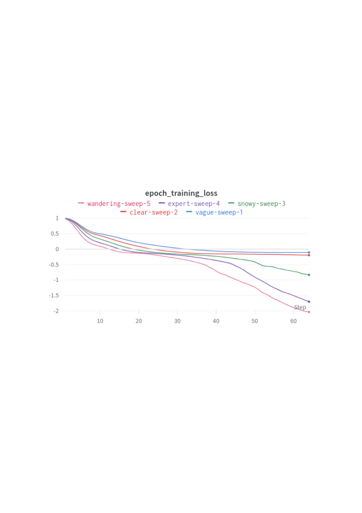

[Original figure (PDF)](../../TeX/Othello-GPT/arXiv-2310.15154v1/figures/das_sweep_train_loss.pdf)

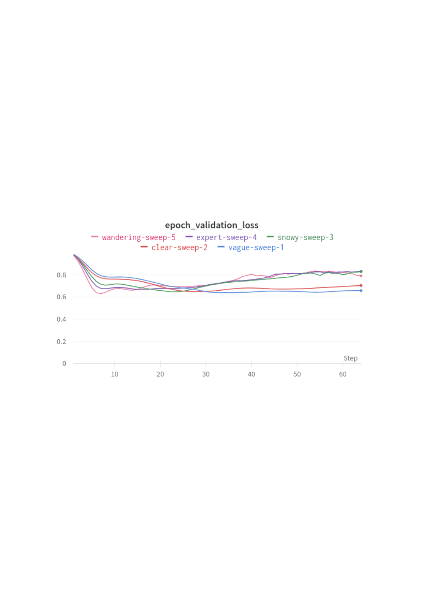

[Original figure (PDF)](../../TeX/Othello-GPT/arXiv-2310.15154v1/figures/das_sweep_val_loss.pdf)

GPT2-small runs are indexed by $n$ where the subspace has dimension $2^{n-1}$. Loss is one minus the patching metric.

See [Appendix A.2](appendix/a2-das-dimensions.md).

## Figure A.7. Residual and layer-output patching

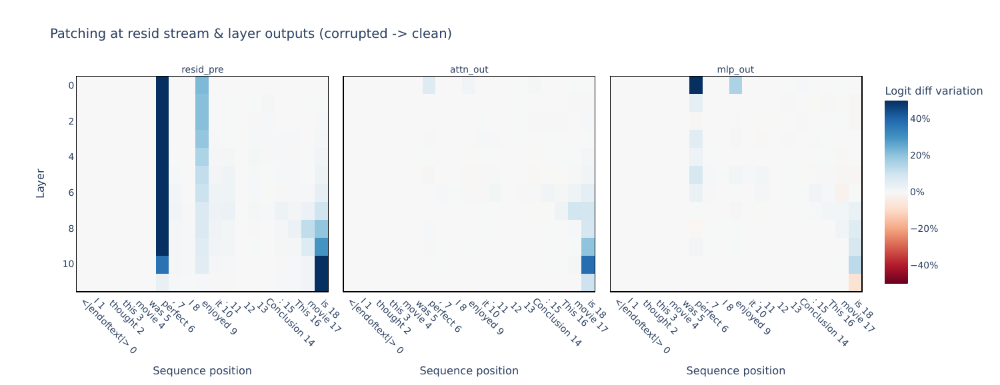

[Original figure (PDF)](../../TeX/Othello-GPT/arXiv-2310.15154v1/figures/gpt2-simple_sentiment-act_patching_at_resid_stream_and_layer_outputs.pdf)

The GPT2-small ToyMovieReview circuit recovers logit difference when patched with original activations in a flipped run. Attention output matters at `SUM`; residual effects appear at layers 8 and 9 for the summary readers and also at the `ADJ` and `VRB` positions.

See [Appendix A.3](appendix/a3-detailed-circuits.md).

## Figure A.8. Heads affected by comma or phrase patching

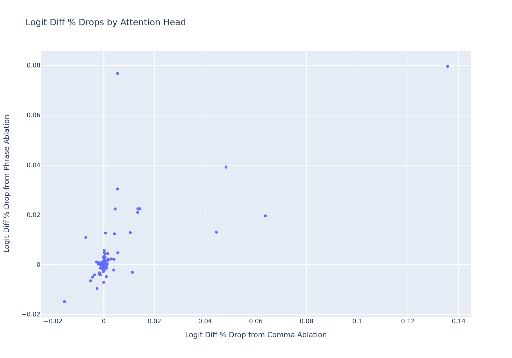

[Original figure (PDF)](../../TeX/Othello-GPT/arXiv-2310.15154v1/figures/pythia-2.8b-mood_stories-comma_vs_phrase_logit_diff_drops.pdf)

Pythia-2.8B heads show different logit-difference drops when commas or pre-comma phrases are patched.

See [Appendix A.4](appendix/a4-additional-summarization.md).

## Figure A.9. Path patching to summary heads

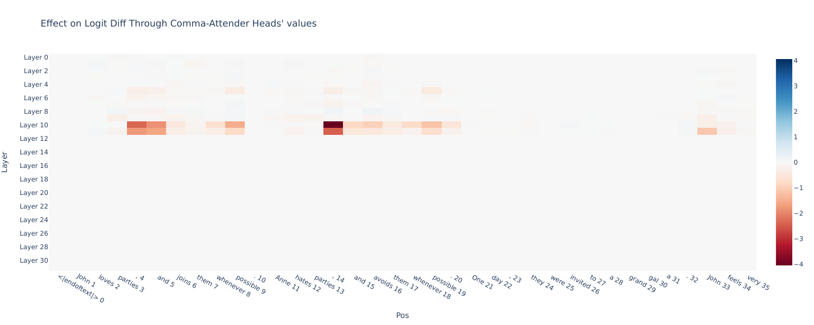

[Original figure (PDF)](../../TeX/Othello-GPT/arXiv-2310.15154v1/figures/pythia-2.8b-char_path_patch_mid_de_cm_pos.pdf)

Pythia-2.8B heads L12H2 and L12H17 writing to the repeated name and `feels` are the receivers. Paths from the commas show the largest loss in performance.

See [Appendix A.4](appendix/a4-additional-summarization.md) and [circuit results](results/4-circuit-analyses.md).

## Figure A.10. Neuron output directions and sentiment

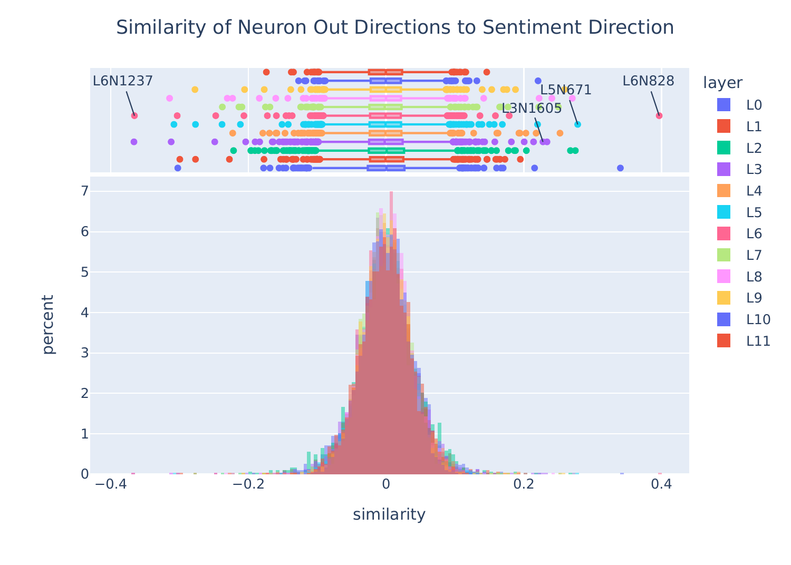

[Original figure (PDF)](../../TeX/Othello-GPT/arXiv-2310.15154v1/figures/neuron_out_similarities.pdf)

The similarity distribution for GPT2-small has heavy tails.

See [Appendix A.5](appendix/a5-neurons.md).

## References

[Complete typeset bibliography source (.bbl)](../../TeX/Othello-GPT/arXiv-2310.15154v1/iclr2024.bbl) · [BibTeX library](../../TeX/Othello-GPT/arXiv-2310.15154v1/iclr2024.bib)

References central to the experiments:

- Biderman et al. (2023). [Pythia: A suite for analyzing large language models across training and scaling](https://arxiv.org/abs/2304.01373).
- Elhage et al. (2021). [A mathematical framework for transformer circuits](https://transformer-circuits.pub/2021/framework/index.html).
- Elhage et al. (2022). [Toy models of superposition](https://transformer-circuits.pub/2022/toy_model/index.html).
- Geiger et al. (2023). [Finding alignments between interpretable causal variables and distributed neural representations](https://arxiv.org/abs/2303.02536).
- Li et al. (2023). [Emergent world representations](../01/INDEX.MD).
- Nanda, Lee, and Wattenberg (2023). [Emergent linear representations in world models of self-supervised sequence models](https://arxiv.org/abs/2309.00941).
- Socher et al. (2013). [Recursive deep models for semantic compositionality over a sentiment treebank](https://aclanthology.org/D13-1170/).
- Turner et al. (2023). [Activation addition: Steering language models without optimization](https://arxiv.org/abs/2308.10248).
- Wang et al. (2023). [Interpretability in the wild: A circuit for indirect object identification in GPT-2 Small](https://arxiv.org/abs/2211.00593).
