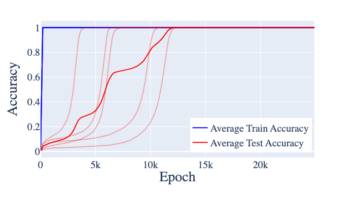
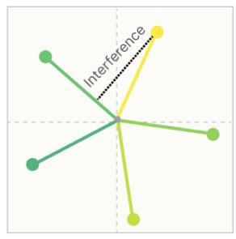

# 机器写下「等等」的时候，它发现了什么？

DeepSeek-R1-Zero 有一段很出名的解题记录。题不长：给定 $a>1$，求方程 $\sqrt{a-\sqrt{a+x}}=x$ 的实数解之和。模型连平方两次，得到了一个货真价实、也货真价实地难看的四次方程。推到这里，它忽然写了一句：**“Wait, wait. Wait.”** 然后掉头去看原式。

在继续读它的草稿之前，不妨抢它一步。别急着消根号，给内层根号起个名字 $y=\sqrt{a+x}$。现在把两行并排写：

$$y^2=a+x,\qquad x^2=a-y.$$

相减。$y^2-x^2=x+y$。因为 $x\geq 0,\ y>0$，约掉 $x+y$，只剩 **$y-x=1$**。四次方程不见了。剩下的 $x^2+x+1=a$ 只有一个非负根 $(\sqrt{4a-3}-1)/2$，代回成立。刚才和现在，用的是同一份信息；你不过是拒绝消掉一个变量，整道题换了一副面孔。

可惜，也是最有意思的地方：[论文刊出的那页草稿](Aha-Moment/02/tables/table-2-aha-moment.md) 并没有展示模型发现这条等式。上面的解法是我们的，不是它的。它说了「等等」，确实回去检查了，然后原表就在后续推导中截断了。那我们凭什么判断，一台机器究竟是在**说出顿悟的台词**，还是在**发现一种此前没有的解法**？

这个问题可以做实验。不妨先找一台根本不会说「等等」的机器。

## 一、它交了两次满分卷。两次用的不是同一种本事

[Power 等人](Grokking/01/INDEX.MD) 让小网络做模 97 的除法，只给它运算表的一部分。不到一千次更新，练过的题接近满分，新题基本靠蒙。继续用原题训练，到接近一百万步，新题也接近满分。更反常的是同一论文里的置换群乘法：在训练数据占比约 25%–30% 的区间，每少给一个百分点的题，达到 99% 验证准确率所需的步数中位数就多约 40%–50%。题给得越少，它反而越早背完，越晚学会。两座终点，往相反的方向移动。

这就是 Grokking，延迟泛化。用「从背答案变成懂规律」解释它不难，难的是交出那条规律。[Nanda 等人](Grokking/02/INDEX.MD) 挑了一台做模 113 **加法**的单层 Transformer，只用三成数对训练，然后把它拆了。换成我们的题目就是：给定 $a,b$，要从 113 个候选数 $c$ 中挑出一个。先别做加法，试着给候选答案打这样一个分：

$$s_k(c)=\cos\!\left(\frac{2\pi k}{113}(a+b-c)\right).$$

只要 $c\equiv a+b\pmod{113}$，无论 $k$ 取哪个整数，这个分量都取到最大值 1。现在倒过来想：若网络能从输入分别取得 $a,b$ 的正弦和余弦，用和角公式拼出和的相位，再和候选数 $c$ 的相位比对，它就能做模加法，连取余那一步都省了。周期本身就是取余。研究者从模型里拆出来的，正是这样一套计分电路，主力只有五个频率：**14、35、41、42、52**。这五个数没写进题面，也没写进训练程序。

漂亮到这个地步，最该防的恰恰是自己：是不是人类拿傅里叶级数，给一团什么都能拟合的数据讲了个好故事？研究者做了一个狠得多的检验。512 个中间层神经元里，433 个可以用各自频率上的低阶三角多项式逼近。那就别光画拟合图，**让这 433 个神经元下班，让公式顶班。** 换完，测试准确率不变，损失只从 $2.41\times10^{-7}$ 变到 $2.48\times10^{-7}$。反过来，从激活里拿走电路读出所依赖的十个方向，损失一下蹿到 5.27，比给 113 个答案均分概率还差。到这里，人已经不只是在描述机器；人写下的数学，能替它工作了。

*横轴是训练轮次，纵轴是准确率。蓝线早已到顶；不同次训练的浅红线各自起飞，平均成较平缓的深红线。图上看不到电路，下一步实验才看得到。*

有了电路，还可以回去破最初那个案子。拿最终找到的五个频率去滤早期的模型快照：只保留它们，测这套算法解新题的本事；专门排除它们，测剩下的成分还能不能背旧题。原先测试准确率几乎不动的区间里，前一种本事已经在长，后一种随后在退。外面看是一次跳变，里面是两套解法交班。读到这里，谁再拿出一条突然上扬的曲线，你大概已经想问：这回又长出了什么电路？

先慢一点。下一条悬崖，拔掉机器电源照样能造。

## 二、别人拆模型，他们拆阅卷机

[Wei 等人研究能力涌现](Emergent/01/INDEX.MD)，横轴换了：这回不是同一台机器训练多久，而是不同模型的规模。配几个示例，让模型做算术、重排字母、转写音标，在一些任务上，前几个规模几乎贴着随机基线，后一个明显跃起。但同一份研究里就埋了一根刺：六个 LaMDA 案例里，榜单尚未起色，正确答案的交叉熵已经在降。也就是说，机器押对的概率在涨，阅卷机却说它毫无长进。

这两件事一点也不矛盾。十位答案，全串相同才给分；暂且假定各位独立且单步正确率同为 $p$，两本成绩册读出的就是 $p$ 和 $p^{10}$。当 $p$ 从 0.5 涨到 0.9，每位的命中率还没翻倍，全串命中率已经从 0.098% 到了 34.87%。测试集要是只有一百道题，前者大概率连一次露脸的机会都没有。[Schaeffer 等人](Emergent/02/INDEX.MD) 不止算了这笔账。他们保存 GPT 系列模型做算术的**同一批输出**，四、五位答案原先按整串判对错，现在改为数最少得编辑几个符号。几条悬崖当场消失。模型压根儿没参加第二次考试。

于是手里有了两种乍看一样、实则判法完全不同的「顿悟」：在模加法里，要把某些频率抹掉，能力才消失；在重评分实验里，动一动判卷规则，跃升就消失。可这两场实验，人都占了一样便宜：我们预先知道什么是正确答案，甚至知道去哪里找圆。要是既不给机器公式，也不给它状态变量，只给它一串动作，**它会不会自己发明那个我们忘了给它的变量？**

## 三、一盘棋里，最能泄露天机的是一颗没用的子

[Othello-GPT](Othello-GPT/01/INDEX.MD) 只读黑白棋的落子序列，任务只是预测下一手。棋盘不在输入里。一手棋能翻转一整排棋子，所以，序列中某格最后一次出现时是谁下的，并不告诉你它此刻是什么颜色。把棋谱停在半局，抽出网络的一层激活 $h$，试试能否从中还原黑、白、空。用线性分类器读，合成棋谱模型最好的错误率仍有 20.4%；换一个两层非线性探针，到第七层，错误率降到 1.7%。这里差的不是一个小数点。用错读数仪，你会漏掉盘面；用更强的读数仪，你又得防着盘面是仪器自己算的。

解围的是一个反事实。棋谱不动，在几层激活里定向编辑一格棋子的状态，问模型接下来的走法更像哪张棋盘。按修改后的盘面计，多报与漏报的合法手数之和，在可正常抵达的测试局面里，从不干预时的平均 2.68 降到最佳干预时的 0.12。屏幕上的历史没有一个字改变，机器却开始为**另一段历史的现在**落子。探针能读出什么是一回事，改了这个量，模型会不会据此行事，是另一回事。

偏有一类局面，能让这把手术刀落空：翻一颗子，下一手合法走法集合**根本不变**。那这颗子的颜色，按眼前的考纲属于超纲内容。[一篇追查「无用」特征来历的研究](Emergent/03/INDEX.MD) 发现，模型对这类棋格也有表征，虽比马上用得着的弱。没有人为黑白颜色出过一道监督题，既然下一手也不用它，梯度从哪儿来？

盯住第 $i$ 个位置的一层激活，按路径把梯度拆开。第一笔来自当前位置预测下一手的误差；第二笔来自更后面的预测，它们通过注意力读过这里，纠正信号便能沿原路回来；第三笔根本不经过这个位置，但各位置共用权重，在别处学会更新棋格，也改变了这里的计算。对那批「无用」棋格，研究者测得第一笔的归因与零不可区分，后两笔仍为正。谜底颇有味道：优化目标没偷偷变成「请学一个世界模型」。恰恰因为**每个位置都有它的下一手**，有些信息今天存下来，明天才结账。

如果这个解释有道理，语言里应该也有这种位置：自己没什么可说，却替后文存着东西。[情感表征实验](Othello-GPT/02/INDEX.MD) 找到的一个位置，是逗号。研究者选出模型原本判对、又含逗号的影评，从激活向量中只减去沿「褒—贬」方向的投影。全位置都做，准确率从 100% 到 62%；**只动逗号**，就到 82%；换随机方向全位置动，变化不到一个百分点。一个纸面上压根没有态度的符号，竟然扛下了接近一半的定向消融效应。它不是生来表示褒贬；它是读到此处时，前文的褒贬被暂存的地址。

注意，刚才拿走的是一个**方向**，不是某号神经元。这一点看似是措辞，接下来却决定了我们要造什么仪器。

## 四、把坐标系转一下，三千四百万个词条的字典就有了来由

设隐藏状态 $h=\sum_j z_jv_j$，每个 $v_j$ 是一个特征的方向。沿单位方向 $v_i$ 读数，得到的不光是 $z_i$，还带一项串扰 $\sum_{j\ne i}z_j\langle v_i,v_j\rangle$。若要求串扰永远为零，你最多放下维数那么多根正交轴。可把题目里的「永远」改成「绝大多数样本上」，答案立刻不一样：只要多数 $z_j$ 平时就是零，让少数方向偶尔打架，可能比永远扔掉其中一些更合算。

[特征叠加的玩具实验](Superposition/01/INDEX.MD) 把这场交易压到了肉眼看得见的二维。给五个特征，只准用两个维度，再用带非线性的读出重建输入。特征密集时，模型把两条正交轴留给最重要的两个，其余舍掉；稀疏度 80% 时，四个特征结成两对相反方向；到 90%，第五个也挤进来，五个方向排成五边形。线性代数没有失效，第五个方向当然不是第五个线性无关向量。改变的是最优解：**容量不再按坐标轴卖，而要按信号同时出现的机会定价。**

*同一模型在三种稀疏度下的[几何对照](Superposition/01/figures/figure-1-five-features.md)。五边形是训练结果，不是给网络的先验。*

正问题是「知道五个信号，怎么塞进两个坐标」。把箭头反过来，就是大模型的逆问题：手里只有一堆 $h$，能不能同时猜出方向字典 $D$，以及每个样本里稀稀落落的系数 $z$，使 $h\approx Dz$？[Anthropic 在 Claude 3 Sonnet 上训练稀疏自编码器](Superposition/02/INDEX.MD)，最大的一本字典有约 3400 万个候选特征。有个方向对不同语言里的金门大桥以及桥的图像都响应。把它钳到自然样本最大激活的十倍，模型竟开始把**自己**描述成那座桥。到这里，几何方向已经不仅能命名，还能操纵。

可这本字典到底读懂了模型多少？论文里有个比金门大桥更值得记住的反例：Sonnet 能列伦敦的行政区，但用 3400 万词条的字典按论文方法查，只给大约六成的区找到了对应特征。**被研究对象答得出，研究仪器却找不全。** 更何况，即便明天找全所有名词，也解释不了这件事：我临时规定「甲之后跟乙」，下一次看到甲，你的模型就能接乙。我是刚刚才定的规矩，你总不能从昨晚存好的权重里，翻出一个叫「今天这条规矩」的词条吧？

## 五、网络里存的不是那个答案，是临时造答案的算法

[归纳头研究](In-Context-Learning/arXiv-2209.11895v1/INDEX.MD) 拆出了一段极小的程序：`[A][B] … [A] → [B]`。第一层把前驱 A 的信息送到旧的 B 所在位置；第二层在新 A 处发出查询，匹配到那个「前驱是 A」的位置，带回它所保存的 B。难怪 B 可以是我现编的。**匹配规则在权重里，匹配到什么在这一次输入里。** 作者追踪了 34 个模型，在小模型上做了五万多次注意力头消融。小型纯注意力模型里，关掉这些头，读到后文时原本享有的预测优势就大幅缩水；推广到更大的模型，共同出现的训练拐点是线索，不是同等强度的拆机证据。

但只要把问题稍微一拧，复制就不够用了。上下文给你几组 $(x_i,y_i)$，它们来自一条本题临时抽取的线性规律；现在给一个新的 $x_*$，对应的 $y_*$ 根本没在前文出现过。你上哪儿复制？[线性注意力与梯度下降的研究](In-Context-Learning/arXiv-2212.07677v2/INDEX.MD) 给出了一个能拿笔验的答案。对平方损失做一步梯度下降，忽略并入步长的归一化常数，把更新后的参数乘上新输入，得到：

$$\hat y_*' = w^\top x_* + \eta\sum_i (y_i-w^\top x_i)\,(x_i^\top x_*).$$

仔细看最后一项。每个旧样本能把新预测往上或往下拉多少？**它自己的残差，乘上它和新输入的内积。** 残差做值，内积做匹配权重，再对上下文求和，正好是一层线性注意力能够实现的运算。这不止是两个公式长得像：实验把训练所得的层和手工构造的一步更新拿去做分布外测试，放大输入尺度，两者连步长失稳的毛病都相似。共享成功容易巧合，共享失败模式，解释又硬了一层。

走到这里，上下文已经两次变了身份。先是存放旧答案的检索表，再是现场拟合规律的样本集。还有第三种用法，比前两个都大胆：**让机器把一个新算出的量写进上下文，自己当下一个读者。** 开头我们给内层根号起名叫 $y$，做的就是这件事。

## 六、一行草稿，究竟能给固定深度的机器多添多少计算？

[思维链提示实验](Chain-of-Thought/01/INDEX.MD) 先给了个数：PaLM 540B 做 GSM8K，八道示例只示范答案，17.9%；示范中间步骤再报答案，56.9%。真正区分解释的是论文在 LaMDA 137B 上做的另一组对照。若只是多生成几个位置就有用，填点号应该也行；若只是示例提供了数学知识，写在答案后面应该也行。结果如下：

| 同一模型、同一题集 | 标准提示 | 先写点号 | 先报答案再推导 | 先推导再报答案 |
| --- | ---: | ---: | ---: | ---: |
| LaMDA 137B，GSM8K 准确率 | 6.5% | 6.4% | 6.1% | **14.3%** |

账得在交卷前算，而且得算有用的账。那么多写一行的收益，究竟是文字比较好懂，还是计算本身变了？[关于串行问题的论文](Chain-of-Thought/03/INDEX.MD) 干脆抹掉自然语言，做迭代平方。从 $u=r$ 出发，连续做 $n$ 次 $u\leftarrow u^2\bmod p$。每一步是同一小段程序，可第 $t+1$ 步偏要吃第 $t$ 步的结果。把中间余数逐个写回去，模型每次只须完成一次状态转移。推广到布尔电路，在论文的有限精度、对数宽度设定下，固定深度模型可以用 $O(T)$ 个生成步模拟 $T$ 个逻辑门。层数没增加；**上一次计算的终点，接到了下一次计算的起点。**

这像电路仿真。能不能再往前走，模拟一台会改写内存的机器？障碍尖锐得很：自回归模型只能往后追加，昨天写的第 37 格，今天拿什么擦？[另一篇思维链表达能力论文](Chain-of-Thought/02/INDEX.MD) 给了个出人意料的答案：**不用擦。** 每一步记下状态、写入的符号和读写头移动方向。以后要读某格，就从历史移动算出地址，找同地址**最近一次**写入。旧值还在上下文里，但不再有发言权。只准追加的日志，由此模拟出了可反复改写的纸带。

前一篇是按电路逐门施工；后一篇要求一套统一规则处理不同输入长度。在后一篇规定的架构与精度条件下，允许线性多个生成步，能识别所有正则语言；允许多项式多个生成步，相应模型的判定能力恰好达到 P。这里最振奋人的不是给聊天框贴张「通用计算机」标签。定理给的是**构造**，不是训练承诺：地图上有路，不表示梯度下降已经走到了那里。于是最棘手的工程问题从理论里直接露了头：草稿当然能续写，可如果第一行就选错了路，允许它写一万行，又能怎么样？

## 七、真正稀缺的不是下一步，是放弃这一步的权利

在 [Tree of Thoughts 的 24 点实验](Aha-Moment/01/INDEX.MD) 里，这不是修辞。约六成普通思维链样本，第一步合并两个数之后，剩下的数就已经无解或不合法。后面写得再流畅，也只是在一条封死的支路上狂奔。把 GPT-4 的权重锁死，只改外面的程序：一次提议若干次合并，评估剩余局面，保留有希望的分支再展开。在那一百道测试题上，单条思维链成功率 4%；每层经筛选只留一条，45%；留五条，74%。甚至让一个事后知道正误的裁判从一百份完整思维链里挑，也只有 49%。这些方法花费不同，但这组数揭穿了一个偷换：**让一百条路各自走到黑，不等于允许在岔路口重选一次。**

可是岔路口也不免费。[测试时算力分配研究](Chain-of-Thought/04/INDEX.MD) 在 MATH 上发现，把答案顺着改下去，整体能进步，但朴素修订也会把约 38% 的原本正确答案改错。那是该多开几条支路，还是留预算给局部修订？分题目难度调比例：较容易的题更适合顺序修，难题常需并行探索再局部修。按论文不含难度估计开销的采样口径，64 次自适应尝试可以超过 256 次纯并行择优。至此我们手上有了一种很具体的本事：给定一道题，由**程序员**决定何时再抽一次，何时回头。

现在把「程序员」三个字拿掉。还记得开头那声 “Wait” 吗？[DeepSeek-R1 的论文](Aha-Moment/02/INDEX.MD) 做了一个区分得很干净的实验：R1-Zero 从预训练基座直接开始强化学习，没有先拿人工标注的标准推导做监督微调。同一题采出一组回答，用可自动核验的结果和格式给奖励，按组内相对表现更新策略。奖励里没有「写到四次方程时请返回原式」这一条。训练往前走，输出变长，检查、重试开始更常出现，AIME 2024 的单次作答正确率从 15.6% 到 77.9%。这里不是上一段那棵外部搜索树：上一段的岔路是程序保留的，这一段的掉头发生在一条生成序列里。它们在屏幕上都像反思，来历完全不同。

现在可以把那张根式方程的草稿摊回桌面了。假如明天有一台模型不只说「等等」，还真写出了 $y-x=1$，你准备怎么证实它抓到的是结构，而不是见过原题？有一个今晚就能动手的实验：保留 $x\ge0,\ y>0$，取正系数 $b,c$，把两行换成 $y^2=a+bx,\ x^2=a-cy$。在 $b=c$ 这族题里，相减仍能约去 $x+y$，得到 $y-x=b$；在 $b\ne c$ 的对照族里，这一步通常走不通。换掉符号、交换两行、藏回嵌套根式，分别测最终答案和那一步消元。更进一步，把中间提示改为一条错误的差值，观察它是检查原式，还是顺着提示滑下去。这还不是电路证据，却已经比数它说了几次 “Wait” 更接近我们真正想知道的事。

这就是这 [17 篇论文](INDEX.MD) 留下的位置。有人从一堆权重里量出了五个频率；有人翻动了一枚输入里从未出现过的棋子；有人只靠不断往后写，造出了一台可以回头读的机器。他们用的东西，你大半已经认识：单位根、投影、链式法则、梯度下降、布尔电路。陌生的是另一端——那些数学结构，有些不是人设计进去的，而是我们在一台训练完的机器里重新发现的。人类花几百年学会用数学描述自然，现在又面对一种新对象：**我们知道它的每一条基本运算，却还不知道这些运算合起来发明了哪些算法。**

这里没有卷末的标准答案。下一次，当一条曲线突然抬头，不必等谁宣布智能又升了一级。把那一步之前的权重存下来，写下两种相反的解释，设计一个能让其中一种输掉的实验。等结果出来，世上第一个知道那台机器刚才做了什么的人，可以是你。
