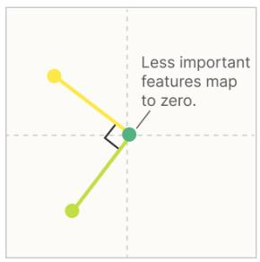
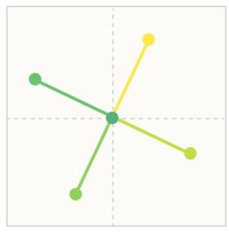
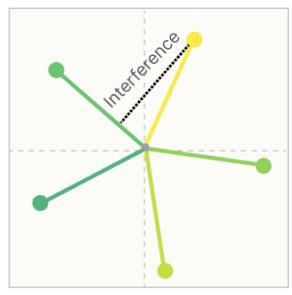

> ⬅️ 返回 [论文索引](../INDEX.MD) · [引言](../introduction/introduction.md) · [基本结果](../results/1-demonstrating-superposition.md)

# Five features in two dimensions

**Dense features:** The two most important features are given dedicated orthogonal dimensions; the other three are not embedded.

**80% sparsity:** The four most important features are represented as antipodal pairs. The least important feature is not embedded.

**90% sparsity:** All five features are embedded as a pentagon, with positive interference.

