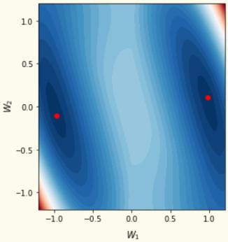
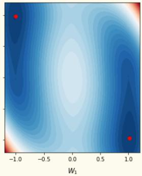
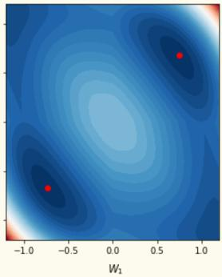

> ⬅️ 返回 [论文索引](../INDEX.MD) · [相变](../results/2-phase-change.md) · [复现说明](../back-matter/comments-and-replications.md)

# Replication Figure 1: Loss surfaces for the $n=2$, $m=1$ case of the ReLU-output toy model

- **(a) $S=0.1$, $I_2=0.1$:** Low importance for feature 2 leads to a low but nonzero $W_2$.
- **(b) $S=0.7$, $I_2=0.2$:** An antipodal solution appears at high sparsity.

**(c) $S=0.1$, $I_2=0.8$:** The “confused feature” solution appears at low sparsity and high importance for feature 2.

