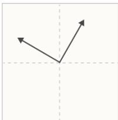
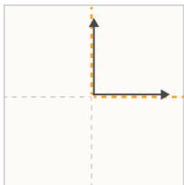
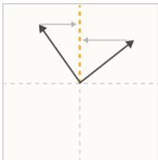
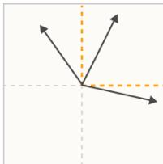
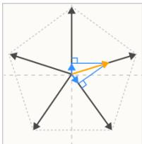
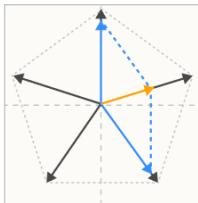
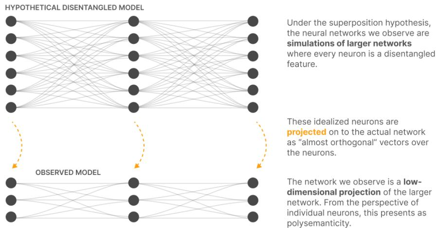

> ⬅️ 返回 [论文索引](../INDEX.MD) · Definitions and Motivation

# Definitions and Motivation

以下保留原文；先读 [玩具模型设置](../methods/1-relu-output.md) 可直接进入实证部分。

## Definitions and Motivation: Features, Directions, and Superposition

In our work, we often think of neural networks as having features of the input represented as directions in activation space. This isn't a trivial claim. It isn't obvious what kind of structure we should expect neural network representations to have. When we say something like "word embeddings have a gender direction" or "vision models have curve detector neurons", one is implicitly making strong claims about the structure of network representations.

Despite this, we believe this kind of "linear representation hypothesis" is supported both by significant empirical findings and theoretical arguments. One might think of this as two separate properties, which we'll explore in more detail shortly:

Decomposability: Network representations can be described in terms of independently understandable features.

Linearity: Features are represented by direction.

If we hope to reverse engineer neural networks, we need a property like decomposability. Decomposability is what allows us to reason about the model without fitting the whole thing in our heads! But it's not enough for things to be decomposable: we need to be able to access the decomposition somehow. In order to do this, we need to identify the individual features within a representation. In a linear representation, this corresponds to determining which directions in activation space correspond to which independent features of the input.

Sometimes, identifying feature directions is very easy because features seem to correspond to neurons. For example, many neurons in the early layers of InceptionV1 clearly correspond to features (e.g. curve detector neurons ). Why is it that we sometimes get this extremely helpfu[6] property, but in other cases don't? We hypothesize that there are really two countervailing forces driving this:

Privileged Basis: Only some representations have a privileged basis which encourages features to align with basis directions (i.e. to correspond to neurons).

Superposition: Linear representations can represent more features than dimensions, using a strategy we call superposition. This can be seen as neural networks simulating larger networks. This pushes features away from corresponding to neurons.

Superposition has been hypothesized in previous work . However, we're not aware of feature[1, 2] superposition having been unambiguously demonstrated to occur in neural networks before ([7] demonstrates a closely related phenomenon of model superposition). The goal of this paper is to change that, demonstrating superposition and exploring how it interacts with privileged bases. If superposition occurs in networks, it deeply influences what approaches to interpretability research make sense, so unambiguous demonstration seems important.

The goal of this section will be to motivate these ideas and unpack them in detail.

It's worth noting that many of the ideas in this section have close connections to ideas in other lines of interpretability research (especially disentanglement), neuroscience (distributed representations, population codes, etc), compressed sensing, and many other lines of work. This section will focus on articulating our perspective on the problem. We'll discuss these other lines of work in detail in Related Work.

## Empirical Phenomena

When we talk about "features" and how they're represented, this is ultimately theory building around several observed empirical phenomena. Before describing how we conceptualize those results, we'll simply describe some of the major results motivating our thinking:

Word Embeddings - A famous result by Mikolov et al. found that word embeddings[8] appear to have directions which correspond to semantic properties, allowing for embedding arithmetic vectors such as $\begin{array} { r l r l r } { \nabla ( \mathrm {  ~ \ " ~ \mathbf { \mu } ~ } \mathrm { k i n g ~ } ^ { \mathrm { m } } ) } & { - } & { \nabla ( \mathrm {  ~ \ " ~ \mathbf { \mu } ~ } \mathrm { m a n ~ } ^ { \mathrm { n } } ) } & { + } & { \nabla ( \mathrm {  ~ \ " ~ \mathbf { \sigma } ~ } \mathrm { w o m a n ~ } ^ { \mathrm { n } } ) } & { = } & { \nabla ( \mathrm {  ~ \ " ~ \mathbf { q } u e e n ~ } ^ { \mathrm { n } } ) } \end{array}$ (but see ).[9]

Latent Spaces - Similar "vector arithmetic" and interpretable direction results have also been found for generative adversarial networks (e.g. ).[10]

Interpretable Neurons - There is a significant body of results finding neurons which appear to be interpretable (in RNNs ; in CNNs ; in GANs ), activating in response to[11, 12] [13, 14] [15] some understandable property. This work has faced some skepticism . In response,[16, 17] several papers have aimed to give extremely detailed accounts of a few specific neurons, in the hope of dispositively establishing examples of neurons which truly detect some understandable property (notably Cammarata et al. , but also ).[6] [18, 19]

Universality - Many analogous neurons responding to the same properties can be found across networks .[20, 1, 18]

Polysemantic Neurons - At the same time, there are also many neurons which appear to not respond to an interpretable property of the input, and in particular, many polysemantic neurons which appear to respond to unrelated mixtures of inputs .[21]

As a result, we tend to think of neural network representations as being composed of features which are represented as directions. We'll unpack this idea in the following sections.

## What are Features?

Our use of the term "feature" is motivated by the interpretable properties of the input we observe neurons (or word embedding directions) responding to. There's a rich variety of such observed properties! We'd like to use the term "feature" to encompass all these properties.2

But even with that motivation, it turns out to be quite challenging to create a satisfactory definition of a feature. Rather than offer a single definition we're confident about, we consider three potentia working definitions:

Features as arbitrary functions. One approach would be to define features as any function of the input (as in ). But this doesn't quite seem to fit our motivations. There's something[22] special about these features that we're observing: they seem to in some sense be fundamental abstractions for reasoning about the data, with the same features forming reliably across models. Features also seem identifiable: cat and car are two features while cat+car and cat-car seem like mixtures of features rather than features in some important sense.

Features as interpretable properties. All the features we described are strikingly understandable to humans. One could try to use this for a definition: features are the presence of human understandable "concepts" in the input. But it seems important to allow for features we might not understand. If AlphaFold discovers some important chemical structure for predicting protein folding, it very well might not be something we initially understand!

Neurons in Sufficiently Large Models. A final approach is to define features as properties of the input which a sufficiently large neural network will reliably dedicate a neuron to representing. For example, curve detectors appear to reliably occur across sufficiently3 sophisticated vision models, and so are a feature. For interpretable properties which we presently only observe in polysemantic neurons, the hope is that a sufficiently large model would dedicate a neuron to them. This definition is slightly circular, but avoids the issues with the earlier ones.

We've written this paper with the final "neurons in sufficiently large models" definition in mind. But we aren't overly attached to it, and actually think it's probably important to not prematurely attach to a definition.4

## Features as Directions

As we've mentioned in previous sections, we generally think of features as being represented by directions. For example, in word embeddings, "gender" and "royalty" appear to correspond to directions, allowing arithmetic like $\begin{array} { r l r l r } { \nabla ( \mathrm {  ~ \ " ~ \mathbf { \mu } ~ } \mathrm { k i n g ~ } ^ { \mathrm { m } } ) } & { - } & { \nabla ( \mathrm {  ~ \ " ~ \mathbf { \mu } ~ } \mathrm { m a n ~ } ^ { \mathrm { n } } ) } & { + } & { \nabla ( \mathrm {  ~ \ " ~ \mathbf { \sigma } ~ } \mathrm { w o m a n ~ } ^ { \mathrm { n } } ) } & { = } & { \nabla ( \mathrm {  ~ \ " ~ \mathbf { q } u e e n ~ } ^ { \mathrm { n } } ) } \end{array}$ . Examples of interpretable neurons are also cases of features as directions, since the amount a[8] neuron activates corresponds to a basis direction in the representation.

Let's call a neural network representation linear if features correspond to directions in activation space. In a linear representation, each feature $f _ { i }$ has a corresponding representation direction .W The presence of multiple features $f _ { 1 } , f _ { 2 } \ldots$ activating with values $x _ { f _ { 1 } } , x _ { f _ { 2 } } \ldots$ is represented by $x _ { f _ { 1 } } W _ { f _ { 1 } } + x _ { f _ { 2 } } W _ { f _ { 2 } } . . . .$ . To be clear, the features being represented are almost certainly nonlinear functions of the input. It's only the map from features to activation vectors which is linear. Note that whether something is a linear representation depends on what you consider to be the features.

We don't think it's a coincidence that neural networks empirically seem to have linear representations. Neural networks are built from linear functions interspersed with non-linearities. In some sense, the linear functions are the vast majority of the computation (for example, as measured in FLOPs). Linear representations are the natural format for neural networks to represent information in! Concretely, there are three major benefits:

Linear representations are the natural outputs of obvious algorithms a layer might implement. If one sets up a neuron to pattern match a particular weight template, it will fire more as a stimulus matches the template better and less as it matches it less well.

Linear representations make features "linearly accessible." A typical neural network layer is a linear function followed by a non-linearity. If a feature in the previous layer is represented linearly, a neuron in the next layer can "select it" and have it consistently excite or inhibit that neuron. If a feature were represented non-linearly, the model would not be able to do this in a single step.

Statistical Efficiency. Representing features as different directions may allow non-local generalization in models with linear transformations (such as the weights of neural nets), increasing their statistical efficiency relative to models which can only locally generalize. This view is especially advocated in some of Bengio's writing (e.g. ). A more accessible[5] argument can be found in this blog post.

It is possible to construct non-linear representations, and retrieve information from them, if you use multiple layers (although even these examples can be seen as linear representations with more exotic features). We provide an example in the appendix. However, our intuition is that non-linear representations are generally inefficient for neural networks.

One might think that a linear representation can only store as many features as it has dimensions, but it turns out this isn't the case! We'll see that the phenomenon we call superposition will allow models to store more features – potentially many more features – in linear representations.

For discussion on how this view of features squares with a conception of features as being multidimensional manifolds, see the appendix “What about Multidimensional Features?”.

## Privileged vs Non-privileged Bases

Even if features are encoded as directions, a natural question to ask is which directions? In some cases, it seems useful to consider the basis directions, but in others it doesn't. Why is this?

When researchers study word embeddings, it doesn't make sense to analyze basis directions. There would be no reason to expect a basis dimension to be different from any other possible direction. One way to see this is to imagine applying some random linear transformation to the wordM embedding, and apply to the following weights. This would produce an identical model whereM−1 the basis dimensions are totally different. This is what we mean by a non-privileged basis. Of course, it's possible to study activations without a privileged basis, you just need to identify interesting directions to study somehow, such as creating a gender direction in a word embedding by taking the difference vector between "man" and "woman".

But many neural network layers are not like this. Often, something about the architecture makes the basis directions special, such as applying an activation function. This "breaks the symmetry", making those directions special, and potentially encouraging features to align with the basis dimensions. We call this a privileged basis, and call the basis directions "neurons." Often, these neurons correspond to interpretable features.

  
In a non-privileged basis. features can be embedded in any direction. There is no reason to expect basis dimensions to be special.  
Examples: word embeddings, transformer residual stream

  
In a privileged basis, there is an incentive for features to align with basis dimensions. This doesn't necessarily mean they will  
Examples: conv net neurons. transformer MLPs

From this perspective, it only makes sense to ask if a neuron is interpretable when it is in a privileged basis. In fact, we typically reserve the word "neuron" for basis directions which are in a privileged basis. (See longer discussion here.)

Note that having a privileged basis doesn't guarantee that features will be basis-aligned – we'll see that they often aren't! But it's a minimal condition for the question to even make sense.

## The Superposition Hypothesis

Even when there is a privileged basis, it's often the case that neurons are "polysemantic", responding to several unrelated features. One explanation for this is the superposition hypothesis. Roughly, the idea of superposition is that neural networks "want to represent more features than they have neurons", so they exploit a property of high-dimensional spaces to simulate a model with many more neurons.

  
Polysemanticity is what we'd expect to observe if features were not aligned with a neuron, despite incentives to align with the privileged basis.

  
In the superposition hypothesis, features can't align with the basis because the model embeds more features than there are neurons. Polysemanticity is inevitable if this happens.

Several results from mathematics suggest that something like this might be plausible:

Almost Orthogonal Vectors. Although it's only possible to have orthogonal vectors in ann -dimensional space, it's possible to have many "almost orthogonal" ( cosinen exp(n) < ϵ similarity) vectors in high-dimensional spaces. See the Johnson–Lindenstrauss lemma.

Compressed sensing. In general, if one projects a vector into a lower-dimensional space, one can't reconstruct the original vector. However, this changes if one knows that the original vector is sparse. In this case, it is often possible to recover the original vector.

Concretely, in the superposition hypothesis, features are represented as almost-orthogona directions in the vector space of neuron outputs. Since the features are only almost-orthogonal, one feature activating looks like other features slightly activating. Tolerating this "noise" or "interference" comes at a cost. But for neural networks with highly sparse features, this cost may be outweighed by the benefit of being able to represent more features! (Crucially, sparsity greatly reduces the costs since sparse features are rarely active to interfere with each other, and non-linear activation functions create opportunities to filter out small amounts of noise.)

  
feature is active, using linear dot product projection on the superposition leads to interference which the model must tolerate or filter.

  
If the features aren't as sparse as a superposition is expecting, multiple present features can additively interfere such that there are multiple possible nonlinear reconstructions of an

One way to think of this is that a small neural network may be able to noisily "simulate" a sparse larger model:

Although we've described superposition with respect to neurons, it can also occur in representations with an unprivileged basis, such as a word embedding. Superposition simply means that there are more features than dimensions.

## Summary: A Hierarchy of Feature Properties

The ideas in this section might be thought of in terms of four progressively more strict properties that neural network representations might have.

Decomposability: Neural network activations which are decomposable can be decomposed into features, the meaning of which is not dependent on the value of other features. (This property is ultimately the most important – see the role of decomposition in defeating the curse of dimensionality.)

Linearity: Features correspond to directions. Each feature $f _ { i }$ has a corresponding representation direction $W _ { i }$ . The presence of multiple features $f _ { 1 } , f _ { 2 } \ldots$ activating with values $x _ { f _ { 1 } } , x _ { f _ { 2 } } \ldots$ is represented by $x _ { f _ { 1 } } W _ { f _ { 1 } } + x _ { f _ { 2 } } W _ { f _ { 2 } } . . .$

Superposition vs Non-Superposition: A linear representation exhibits superposition if $W ^ { T } W$ is not invertible. If $W ^ { T } W$ is invertible, it does not exhibit superposition.

Basis-Aligned: A representation is basis aligned if all $W _ { i }$ are one-hot basis vectors. A representation is partially basis aligned if all $W _ { i }$ are sparse. This requires a privileged basis.

The first two (decomposability and linearity) are properties we hypothesize to be widespread, while the latter (non-superposition and basis-aligned) are properties we believe only sometimes occur.

