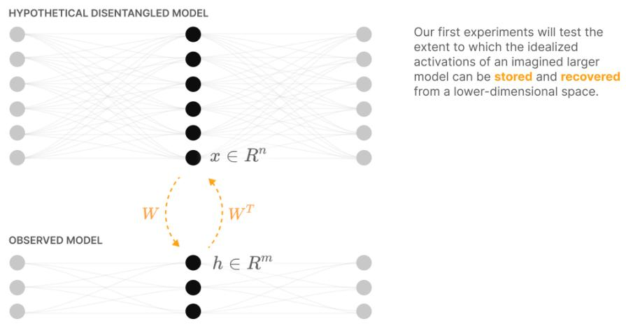

> ⬅️ 返回 [论文索引](../INDEX.MD) · Demonstrating Superposition

# ReLU-output toy model: experimental setup

见 [基本结果](../results/1-demonstrating-superposition.md)、[数学分析](2-mathematical-understanding.md) 和 [相变](../results/2-phase-change.md)。

## Demonstrating Superposition

If one takes the superposition hypothesis seriously, a natural first question is whether neural networks can actually noisily represent more features than they have neurons. If they can't, the superposition hypothesis may be comfortably dismissed.

The intuition from linear models would be that this isn't possible: the best a linear model can do is to store the principal components. But we'll see that adding just a slight nonlinearity can make models behave in a radically different way! This will be our first demonstration of superposition. (It will also be an object lesson in the complexity of even very simple neural networks.)

## Experiment Setup

Our goal is to explore whether a neural network can project a high dimensional vector $x \in R ^ { n }$ into a lower dimensional vector $h \in R ^ { m }$ and then recover it. 5

## THE FEATURE VECTOR (X)

We begin by describing the high-dimensional vector : the activations of our idealized,x

disentangled larger model. We call each element $x _ { i }$ a "feature" because we're imagining features to be perfectly aligned with neurons in the hypothetical larger model. In a vision model, this might be a Gabor filter, a curve detector, or a floppy ear detector. In a language model, it might correspond to a token referring to a specific famous person, or a clause being a particular kind of description.

Since we don't have any ground truth for features, we need to create synthetic data for whichx simulates any important properties we believe features have from the perspective of modeling them. We make three major assumptions:

Feature Sparsity: In the natural world, many features seem to be sparse in the sense that they only rarely occur. For example, in vision, most positions in an image don't contain a horizontal edge, or a curve, or a dog head . In language, most tokens don't refer to Martin[1] Luther King or aren't part of a clause describing music . This idea goes back to classical[2] work on vision and the statistics of natural images (see e.g. Olshausen, 1997, the section "Why Sparseness?" ). For this reason, we will choose a sparse distribution for our[24] features.

More Features Than Neurons: There are an enormous number of potentially useful features a model might represent. This imbalance between features and neurons in real models6 seems like it must be a central tension in neural network representations.

Features Vary in Importance: Not all features are equally useful to a given task. Some can reduce the loss more than others. For an ImageNet model, where classifying different species of dogs is a central task, a floppy ear detector might be one of the most important features it can have. In contrast, another feature might only very slightly improve performance.7

Concretely, our synthetic data is defined as follows: The input vectors are synthetic data intendedx to simulate the properties we believe the true underlying features of our task have. We consider each dimension $x _ { i }$ to be a "feature". Each one has an associated sparsity $S _ { i }$ and importance $I _ { i } .$ . We let $x _ { i } = 0$ with probability $S _ { i }$ , but is otherwise uniformly distributed between $[ 0 , 1 ] . ^ { 8 }$ In practice, we focus on the case where all features have the same sparsity, $S _ { i } = S$

$$
\text { THE   MODEL } (X \to X ^ {\prime})
$$

We will actually consider two models, which we motivate below. The first "linear model" is a well understood baseline which does not exhibit superposition. The second "ReLU output model" is a very simple model which does exhibit superposition. The two models vary only in the final activation function.

$$
\text { Linear   Model } \quad \text { ReLU   Output   Model }
$$

$$
\begin{array}{l l} h = W x & \quad h = W x \\ x ^ {\prime} = W ^ {T} h + b & \quad x ^ {\prime} = \operatorname{ReLU} (W ^ {T} h + b) \\ x ^ {\prime} = W ^ {T} W x + b & \quad x ^ {\prime} = \operatorname{ReLU} (W ^ {T} W x + b) \end{array}
$$

## Why these models?

The superposition hypothesis suggests that each feature in the higher-dimensional model corresponds to a direction in the lower-dimensional space. This means we can represent the down projection as a linear map $h = W x$ . Note that each column $W _ { i }$ corresponds to the direction in the lower-dimensional space that represents a feature $x _ { i }$

To recover the original vector, we'll use the transpose of the same matrix $W ^ { T }$ . This has the advantage of avoiding any ambiguity regarding what direction in the lower-dimensional space really corresponds to a feature. It also seems relatively mathematically principled , and empirically works.9

We also add a bias. One motivation for this is that it allows the model to set features it doesn't represent to their expected value. But we'll see later that the ability to set a negative bias is important for superposition for a second set of reasons – roughly, it allows models to discard small amounts of noise.

The final step is whether to add an activation function. This turns out to be critical to whether superposition occurs. In a real neural network, when features are actually used by the model to do computation, there will be an activation function, so it seems principled to include one at the end.

## THE LOSS

Our loss is weighted mean squared error weighted by the feature importances, ${ { I } _ { i , } }$ described above:

$$
L = \sum_ {x} \sum_ {i} I _ {i} (x _ {i} - x _ {i} ^ {\prime}) ^ {2}
$$

