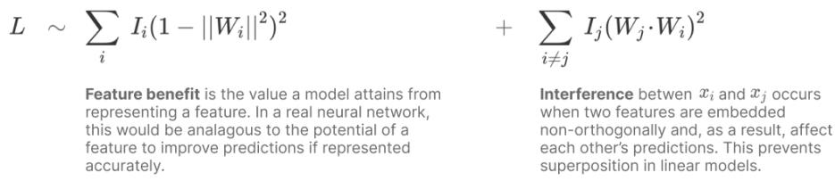

> ⬅️ 返回 [论文索引](../INDEX.MD) · Demonstrating Superposition

# Mathematical understanding of the ReLU-output model

见 [实验设置](1-relu-output.md)、[基本结果](../results/1-demonstrating-superposition.md) 和 [相变](../results/2-phase-change.md)。

## Mathematical Understanding

In the previous section, we observed a surprising empirical result: adding a ReLU to the output of our model allowed a radically different solution – superposition – which doesn't occur in linear models.

The model where it occurs is still quite mathematically simple. Can we analytically understand why superposition is occurring? And for that matter, why does adding a single non-linearity make things so different from the linear model case? It turns out that we can get a fairly satisfying answer, revealing that our model is governed by balancing two competing forces – feature benefit and interference – which will be useful intuition going forwards. We'll also discover a connection to the famous Thomson Problem in chemistry.

Let's start with the linear case. This is well understood by prior work! If one wants to understand why linear models don't exhibit superposition, the easy answer is to observe that linear models essentially perform PCA. But this isn't fully satisfying: if we set aside all our knowledge and intuition about linear functions for a moment, why exactly is it that superposition can't occur?

A deeper understanding can come from the results of Saxe et al. who study the learning[26] dynamics of linear neural networks – that is, neural networks without activation functions. Such models are ultimately linear functions, but because they are the composition of multiple linear functions the dynamics are potentially quite complex. The punchline of their paper reveals that neural network weights can be thought of as optimizing a simple closed-form solution. We can tweak their problem to be a bit more similar to our linear case, revealing the following equation:10

The Saxe results reveal that there are fundamentally two competing forces which control learning dynamics in the considered model. Firstly, the model can attain a better loss by representing more features (we've labeled this "feature benefit"). But it also gets a worse loss if it represents more than it can fit orthogonally due to "interference" between features. In fact, this makes it never11 worthwhile for the linear model to represent more features than it has dimensions.12

Can we achieve a similar kind of understanding for the ReLU output model? Concretely, we'd like to understand $\begin{array} { r } { L = \int _ { x } | | I ( x - \mathrm { R e L U } ( W ^ { T } W x + b ) ) | | ^ { 2 } d { \bf p } ( x ) } \end{array}$ where is distributed such thatx $x _ { i } = 0$ with probability .S

The integral over decomposes into a term for each sparsity pattern according to the binomialx expansion of $( ( 1 - S ) + S ) ^ { n }$ . We can group terms of the sparsity together, rewriting the loss as $L = ( 1 - S ) ^ { n } L _ { n } + . . . + \ ( 1 - S ) S ^ { n - 1 } L _ { 1 } + S ^ { n } L _ { 0 }$ , with each $L _ { k }$ corresponding to the loss when the input is a -sparse vector. Note that ask $S  1 , L _ { 1 }$ and $L _ { 0 }$ dominate. The term,L0 corresponding to the loss on a zero vector, is just a penalty on positive biases, $\begin{array} { r } { \sum _ { i } \mathrm { R e L U } ( b _ { i } ) ^ { 2 } } \end{array}$ . So the interesting term is $L _ { 1 }$ the loss on -sparse vectors:1

$$
L _ {1} = \sum_ {i} \int_ {0 \leq x _ {i} \leq 1} I _ {i} (x _ {i} - \operatorname{ReLU} (| | W _ {i} | | ^ {2} x _ {i} + b _ {i})) ^ {2} + \sum_ {i \neq j} \int_ {0 \leq x _ {i} \leq 1} I _ {j} \operatorname{ReLU} (W _ {j} \cdot W _ {i} x _ {i} + b _ {j}) ^ {2}
$$

If we focus on the case $x _ { i } = 1$ , we get something which looks even more analagous to the linear case:

$$
\begin{array}{l l} = \sum_ {i} I _ {i} (1 - \operatorname{ReLU} (| | W _ {i} | | ^ {2} + b _ {i})) ^ {2} & + \sum_ {i \neq j} I _ {j} \operatorname{ReLU} (W _ {j} \cdot W _ {i} + b _ {j}) ^ {2} \\ \text {Feature benefit is similar to before. Note that ReLU never makes things worse, and that the bias can help when the model doesn't represent a feature by taking on the expected value.} & \text {Interference is similar to before but ReLU means that negative interference, or interference where a negative bias pushes it below zero, is "free" in the 1 -sparse case.} \end{array}
$$

This new equation is vaguely similar to the famous Thomson problem in chemistry. In particular, if we assume uniform importance and that there are a fixed number of features with $\left| \left| W _ { i } \right| \right| = 1$ and the rest have $| | W _ { i } | | = 0$ , and that $b _ { i } = 0$ , then the feature benefit term is constant and the interference term becomes a generalized Thomson problem – we're just packing points on the surface of the sphere with a slightly unusual energy function. (We'll see this can be a productive analogy when we resume our empirical investigation in the following sections!)

Another interesting property is that ReLU makes negative interference free in the 1-sparse case. This explains why the solutions we've seen prefer to only have negative interference when possible. Further, using a negative bias can convert small positive interferences into essentially being negative interferences.

What about the terms corresponding to less sparse vectors? We leave explicitly writing these out to the reader, but the main idea is that there are multiple compounding interferences, and the "active features" can experience interference. In a later section, we'll see that features often organize themselves into sparse interference graphs such that only a small number of features interfere with another feature – it's interesting to note that this reduces the probability of compounding interference and makes the 1-sparse loss term more important relative to others.

