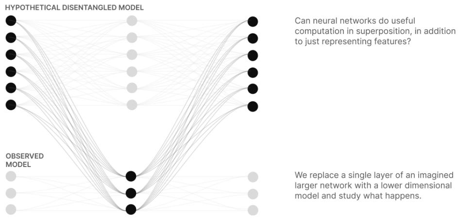

> ⬅️ 返回 [论文索引](../INDEX.MD) · Computation in Superposition

# Absolute-value toy model: experimental setup

见 [基本结果](../results/9-computation.md)。

## Computation in Superposition

So far, we've shown that neural networks can store sparse features in superposition and then recover them. But we actually believe superposition is more powerful than this – we think that neural networks can perform computation entirely in superposition rather than just using it as storage. This model will also give us a more principled way to study a privileged basis where features align with basis dimensions.

To explore this, we consider a new setup where we imagine our input and output layer to be the layers of our hypothetical disentangled model, but have our hidden layer be a smaller layer we're imagining to be the observed model which might use superposition. We'll then try to compute a simple non-linear function and explore whether it can use superposition to do this. Since the model will have (and need to use) the hidden layer non-linearity, we'll also see features align with a privileged basis.

Specifically, we'll have the model compute $y = \operatorname { a b s } ( x )$ . Absolute value is an appealing function to study because there's a very simple way to compute it with ReLU neurons: . This simple structure will make it easy for us to study theabs(x) = ReLU(x) + ReLU(−x) geometry of how the hidden layer is leveraged to do computation.

Since this model needs ReLU to compute absolute value, it doesn't have the issues the model in the previous section had with trying to avoid the activation function.

## Experiment Setup

The input feature vector, $x ,$ is still sparse, with each feature $x _ { i }$ having probability $S _ { i }$ of being .0 However, since we want to have the model compute absolute value, we need to allow it to take on non-positive values for this to be a non-trivial task. As a result, if it is non-zero, its value is now sampled uniformly from $[ - 1 , 1 ]$ . The target output is .y y = abs(x)

Following the previous section, we'll consider the "ReLU hidden layer" toy model variant, but no longer tie the two weights to be identical:

$$
h = \operatorname{ReLU} (W _ {1} x)
$$

$$
y ^ {\prime} = \operatorname{ReLU} (W _ {2} h + b)
$$

The loss is still the mean squared error weighted by feature importances $I _ { i }$ as before.

