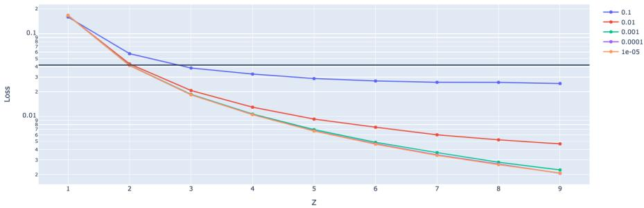

> ⬅️ 返回 [论文索引](../INDEX.MD) · Nonlinear Compression

# Nonlinear compression and compressed-sensing bounds

## Nonlinear Compression

This paper focuses on the assumption that representations are linear. But what if models don’t use linear feature directions to represent information? What might such a thing concretely look like?

Neural networks have nonlinearities that make it theoretically possible to compress information even more compactly than a linear superposition. There are reasons we think models are unlikely to pervasively use nonlinear compression schemes:

The model needs to decompress things before it can compute with them naturally: Most of the computation in the model is linear, so this kind of compression is likely only worth it to save space in the residual stream across many layers before being decompressed to be computed with linearly again.

They’re probably difficult to learn: Nonlinear compression schemes may require finely tuned approximations of discontinuities, and for the compression and decompression to line up, and may be difficult for gradient descent to learn.

They probably take enough neurons that the benefit over superposition isn’t worth it:

Representing the piecewise linear functions in the simple example with ReLU neurons using the universal function approximation result that each line segment takes two neurons, would require 12 neurons per Z segment, so only starts to beat linear compression at a combined 36 neurons for the compression and decompression.

This comparison has only one hidden dimension and dense features, which is somewhat of a degenerate case for superposition. Superposition is much more powerful for compression of sparse features in many dimensions. We suspect in large models the scaling is in favor of superposition, although this is just intuition and it’s possible that scaling nonlinear compression is competitive.

Regardless of whether large models end up using nonlinear compression, it should be possible to view directions being used with nonlinear compression as linear feature directions and reverse engineer the computation being used for compression like any other circuit. If this kind of encoding is pervasive throughout the network then it may merit some kind of automated decoding. It shouldn’t pose a fundamental challenge to interpretability unless the model learns a scheme for doing complex computation while staying in a complicated nonlinear representation, which we suspect is unlikely.

To help provide intuition, the simplest example of what a nonlinear compression scheme might look like is compressing two [0,1) dimensions x and y into a single [0,1) dimension t:

$$
t = \frac {\lfloor Z x \rfloor + y}{Z}
$$

This works by quantizing the dimension using some integerx $Z$ such that the floating point precision of is splitt between and . This particular function needs the discontinuous floor function to compute, and the discontinuousx y fmod function to invert, but models can’t compute discontinuous functions. However it’s possible to replace the discontinuities with steep linear segments that are only some epsilon value wide.

We can compare the mean squared error loss on random uniform dense values of and and see that even withx y epsilons as large as and0.1 $Z$ values as small as 3 the nonlinear compression outperforms linear compression such as picking one of the dimensions or using the average:

Nonlinear compression loss for varying epsilon vs linear compression reference line  

## Connection between compressed sensing lower bounds and the toy model

Here, we formalize the relationship between a compressed sensing lower bound and the toy model.

Let $T ( x ) : \mathbb { R } ^ { n }  \mathbb { R } ^ { n }$ be the complete toy model autoencoder defined by $T ( x ) = \mathrm { R e L U } ( W _ { 2 } W _ { 1 } x - b )$ for an m × n matrix $W _ { 1 }$ and an $n \times m$ matrix $W _ { 2 }$

## We derive the following theorem:

Theorem 1. Suppose that the toy model recovers all withx $T ( x )$ such that $\| T ( x ) - x \| _ { 2 } \leq \varepsilon$ for sufficiently small andε ε $W _ { 1 }$ has the $( \delta , k )$ restricted isometry property. The inner dimension of the projection matrix isW $m = \Omega ( k l o g ( n / k ) )$ .

We prove this result by framing our toy model as a compressed sensing algorithm. The primary barrier to doing so is that our optimization only searches for vectors that are close in $\ell _ { 2 }$ distance to the original vector and may not itself be exactly -sparse. The following lemma resolves this concern through a denoising step:k

Lemma 1. Suppose that we have a toy model $T ( x )$ with the properties in Theorem 1. Then there exists a compressed sensing algorithm $f ( \boldsymbol { y } ) : \mathbb { R } ^ { m }  \mathbb { R } ^ { n }$ for the measurement matrix $W _ { 1 }$

P f. We construct $f ( y )$ as follows. First, compute $\tilde { x } = \mathrm { R e L U } ( W _ { 2 } y - b )$ , as in $T ( x )$ . This produces the vector $\tilde { x } = T ( x )$ and so by supposition $\| T ( x ) - x \| _ { 2 } \leq \varepsilon$ . Next, we threshold to obtain by dropping all but its largestx\~ x\~′ k entries. Lastly, we solve the optimization problem: minx $\| x ^ { \prime } - \tilde { x } ^ { \prime } \|$ subject to $W _ { 1 } x ^ { \prime } = y _ { i }$ , which is convex because $x ^ { \prime }$ and $\tilde { x } ^ { \prime }$ have the same support. For sufficiently small (specifically, smaller than the ε ε $( k + 1 ) \mathrm { t h }$ largest entry in ), bothx x and the nearest -sparse vector to have the same support, and so the the convex optimization problem has a uniquek x solution: the nearest sparse vector to . Therefore, is a compressed sensing algorithm fork x f $W _ { 1 }$ with approximation factor 1. .

Lastly, we use the deterministic compressed sensing lower bound of Do Ba, Indyk, Price, and Woodruff :[49]

Theorem 2 (Corollary 3.1 in ). Given a matrix with the restricted isometry property, a sparse recovery[49] k × n A algorithm find a -sparse approximationk $\hat { x } \circ \dag x \in \mathbb { R } ^ { n }$ from such tha Ax

$$
\| x - \hat {x} \| _ {1} \leq C (k) \min _ {x ^ {\prime}, \| x ^ {\prime} \| _ {0} \leq k} \| x - x ^ {\prime} \| _ {1}
$$

for an approximation factor $C ( k ) . \mid \mid C ( k ) = O ( 1 )$ , then a sparse recovery algorithm exists only i $m = \Omega ( k \log ( n / k ) )$

Theorem 1 follows directly from Lemma 1 and Theorem 2.
