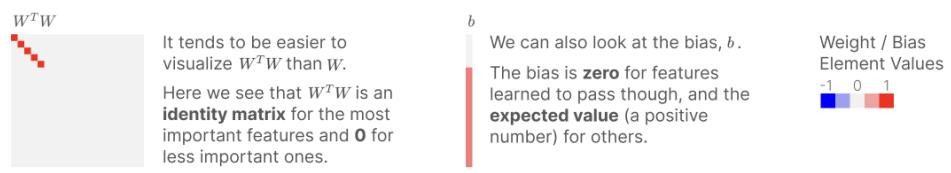
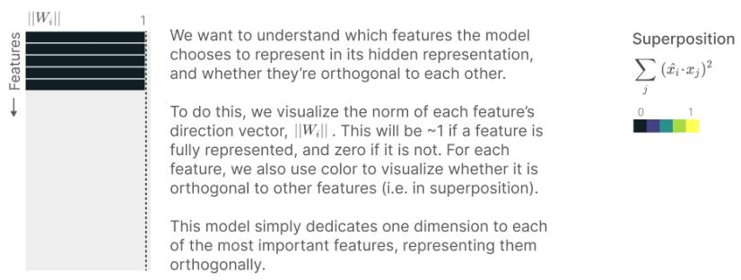
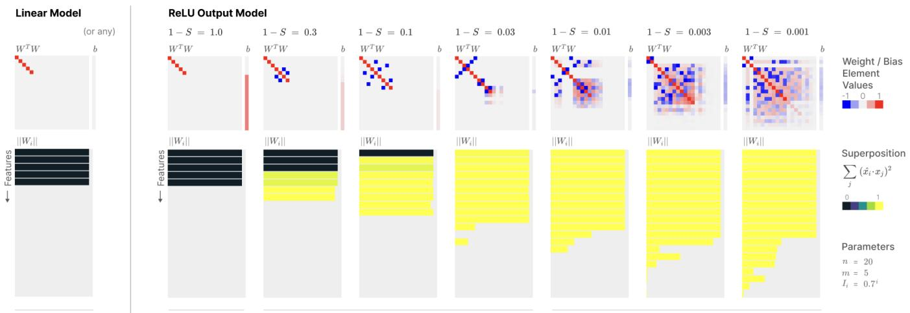
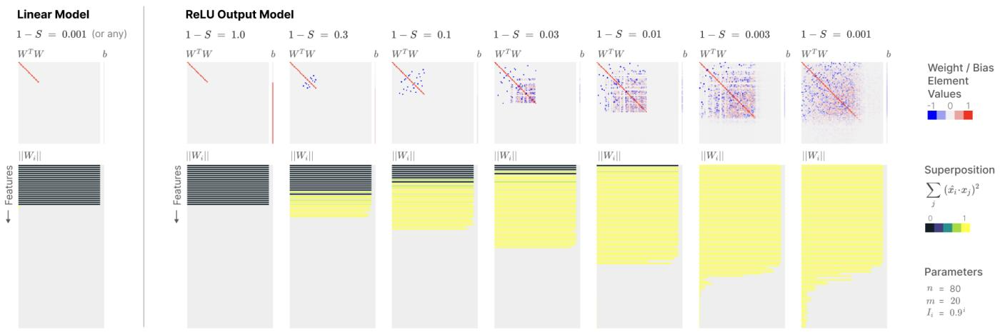

> ⬅️ 返回 [论文索引](../INDEX.MD) · Demonstrating Superposition

# Demonstrating superposition

见 [实验设置](../methods/1-relu-output.md)、[数学分析](../methods/2-mathematical-understanding.md) 和 [五特征示意](../figures/figure-1-five-features.md)。

## Basic Results

Our first experiment will simply be to train a few ReLU output models with different sparsity levels and visualize the results. (We'll also train a linear model – if optimized well enough, the linear model solution does not depend on sparsity level.)

The main question is how to visualize the results. The simplest way is to visualize $W ^ { T } W$ (a features by features matrix) and (a feature length vector). Note that features are arranged from mostb important to least, so the results have a fairly nice structure. Here's an example of what this type of visualization might look like, for a small model model $\left( n = 2 0 ; m = 5 ; \right)$ which behaves in the "expected linear model-like" way, only representing as many features as it has dimensions:

But the thing we really care about is this hypothesized phenomenon of superposition – does the model represent "extra features" by storing them non-orthogonally? Is there a way to get at it more explicitly? Well, one question is just how many features the model learns to represent. For any feature, whether or not it is represented is determined by $\left| \left| W _ { i } \right| \right|$ ∣, the norm of its embedding vector.

We'd also like to understand whether a given feature shares its dimension with other features. For this, we calculate $\textstyle \sum _ { j \neq i } ( { \hat { W } } _ { i } \cdot W _ { j } ) ^ { 2 }$ , projecting all other features onto the direction vector of $W _ { i }$ . It will be if the feature is orthogonal to other features (dark blue below). On the other hand, values0 $\geq 1$ mean that there is some group of other features which can activate $W _ { i }$ as strongly as feature i itself!

We can visualize the model we looked at previously this way:

Now that we have a way to visualize models, we can start to actually do experiments. We'll start by considering models with only a few features $( n = 2 0 ; m = 5 ; I _ { i } = 0 . 7 ^ { i } )$ . This will make it easy to visually see what happens. We consider a linear model, and several ReLU-output models trained on data with different feature sparsity levels:

  
In the high sparsity regime, models put all features in superposition, and continue packing more. Note that at this point we begin to see positive interference and negative biases. We'll talk about this more later.

As our standard intuitions would expect, the linear model always learns the top- most importantm features, analogous to learning the top principal components. The ReLU output model behaves the same on dense features $( 1 - S = 1 . 0 )$ , but as sparsity increases, we see superposition emerge. The model represents more features by having them not be orthogonal to each other. It starts with less important features, and gradually affects the most important ones. Initially this involves arranging them in antipodal pairs, where one feature’s representation vector is exactly the negative of the other’s, but we observe it gradually transition to other geometric structures as it represents more features. We'll discuss feature geometry further in the later section, The Geometry of Superposition.

The results are qualitatively similar for models with more features and hidden dimensions. For example, if we consider a model with $m = 2 0$ hidden dimensions and $n = 8 0$ features (with importance increased to $I _ { i } = 0 . 9 ^ { i }$ to account for having more features), we observe essentially a rescaled version of the visualization above:

