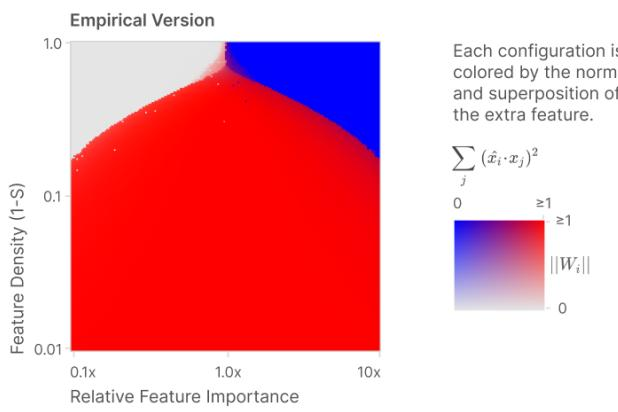
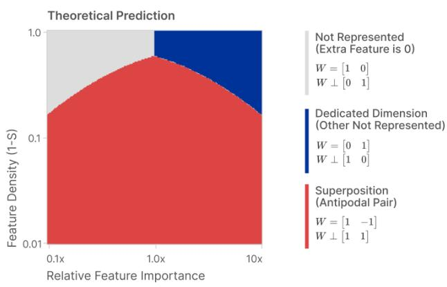
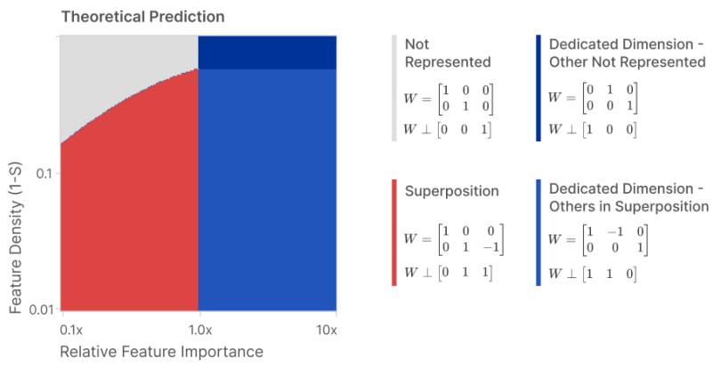
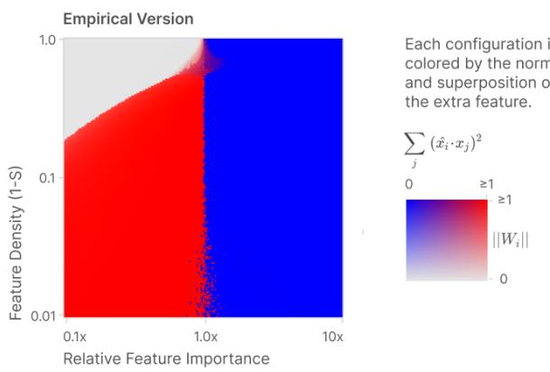

> ⬅️ 返回 [论文索引](../INDEX.MD) · Superposition as a Phase Change

# Superposition as a phase change

见 [输出 ReLU 玩具模型](../methods/1-relu-output.md) 和 [复现：损失曲面](../figures/replication-figure-1-loss-surfaces.md)。

## Superposition as a Phase Change

The results in the previous section seem to suggest that there are three outcomes for a feature when we train a model: (1) the feature may simply not be learned; (2) the feature may be learned, and represented in superposition; or (3) the model may represent a feature with a dedicated dimension. The transitions between these three outcomes seem sharp. Possibly, there's some kind of phase change.13

One way to understand this better is to explore if there's something like a "phase diagram" from physics, which could help us understand when a feature is expected to be in one of these regimes. Although we can see hints of this in our previous experiment, it's hard to really isolate what's going on because many features are changing at once and there may be interaction effects. As a result, we set up the following experiment to better isolate the effects.

As an initial experiment, we consider models with 2 features but only 1 hidden layer dimension. We still consider the ReLU output model, $\mathrm { R e L U } ( W ^ { T } W x - b )$ . The first feature has an importance of 1.0. On one axis, we vary the importance of the 2nd "extra" feature from 0.1 to 10. On the other axis, we vary the sparsity of all features from 1.0 to 0.01. We then plot whether the 2nd "extra" feature is not learned, learned in superposition, or learned and represented orthogonally. To reduce noise, we train ten models for each point and average over the results, discarding the model with the highest loss.

We can compare this to a theoretical "toy model of the toy model" where we can get closed form solutions for the loss of different weight configurations as a function of importance and sparsity. There are three natural ways to store 2 features in 1 dimension: $W = [ 1 , 0 ]$ (ignore , throwing[0, 1] away the extra feature), $W = [ 0 , 1 ]$ (ignore , throwing away the first feature to give the extra[1, 0] feature a dedicated dimension), and $W = [ 1 , - 1 ]$ (store the features in superposition, losing the ability to represent $[ 1 , 1 ]$ , the combination of both features at the same time). We call this last solution “antipodal” because the two basis vectors and are mapped in opposite[1, 0] [0, 1] directions. It turns out we can analytically determine the loss for these solutions (details can be found in this notebook).

## Sparsity-Relative Importance Phase Diagram (n=2, m=1)

What happens to an "extra feature" if the model can't give each feature a dimension? There are three possibilities, depending on feature sparsity and the extra feature's importance relative to other features:

Extra Feature is Not Represented Extra Feature Gets Dedicated Dimension Extra Feature is Stored In Superposition

We can both study this empirically and build a theoretical model:

  
Each configuration is colored by the norm and superposition of the extra feature.

As expected, sparsity is necessary for superposition to occur, but we can see that it interacts in an interesting way with relative feature importance. But most interestingly, there appears to be a real phase change, observed in both the empirical and theoretical diagrams! The optimal weight configuration discontinuously changes in magnitude and superposition. (In the theoretical model, we can analytically confirm that there's a first-order phase change: there's crossover between the functions, causing a discontinuity in the derivative of the optimal loss.)

We can ask this same question of embedding three features in two dimensions. This problem still has a single "extra feature" (now the third one) we can study, asking what happens as we vary its importance relative to the other two and change sparsity.

For the theoretical model, we now consider four natural solutions. We can describe solutions by asking "what feature direction did ignore?" For example,W $W$ might just not represent the extra feature – we'll write this $W \perp [ 0 , 0 , 1 ]$ . Or $W$ might ignore one of the other features, $W \perp [ 1 , 0 , 0 ]$ But the interesting thing is that there are two ways to use superposition to make antipodal pairs. We can put the "extra feature" in an antipodal pair with one of the others $( W \perp [ 0 , 1 , 1 ] )$ or put the other two features in superposition and give the extra feature a dedicated dimension $( W \perp [ 1 , 1 , 0 ]$ ). Details on the closed form losses for these solutions can be found in this notebook. We do not consider a last solution of putting all the features in joint superposition, $W \perp [ 1 , 1 , 1 ]$

Sparsity-Relative Importance Phase Diagram (n=3, m=2)  
  
Each configuration is colored by the norm and superposition of the extra feature.

These diagrams suggest that there really is a phase change between different strategies for encoding features. However, we'll see in the next section that there's much more complex structure this preliminary view doesn't capture.

