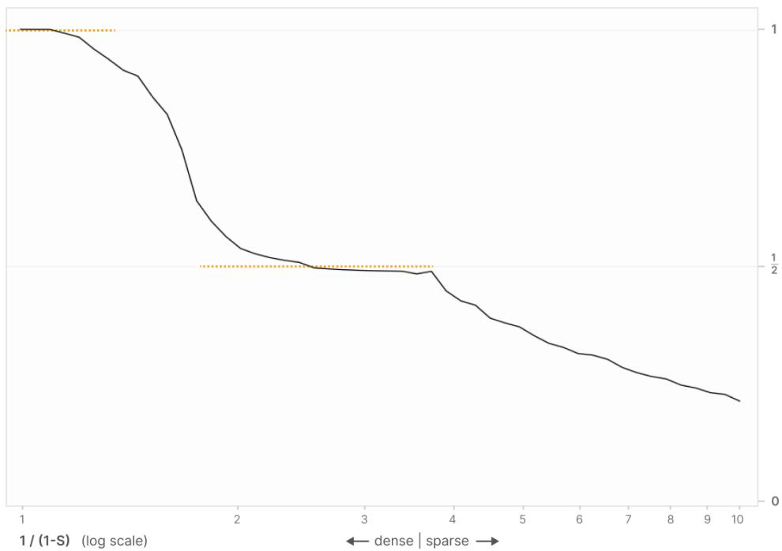
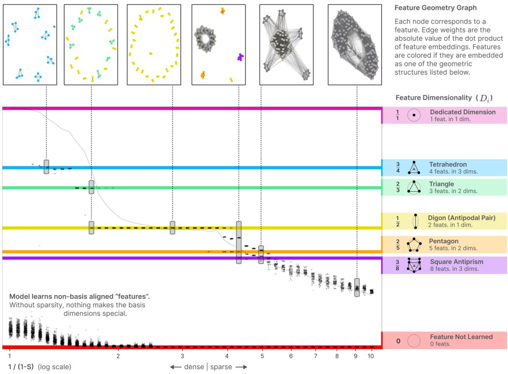
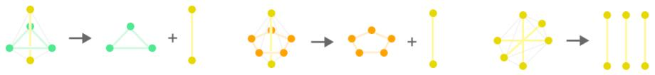
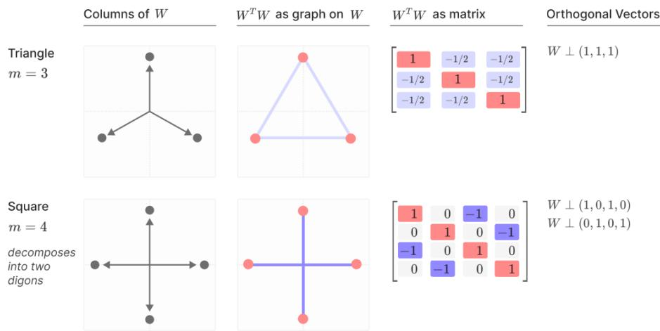

> ⬅️ 返回 [论文索引](../INDEX.MD) · The Geometry of Superposition

# Uniform superposition

下一节：[非均匀几何](4-non-uniform-geometry.md)。

## The Geometry of Superposition

We've seen that superposition can allow a model to represent extra features, and that the number of extra features increases as we increase sparsity. In this section, we'll investigate this relationship in more detail, discovering an unexpected geometric story: features seem to organize themselves into geometric structures such as pentagons and tetrahedrons! In some ways, the structure described in this section seems "too elegant to be true" and we think there's a good chance it's at least partly idiosyncratic to the toy model we're investigating. But it seems worth investigating because if anything about this generalizes to real models, it may give us a lot of leverage in understanding their representations.

We'll start by investigating uniform superposition, where all features are identical: independent, equally important and equally sparse. It turns out that uniform superposition has a surprising connection to the geometry of uniform polytopes! Later, we'll move on to investigate non-uniform superposition, where features are not identical. It turns out that this can be understood, at least to some extent, as a deformation of uniform superposition.

## Uniform Superposition

As mentioned above, we begin our investigation with uniform superposition, where all features have the same importance and sparsity. We'll see later that this case has some unexpected structure, but there's also a much more basic reason to study it: it's much easier to reason about than the nonuniform case, and has fewer variables we need to worry about in our experiments.

We'd like to understand what happens as we change feature sparsity, . Since all features areS equally important, we will assume without loss of generality that each feature has importance14 $I _ { i } = 1$ . We'll study a model with $n = 4 0 0$ features and $m = 3 0$ hidden dimensions, but it turns out the number of features and hidden dimensions doesn't matter very much. In particular, it turns out that the number of input features doesn't matter as long as it's much larger than the number ofn hidden dimensions, $n \gg m$ . And it also turns out that the number of hidden dimensions doesn't really matter as long as we're interested in the ratio of features learned to hidden features. Doubling the number of hidden dimensions just doubles the number of features the model learns.

A convenient way to measure the number of features the model has learned is to look at the Frobenius norm, $| | W | | _ { F } ^ { 2 }$ . Since $| | W _ { i } | | ^ { 2 } \simeq 1$ if a feature is represented and $| | W _ { i } | | ^ { 2 } \simeq 0$ if it is not, this is roughly the number of features the model has learned to represent. Conveniently, this norm is basis-independent, so it still behaves nicely in the dense regime $S = 0$ where the feature basis isn't privileged by anything and the model represents features with arbitrary directions instead.

We'll plot $D ^ { * } = m / | | W | | _ { F } ^ { 2 }$ , which we can think of as the "dimensions per feature":

  
Number of Hidden Dimensions per Embedded Feature $m / | | W | | _ { F } ^ { 2 }$  
Unexpectedly, we find that the number of dimensions per feature is "sticky" at 1 and 1/2. We denote this with...

Surprisingly, we find that this graph is "sticky" at and1 $1 / 2 .$ . (This very vaguely resembles the fractional quantum Hall effect – see e.g. this diagram.) Why is this? On inspection, the $1 / 2$ "sticky point" seems to correspond to a precise geometric arrangement where features come in "antipodal pairs", each being exactly the negative of the other, allowing two features to be packed into each hidden dimension. It appears that antipodal pairs are so effective that the model preferentially uses them over a wide range of the sparsity regime.

It turns out that antipodal pairs are just the tip of the iceberg. Hiding underneath this curve are a number of extremely specific geometric configurations of features.

## FEATURE DIMENSIONALITY

In the previous section, we saw that there's a sticky regime where the model has "half a dimension per feature" in some sense. This is an average statistical property of the features the model represents, but it seems to hint at something interesting. Is there a way we could understand what "fraction of a dimension" a specific feature gets?

We'll define the dimensionality of the th feature,i $D _ { i }$ , as:

$$
D _ {i} = \frac {| | W _ {i} | | ^ {2}}{\sum_ {j} (\hat {W} _ {i} \cdot W _ {j}) ^ {2}}
$$

where $W _ { i }$ is the weight vector column associated with the th feature, andi $\hat { W _ { i } }$ is the unit version of that vector.

Intuitively, the numerator represents the extent to which a given feature is represented, while the denominator is "how many features share the dimension it is embedded $\mathrm { i n } "$ by projecting each feature onto its dimension. In the antipodal case, each feature participating in an antipodal pair will have a dimensionality of $D = 1 / ( 1 + 1 ) = 1 / 2$ while features which are not learned will have a dimensionality of . Empirically, it seems that the dimensionality of all features add up to the number0 of embedding dimensions when the features are "packed efficiently" in some sense.

We can now break the above plot down on a per-feature basis. This reveals many more of these "sticky points"! To help us understand this better, we're going to create a scatter plot annotated with some additional information:

We start with the line plot we had in the previous section.

We overlay this with a scatter plot of the individual feature dimensionalities for each feature in the models at each sparsity level.

The feature dimensionalities cluster at certain fractions, so we draw lines for those. (It turns out that each fraction corresponds to a specific weight geometry – we'll discuss this shortly.)

We visualize the weight geometries for a few models with a "feature geometry graph" where each feature is a node and edge weights are based on the absolute value of the dot product feature embedding vectors. So features are connected if they aren't orthogonal.

Let's look at the resulting plot, and then we'll try to figure out what it's showing us:

What is going on with the points clustering at specific fractions?? We'll see shortly that the model likes to create specific weight geometries and kind of jumps between the different configurations.

In the previous section, we developed a theory of superposition as a phase change. But everything on this plot between 0 (not learning a feature) and 1 (dedicating a dimension to a feature) is superposition. Superposition is what happens when features have fractional dimensionality. That is to say – superposition isn't just one thing!

How can we relate this to our original understanding of the phase change? We often think of water as only having three phases: ice, water and steam. But this is a simplification: there are actually many phases of ice, often corresponding to different crystal structures (eg. hexagonal vs cubic ice). In a vaguely similar way, neural network features seem to also have many other phases within the general category of "superposition."

## WHY THESE GEOMETRIC STRUCTURES?

In the previous diagram, we found that there are distinct lines corresponding to dimensionality of: ¾ (tetrahedron), ⅔ (triangle), ½ (antipodal pair), ⅖ (pentagon), ⅜ (square antiprism), and 0 (feature not learned). We believe there would also be a 1 (dedicated dimension for a feature) line if not for the fact that basis features are indistinguishable from other directions in the dense regime.

Several of these configurations may jump out as solutions to the famous Thomson problem. (In particular, square antiprisms are much less famous than cubes and are primarily of note for their role in molecular geometry due to being a Thomson problem solution.) As we saw earlier, there is a very real sense in which our model can be understood as solving a generalized version of the Thomson problem. When our model chooses to represent a feature, the feature is embedded as a point on an m-dimensional sphere.

A second clue as to what's going on is that there are lines for the Thomson solutions which are uniform polyhedra (e.g. tetrahedron), but there seem to be split lines where we'd expect to see nonuniform solutions (e.g. instead of a ⅗ line for triangular bipyramids we see a co-occurence of points at ⅔ for triangles and points at ½ for a antipodes). In a uniform polyhedron, all vertices have the same geometry, and so if we embed features as them each feature has the same dimensionality. But if we embed features as a non-uniform polyhedron, different features will have more or less interference with others.

In particular, many of the Thomson solutions can be understood as tegum products (an operation which constructs polytopes by embedding two polytopes in orthogonal subspaces) of smaller uniform polytopes. (In the earlier graph visualizations of feature geometry, two subgraphs are disconnected if and only if they are in different tegum factors.) As a result, we should expect their dimensionality to actually correspond to the underlying factor uniform polytopes.

  
rather than 6×3/5 featurs.

This also suggests a possible reason why we observe 3D Thomson problem solutions, despite the fact that we're actually studying a higher dimensional version of the problem. Just as many 3D Thomson solutions are tegum products of 2D and 1D solutions, perhaps higher dimensional solutions are often tegum products of 1D, 2D, and 3D solutions.

The orthogonality of factors in tegum products has interesting implications. For the purposes of superposition, it means that there can't be any "interference" across tegum-factors. This may be preferred by the toy model: having many features interfere simultaneously could be really bad for it. (See related discussion in our earlier mathematical analysis.)

## Aside: Polytopes and Low-Rank Matrices

At this point, it's worth making explicit that there's a correspondence between polytopes and symmetric, positive-definite, low-rank matrices (i.e. matrices of the form ). ThisWT W correspondence underlies the results we saw in the previous section, and is generally useful for thinking about superposition.

In some ways, the correspondence is trivial. If one has a rank- -matrix of the form ,m n×n WT W then is a -matrix. We can interpret the columns of as points in a -dimensionalW n×m W n m space. The place where this starts to become interesting is that it makes it clear that isWT W driven by the geometry. In particular, we can see how the off-diagonal terms are driven by the geometry of the points.

Put another way, there's an exact correspondence between polytopes and strategies for superposition. For example, every strategy for putting three features in superposition in a 2- dimensional space corresponds to a triangle, and every triangle corresponds to such a strategy. From this perspective, it doesn't seem surprising that if we have three equally important and equally sparse features, the optimal strategy is an equilateral triangle.

  
This correspondence also goes the other direction. Suppose we have a rank $( n - i )$ -matrix of the form $W ^ { T } W$ . We can characterize it by the dimensions did not represent – that is, whichW directions are orthogonal to ? For example, if we have aW $( n { - } 1 )$ -matrix, we might ask what single direction did not represent? This is especially informative if we assume thatW $W ^ { T } W$ will be as "identity-like" as possible, given the constraint of not representing certain vectors.

In fact, given such a set of orthogonal vectors, we can construct a polytope by starting with basisn vectors and projecting them to a space orthogonal to the given vectors. For example, if we start in three dimensions and then project such that $W \perp ( 1 , 1 , 1 )$ , we get a triangle. More generally, setting $W \perp ( 1 , 1 , 1 , \ldots )$ gives us a regular -simplex. This is interesting because it's in some n sense the "minimal possible superposition." Assuming that features are equally important and sparse, the best possible direction to not represent is the fully dense vector $( 1 , 1 , 1 , \ldots ) !$

