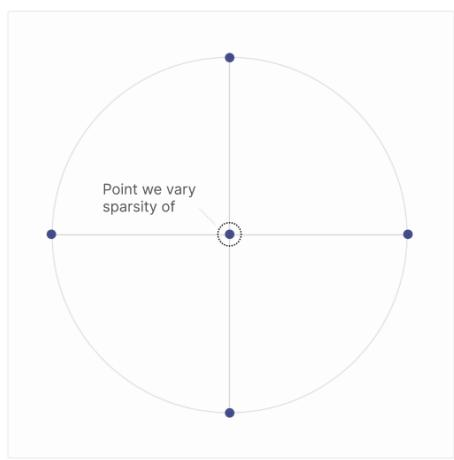
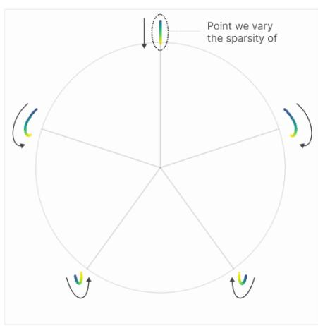
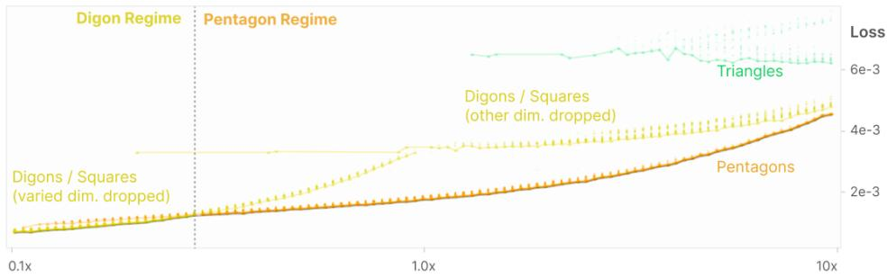

> ⬅️ 返回 [论文索引](../INDEX.MD) · The Geometry of Superposition

# Non-uniform superposition

见 [均匀情形](3-uniform-geometry.md) 和 [相对特征密度表](../tables/table-1-relative-feature-density.md)。

## Non-Uniform Superposition

So far, this section has focused on the geometry of uniform superposition, where all features are of equal importance, equal sparsity, and independent. The model is essentially solving a variant of the Thomson problem. Because all features are the same, solutions corresponding to uniform polyhedra get especially low loss. In this subsection, we'll study non-uniform superposition, where features are somehow not uniform. They may vary in importance and sparsity, or have a correlational structure that makes them not independent. This distorts the uniform geometry we saw earlier.

In practice, it seems like superposition in real neural networks will be non-uniform, so developing an understanding of it seems important. Unfortunately, we're far from a comprehensive theory of the geometry of non-uniform superposition at this point. As a result, the goal of this section will merely be to highlight some of the more striking phenomena we observe:

Features varying in importance or sparsity causes smooth deformation of polytopes as the imbalance builds, up until a critical breaking point at which they snap to another polytope.

Correlated features prefer to be orthogonal, often forming in different tegum factors. As a result, correlated features may form an orthogonal local basis. When they can't be orthogonal, they prefer to be side-by-side. In some cases correlated features merge into a single feature: this hints at some kind of interaction between "superposition-like behavior" and "PCA-like behavior".

Anti-correlated features prefer to be in the same tegum factor when superposition is necessary. They prefer to have negative interference, ideally being antipodal.

We attempt to illustrate these phenomena with some representative experiments below.

## PERTURBING A SINGLE FEATURE

The simplest kind of non-uniform superposition is to vary one feature and leave the others uniform. As an experiment, let's consider an experiment where we represent features inn = 5 m = 2 dimensions. In the uniform case, with importance and activation density , weI = 1 1 − S = 0.05 get a regular pentagon. But if we vary one point – in this case we'll make it more or less sparse – we see the pentagram stretch to account for the new value. If we make it denser, activating more frequently (yellow) the other features repel from it, giving it more space. On the other hand, if we make it sparser, activating less frequently (blue) it takes less space and other points push towards it.

If we make it sufficiently sparse, there's a phase change, and it collapses from a pentagon to a pair of digons with the sparser point at zero. The phase change corresponds to loss curves corresponding to the two different geometries crossing over. (This observation allows us to directly confirm that it is genuinely a first order phase change.)

To visualize the solutions, we canonicalize them, rotating them to align with each other in a consistent manner.

Digon (Square) Solutions  

Pentagon Solutions  
  
When the sparsity of the varied point falls below a certain critical threshold (\~2.5x less than others) the pentagon solution changes to two digons.  
Note how vertices shift as sparsity changes

To study non-uniform sparsity, we consider models with five features, varying the sparsity of a single feature and observing how the resulting solutions change. We observe a mixture of continuous deformation and sharp phase changes.

Parameters: [Relative Feature Density ($1-S$)](../tables/table-1-relative-feature-density.md).

The Pentagon-Digon Phase Change Corresponds to a Loss Curve Crossover

  
Gradient descent has trouble moving between solutions associated with different geometries. As a result, fitting the model will often produce non-optimal solutions. By characterizing and plotting these, we can see that each geometry creates a different loss curve, and that the pentagon-digon phase change corresponds to a cross over between the curves.

These results seem to suggest that, at least in some cases, non-uniform superposition can be understood as a deformation of uniform superposition andjumping between uniform superposition configurations rather than a totally different regime. Since uniform superposition has a lot of understandable structure, but real world superposition is almost certainly non-uniform, this seems very promising!

The reason pentagonal solutions are not on the unit circle is because models reduce the effect of positive interference, setting a slight negative bias to cut off noise and setting their weights to $| | W _ { i } | | = 1 / ( 1 - b _ { i } )$ to compensate. Distance from the unit circle can be interpreted as primarily driven by the amount of positive interference.

A note for reimplementations: optimizing with a two-dimensional hidden space makes this easier to study, but the actual optimization process to be really challenging from gradient descent – a lot harder than even just having three dimensions. Getting clean results required fitting each model multiple times and taking the solution with the lowest loss. However, there's a silver lining to this: visualizing the sub-optimal solutions on a scatter plot as above allows us to see the loss curves for different geometries and gain greater insight into the phase change.

