> ⬅️ 返回 [论文索引](../INDEX.MD) · Correlated and Anticorrelated Features

# Correlated and anticorrelated features

本节比较不同共现结构对特征方向的影响。

## Correlated and Anticorrelated Features

A more complicated form of non-uniform superposition occurs when there are correlations between features. This seems essential for understanding superposition in the real world, where many features are correlated or anti-correlated.

For example, one very pragmatic question to ask is whether we should expect polysemantic neurons to group the same features together across models. If the groupings were random, you could use this to detect polysemantic neurons, by comparing across models! However, we'll see that correlational structure strongly influences which features are grouped together in superposition.

The behavior seems to be quite nuanced, with a kind of "order of preferences" for how correlated features behave in superposition. The model ideally represents correlated features orthogonally, in separate tegum factors with no interactions between them. When that fails, it prefers to arrange them so that they're as close together as possible – it prefers positive interference between correlated features over negative interference. Finally, when there isn't enough space to represen all the correlated features, it will collapse them and represent their principal component instead! Conversely, when features are anti-correlated, models prefer to have them interfere, especially with negative interference. We'll demonstrate this with a few experiments below.

## SETUP FOR EXPLORING CORRELATED AND ANTICORRELATED FEATURES

Throughout this section we'll refer to "correlated feature sets" and "anticorrelated feature sets".

Correlated Feature Sets. Our correlated feature sets can be thought of as "bundles" of cooccurring features. One can imagine a highly idealized version of what might happen in an image classifier: there could be a bundle of features used to identify animals (fur, ears, eyes) and another bundle used to identify buildings (corners, windows, doors). Features from one of these bundles are likely to appear together. Mathematically, we represent this by linking the choice of whether all the features in a correlated feature set are zero or not together. Recall that we originally defined our synthetic distribution to have features be zero with probability and otherwise uniformlyS distributed between [0,1]. We simply have the same sample determine whether they're zero.

Anticorrelated Feature Sets. One could also imagine anticorrelated features which are extremely unlikely to occur together. To simulate these, we'll have anticorrelated feature sets where only one feature in the set can be active at a time. To simulate this, we'll have the feature set be entirely zero with probability , but then only have one randomly selected feature in the set be uniformlyS sampled from [0,1] if it's active, with the others being zero.

## ORGANIZATION OF CORRELATED AND ANTICORRELATED FEATURES

For our initial investigation, we simply train a number of small toy models with correlated and anticorrelated features and observe what happens. To make this easy to study, we limit ourselves to the case where we can explicitly visualize the weights as points in 2D space. In general, suchm = 2 solutions can be understood as a collection of points on a unit circle. To make solutions easy to compare, we rotate and flip solutions to align with each other.

## Models prefer to represent correlated features in orthogonal dimensions.

We train several models with 2 sets of 2 correlated features (n=4 total) and a m=2 hidden dimensions. We then visualize the weight column for each feature. For ease of comparison, we rotate and flip solutions to have a consistent orientation

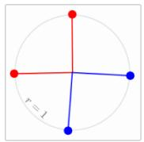

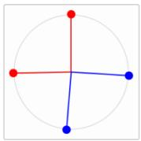

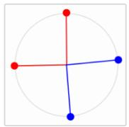

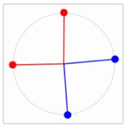

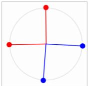  
anddenote correlated feature sets.  
Correlated feature sets are constructed by having them always co-occur (ie. be zero or not) at the same time.

## Models prefer to represent anticorrelated features in opposite directions.

We train several models with 2 sets of 2 anticorrelated features (n=4 total) and a m=2 hidden dimensions. We then visualize the weight column for each feature. For ease of comparison, we rotate and flip solutions to have a consistent orientation

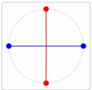

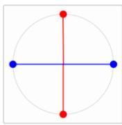

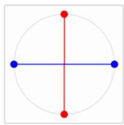

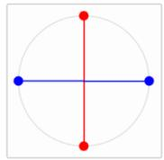

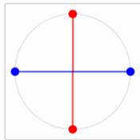  
anddenote anticorrelated feature sets.  
Anticorrelated feature sets are constructed by having them never co-occur (ie. be zero or not) at the same time.

## Models prefer to arrange correlated features side by side if they can't be orthogonal.

We train several models with 3 sets of 2 correlated features (n=6 total) and a m=2 hidden dimensions. We then visualize the weight column for each feature. For ease of comparison, we rotate and flip solutions to have a consistent orientation. (Note that models will not embed 6 independent features as a hexagon like this.)

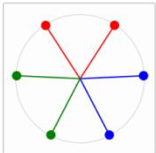

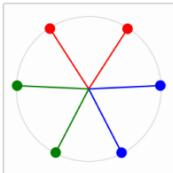

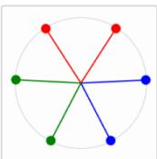

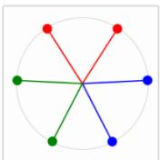

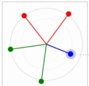  
●,●, and ● denote correlated feature sets.  
Sometimes correlated feature sets "collapse". In this case it's an optimization failure, but we'll return to it shortly as an important phennomenon.

## LOCAL ALMOST-ORTHOGONAL BASES

It turns out that the tendency of models to arrange correlated features to be orthogonal is actually quite a strong phenomenon. In particular, for larger models, it seems to generate a kind of "loca almost-orthogonal basis" where, even though the model as a whole is in superposition, the correlated feature sets considered in isolation are (nearly) orthogonal and can be understood as having very little superposition.

To investigate this, we train a larger model with two sets of correlated features and visualize $W ^ { T } W$

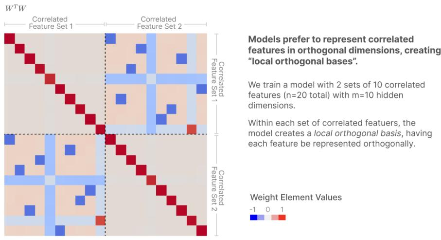  
No Features Collapsed Approximately 1-S ≤ 0.05  
If this result holds in real neural networks, it suggests we might be able to make a kind of "local nonsuperposition" assumption, where for certain sub-distributions we can assume that the activating features are not in superposition. This could be a powerful result, allowing us to confidently use methods such as PCA which might not be principled to generally use in the context of superposition.

## COLLAPSING OF CORRELATED FEATURES

One of the most interesting properties is that there seems to be a trade off with Principal Components Analysis (PCA) and superposition. If there are two correlated features anda $b ,$ but the model only has capacity to represent one, the model will represent their principal component $( a + b ) / \sqrt { 2 } ,$ , a sparse variable that has more impact on the loss than either individually, and ignore the second principal component $( a - b ) / { \sqrt { 2 } } .$

As an experiment, we consider six features, organized into three sets of correlated pairs. Features in each correlated pair are represented by a given color (red, green, and blue). The correlation is created by having both features always activate together – they're either both zero or neither zero. (The exact non-zero values they take when they activate is uncorrelated.)

As we vary the sparsity of the features, we find that in the very sparse regime, we observe superposition as expected, with features arranged in a hexagon and correlated features side-byside. As we decrease sparsity, the features progressively "collapse" into their principal components. In very dense regimes, the solution becomes equivalent to PCA.

1 Solutions are "more PCA-like'  
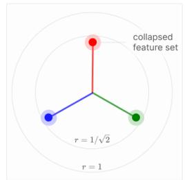

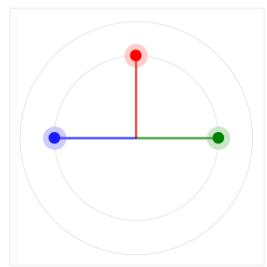  
All Sets of Features Collapsed Approximately 0.25 ≤ 1-S ≤ 0.5

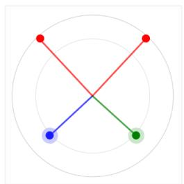  
Two Sets of Features Collapsed Approximately 0.15 ≤ 1-S ≤ 0.2

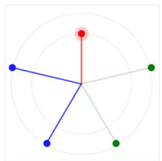  
One Set of Features Collapsed Approximately 0.05 ≤ 1-S ≤ 0.15

Solutions involve more superposition  
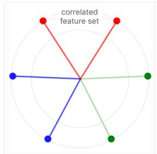

These results seem to hint that PCA and superposition are in some sense complementary strategies which trade off with one another. As features become more correlated, PCA becomes a better strategy. As features become sparser, superposition becomes a better strategy. When features are both sparse and correlated, mixtures of each strategy seem to occur. It would be nice to more deeply understand this space of tradeoffs.

It's also interesting to think about this in the context of continuous equivariant features, such as features which occur in different rotations.

