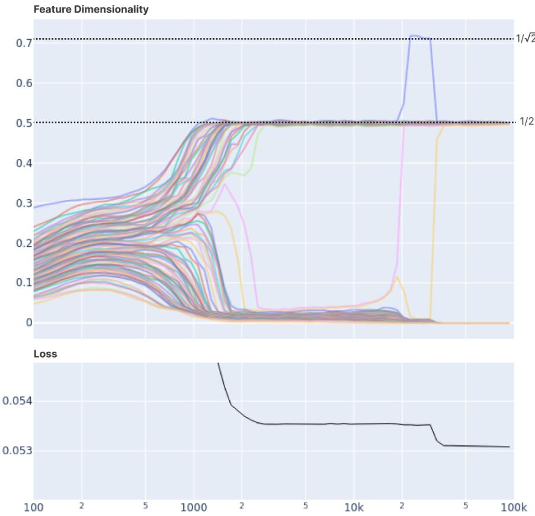
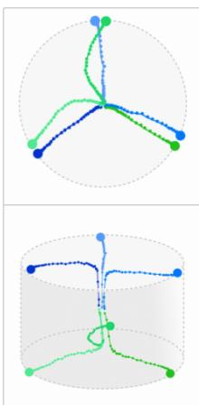
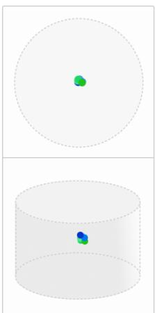
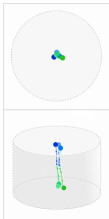
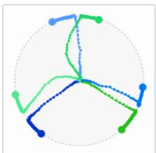
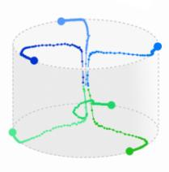
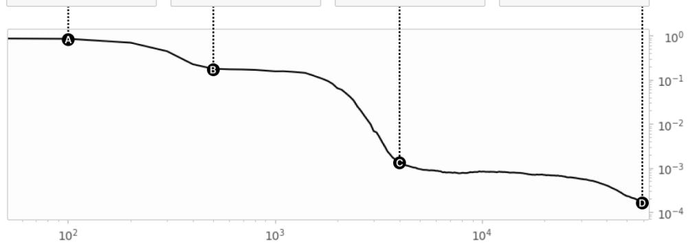
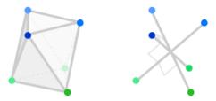

> ⬅️ 返回 [论文索引](../INDEX.MD) · Superposition and Learning Dynamics

# Superposition and learning dynamics

见 [均匀几何](3-uniform-geometry.md) 中的几何术语。

## Superposition and Learning Dynamics

The focus of this paper is how superposition contributes to the functioning of fully trained neura networks, but as a brief detour it's interesting to ask how our toy models – and the resulting superposition – evolve over the course of training.

There are several reasons why these models seem like a particularly interesting case for studying learning dynamics. Firstly, unlike most neural networks, the fully trained models converge to a simple but non-trivial structure that rhymes with an emerging thread of evidence that neural network learning dynamics might have geometric weight structure that we can understand. One might hope that understanding the final structure would make it easier for us to understand the evolution over training. Secondly, superposition hints at surprisingly discrete structure (regular polytopes of all things!). We'll find that the underlying learning dynamics are also surprisingly discrete, continuing an emerging trend of evidence that neural network learning might be less continuous than it seems. Finally, since superposition has significant implications for interpretability, it would be nice to understand how it emerges over training – should we expect models to use superposition early on, or is it something that only emerges later in training, as models struggle to fit more features in?

Unfortunately, we aren't able to give these questions the detailed investigation they deserve within the scope of this paper. Instead, we'll limit ourselves to a couple particularly striking phenomena we've noticed, leaving more detailed investigation for future work.

## PHENOMENON 1: DISCRETE "ENERGY LEVEL" JUMPS

Perhaps the most striking phenomenon we've noticed is that the learning dynamics of toy models with large numbers of features appear to be dominated by "energy level jumps" where features jump between different feature dimensionalities. (Recall that a feature's dimensionality is the fraction of a dimension dedicated to representing a feature.)

Let's consider the problem setup we studied when investigating the geometry of uniform superposition in the previous section, where we have a large number of features of equal importance and sparsity. As we saw previously, the features ultimately arrange themselves into a small number of polytopes with fractional dimensionalities.

A natural question to ask is what happens to these feature dimensionalities over the course of training. Let's pick one model where all the features converge into digons and observe. In the first plot, each colored line corresponds to the dimensionality of a single feature. The second plot shows how the loss curve changes over the same duration.

Note how the dimensionality of some features "jump" between different values and swap places. As this happens, the loss curve also undergoes a sudden drop (a very small one at the first jump, and a larger one at the second jump).

These results make us suspect that seemingly smooth decreases of the loss curve in larger models are in fact composed of many small jumps of features between different configurations. (For similar results of sudden mechanistic changes, see Olsson et al.'s induction head phase change , and[27] Nanda and Lieberum's results on phase changes in modular arithmetic . More broadly, consider[28] the phenomenon of grokking .)[29]

## PHENOMENON 2: LEARNING AS GEOMETRIC TRANSFORMATIONS

Many of our toy model solutions can be understood as corresponding to geometric structures. This is especially easy to see and study when there are only hidden dimensions, since we canm = 3 just directly visualize the feature embeddings as points in 3D space forming a polyhedron.

It turns out that, at least in some cases, the learning dynamics leading to these structures can be understood as a sequence of simple, independent geometric transformations!

One particularly interesting example of this phenomenon occurs in the context of correlated features, as studied in the previous section. Consider the problem of representing features inn = 6 superposition within dimensions. If we have the features be sets of correlated features,m = 3 6 2 3 we observe a really interesting pattern. The learning proceeds in distinct regimes which are visible in the loss curve, with each regime corresponding to a distinct geometric transformation:

  
Initially, weights are initialized randomly close to zero.

  
B The first change in training is that the two sets of correlated features push apart one axis.

  
©Next, each set of correlated features expands into a triangle.

  
Finally, the triangles rotate into an antiprism.

  
Training Steps  
Feature Weight Trajectories (top and 3D perspecitve)  
anddenote correlated feature sets.  
Note that the resulting triangular antiprism is equivelant to a octahedron with features forming antipodal pairs with features from a different correlated feature set.

(Although the last solution – an octahedron with features from different correlated sets arranged in antipodal pairs – seems to be a strong attractor, the learning trajectory visualized above appears to be one of a few different learning trajectories that attract the model. The different trajectories vary at step C : sometimes the model gets pulled directly into the antiprism configuration from the start or organize features into antipodal pairs. Presumably this depends on which feature geometry the model is closest to when step B ends.)

The learning dynamics we observe here seem directly related to previous findings on simple models. found that two-layer neural networks, in early stages of training, tend to learn a linea[30] approximation to a problem. Although the technicalities of our data generation process do not precisely match the hypotheses of their theorem, it seems likely that the same basic mechanism is at work. In our case, we see the toy network learns a linear PCA solution before moving to a better nonlinear solution. A second related finding comes from , who looked at hierarchical sets of[31] features, with a data generation process similar to the one we consider. They find empirically that certain networks (nonlinear and deep linear) “split” embedding vectors in a manner very much like what we observed. They also provide a theoretical analysis in terms of the underlying dynamical system. A key difference is that they focus on the topology—the branching structure of the emerging feature representations—rather than the geometry. Despite this difference, it seems likely that their analysis could be generalized to our case.

## Loss Curve

The loss curve goes through several distinct regimes corresponding to different geometric transformations of the weights (as seen above)

