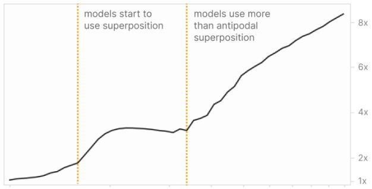
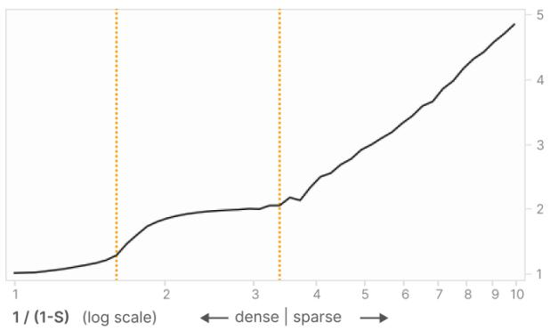
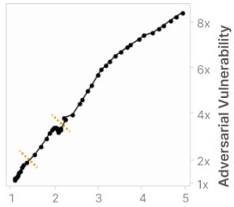

> ⬅️ 返回 [论文索引](../INDEX.MD) · Relationship to Adversarial Robustness

# Relationship to adversarial robustness

本节报告玩具实验及其与真实网络中对抗样本的可能联系。

# Relationship to Adversarial Robustness

Although we're most interested in the implications of superposition for interpretability, there appears to be a connection to adversarial examples. If one gives it a little thought, this connection can actually be quite intuitive.

In a model without superposition, the end-to-end weights for the first feature are:

$$
(W ^ {T} W) _ {0} = (1, 0, 0, 0, \dots)
$$

But in a model with superposition, it's something like:

$$
(W ^ {T} W) _ {0} = (1, \epsilon , - \epsilon , \epsilon , \dots)
$$

The entries (which are solely an artifact of superposition "interference") create an obvious way forϵ an adversary to attack the most important feature. Note that this may remain true even in the infinite data limit: the optimal behavior of the model fit to sparse infinite data is to use superposition to represent more features, leaving it vulnerable to attack.

To test this, we generated L2 adversarial examples (allowing a max L2 attack norm of 0.1 of the average input norm). We originally generated attacks with gradient descent, but found that for extremely sparse examples where ReLU neurons are in the zero regime 99% of the time, attacks were difficult, effectively due to gradient masking . Instead, we found it worked better to[32] analytically derive adversarial attacks by considering the optimal L2 attacks for each feature ( $\lambda ( W ^ { T } W ) _ { i } / | | ( W ^ { T } W ) _ { i } | | _ { 2 } )$ and taking the one of these attacks which most harms model performance.

We find that vulnerability to adversarial examples sharply increases as superposition forms (increasing by >3x), and that the level of vulnerability closely tracks the number of features per dimension (the reciprocal of feature dimensionality).

  
Vulnerability to Adversarial Examples (Relative to Non-Superposition Model)

$$
(L ^ {\prime} - L) / (L _ {0} ^ {\prime} - L _ {0})
$$

The model's vulnerability to adversarial examples increases with feature sparsity, tracking the "features per dimension' measure of superposition plottec below.

Features Per Dimension

$$
1 / D ^ {*} = | | W | | _ {F} ^ {2} / m
$$

Here we plot the number of features per dimension, the reciprocal of the "dimensionality' we defined in the pervious section. We see that the curve closely parallels vulnerability to adversarial examples.

  
Features Per Dimension

We can also directly plot adversarial vulnerability agains the number of features per dimension. This reveals that adversarial vulnerability is highly correlated with the number of features stored in superposition per dimension.

We're hesitant to speculate about the extent to which superposition is responsible for adversarial examples in practice. There are compelling theories for why adversarial examples occur without reference to superposition (e.g. ). But it is interesting to note that if one wanted to try to argue[33] for a "superposition maximalist stance", it does seem like many interesting phenomena related to adversarial examples can be predicted from superposition. As seen above, superposition can be used to explain why adversarial examples exist. It also predicts that adversarially robust models would have worse performance, since making models robust would require giving up superposition and representing less features. It predicts that more adversarially robust models might be more interpretable (see e.g. ). Finally, it could arguably predict that adversarial examples transfer (see[34] e.g. ) if the arrangement of features in superposition is heavily influenced by which features are[35] correlated or anti-correlated (see earlier results on this). It might be interesting for future work to see how far the hypothesis that superposition is a significant contributor to adversarial examples can be driven.

In addition to observing that superposition can cause models to be vulnerable to adversaria examples, we briefly experimented with adversarial training to see if the relationship could be used in the other direction to reduce superposition. To keep training reasonably efficient, we used the analytic optimal attack against a random feature. We found that this did reduce superposition, but attacks had to be made unreasonably large (80% input L2 norm) to fully eliminate it, which didn't seem satisfying. Perhaps stronger adversarial attacks would work better. We didn't explore this further since the increased cost and complexity of adversarial training made us want to prioritize other lines of attack on superposition first.

