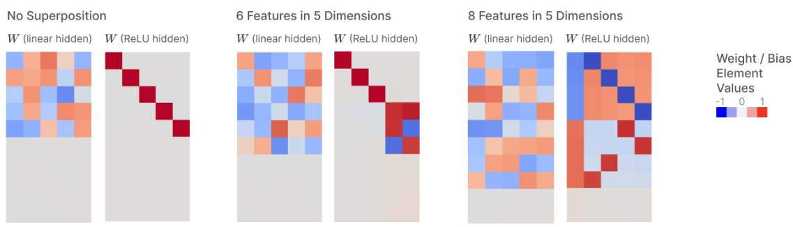
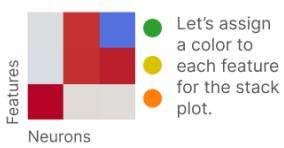
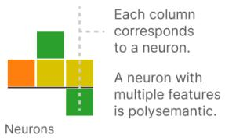
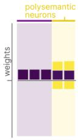
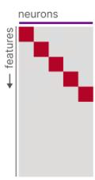
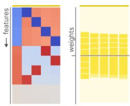
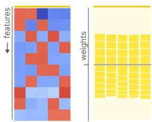
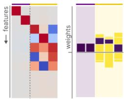
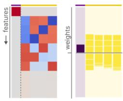
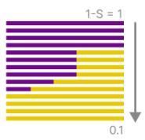

> ⬅️ 返回 [论文索引](../INDEX.MD) · Superposition in a Privileged Basis

# Superposition in a privileged basis

见 [基底定义](../introduction/definitions-and-motivation.md) 和 [叠加中的计算](9-computation.md)。

# Superposition in a Privileged Basis

So far, we've explored superposition in a model without a privileged basis. We can rotate the hidden activations arbitrarily and, as long as we rotate all the weights, have the exact same model behavior. That is, for any ReLU output model with weights , we could take an arbitrary orthogonal matrixW O and consider the mode $W ^ { \prime } = O W$ . Since $( O W ) ^ { T } ( O W ) = W ^ { T } W$ , the result would be an identical model!

Models without a privileged basis are elegant, and can be an interesting analogue for certain neural network representations which don't have a privileged basis – word embeddings, or the transformer residual stream. But we'd also (and perhaps primarily) like to understand neural network representations where there are neurons which do impose a privileged basis, such as transformer MLP layers or conv net neurons.

Our goal in this section is to explore the simplest toy model which gives us a privileged basis. There are at least two ways we could do this: we could add an activation function or apply L1 regularization to the hidden layer. We'll focus on adding an activation function, since the representation we are most interested in understanding is hidden layers with neurons, such as the transformer MLP layer.

This gives us the following "ReLU hidden layer" model:

$$
h = \operatorname{ReLU} (W x)
$$

$$
x ^ {\prime} = \operatorname{ReLU} (W ^ {T} h + b)
$$

We'll train this model on the same data as before.

Adding a ReLU to the hidden layer radically changes the model from an interpretability perspective. The key thing is that while in our previous model was challenging to interpret (recall that weW visualized $W ^ { T } W$ rather than ), in the ReLU hidden layer model can be directly interpreted,W W since it connects features to basis-aligned neurons.

We'll discuss this in much more detail shortly, but here's a comparison of weights resulting from a linear hidden layer model and a ReLU hidden layer model:

Recall that we think of basis elements in the input as "features," and basis elements in the middle layer as "neurons". Thus is a map from features to neurons.W

What we see in the above plot is that the features are aligning with neurons in a structured way! Many of the neurons are simply dedicated to representing a feature! (This is the critical property that justifies why neuron-focused interpretability approaches – such as much of the work in the original Circuits thread – can be effective in some circumstances.)

## VISUALIZING SUPERPOSITION IN TERMS OF NEURONS

Having a privileged basis opens up new possibilities for visualizing our models. As we saw above, we can simply inspect . We can also make a per-neuron stacked bar plot where, for every neuron,W we visualize its weights as a stack of rectangles on top of each other:

Each column in the stack plot visualizes one column of .W

Each rectangle represents one weight entry, with height corresponding to the absolute value.

The color of each rectangle corresponds to the feature it acts on (i.e. which row of it's in).W

Negative values go below the x-axis.

The order of the rectangles is not significant.

This stack plot visualization can be nice as models get bigger. It also makes polysemantic neurons obvious: they simply correspond to having more than one weight.

W as Matrix

Since the hidden layer now has a priviliged basis can visualize the raw weight matrix

W as Stack Plot

  
Instead of showing a matrix, we can map features to colors and stack the weights per neuron.

We'll now visualize a ReLU hidden layer toy model with n = 10; $m = 5 ; I ^ { i } = 0 . 7 5 ^ { i }$ and varying feature sparsity levels. We chose a very small model (only 5 neurons) both for ease of visualization, and to circumvent some issues with this toy model we'll discuss below.

However, we found that these small models were harder to optimize. For each model shown, we trained 1000 models and visualized the one with the lowest loss. Although the typical solutions are often similar to the minimal loss solutions shown, selecting the minimal loss solutions reveals even more structure in how features align with neurons. It also reveals that there are ranges of sparsity values where the optimal solution for all models trained on data with that sparsity have the same weight configurations.

The solutions are visualized below, both visualizing the raw and a neuron stacked bar plot. WeW color features in the stacked bar plot based on whether they're in superposition, and color neurons as being monosemantic or polysemantic depending on whether they store more than one feature. Neuron order was chosen by hand (since it's arbitrary).

  
neuron weights stacked bar plot

## All Monosemantic Neurons (approximately 0.5 ≤ 1-S)

In this regime, every feature gets a dedicated neuron. That is, the model consists entirely of monosemantic neurons.

## Three Features in Two Neurons (approximately $0 . 2 \leq 1 - \mathbb { S } \leq 0 . 5 )$

In this regime, the three most important features still get dedicated neurons, but the next three are represented in a kind of binary code by two neuron's activations.

These two neurons form a binary code for three features. Note that the (1,1) feature is orthogonal to the others, while the other two are an antipodal pair.

## Five Features in Three Neurons (1-S = 0.15)

At this sparsity level (which seems quite narrow), we still see two monosemantic neurons, and three polysemantic neurons. The three polysemantic neurons imlement a code that doesn't have any very simple explanation

## Six Features in Four Neurons (1-S = 0.12)

In this regime, we have one monosemantic neuron. The four polysemantic neurons implement an interesting code. One neuron seems to distinguish between important and unimportant features. Important features are then encoded as sets of two of the other three neurons, while unimportant features are represented by one neuorn

## Eight Features in Five Neurons (0.05 ≤ 1-S ≤ 0.08)

In this regime, all neurons are polysemantic. The code is a kind of extension of the one described previously: one distinguishes imporant and unimportant features. Then either sets of three of the other neurons, or a single other neuron, are used to distinguish the specific feature.

## Features are Pairs of Neurons (1-S ≤ 0.04)

In this regime, each feature simply correspond to a pair of neurons.

Presumably if there were more features, increasing sparsity would eventually produce a dense binary code. But with only 10 features, this is the densest code that forms

As feature sparsity increases, we see neurons shift from being monosemantic to being polysemantic

  
Individual features are colored based on whether they're in superposition

The most important thing to pay attention to is how there's a shift from monosemantic to polysemantic neurons as sparsity increases. Monosemantic neurons do exist in some regimes! Polysemantic neurons exist in others. And they can both exist in the same model! Moreover, while it's not quite clear how to formalize this, it looks a great deal like there's a neuron-level phase change, mirroring the feature phase changes we saw earlier.

It's also interesting to examine the structure of the polysemantic solutions, which turn out to be surprisingly structured and neuron-aligned. Features typically correspond to sets of neurons (monosemantic neurons might be seen as the special case where features only correspond to singleton sets). There's also structure in how polysemantic neurons are. They transition from monosemantic, to only representing a few features, to gradually representing more. However, it's unclear how much of this is generalizable to real models.

## LIMITATIONS OF THE RELU HIDDEN LAYER TOY MODEL SIMULATING IDENTITY

Unfortunately, the toy model described in this section has a significant weakness, which limits the regimes in which it shows interesting results. The issue is that the model doesn't benefit from the ReLU hidden layer – it has no role except limiting how the model can encode information. If given any chance, the model will circumvent it. For example, given a hidden layer bias, the model will set all the biases to be positive, shifting the neurons into a positive regime where they behave linearly. If one removes the bias, but gives the model enough features, it will simulate a bias by averaging over many features. The model will only use the ReLU activation function if absolutely forced, which is a significant mark against studying this toy model.

We'll introduce a model without this issue in the next section, but wanted to study this model as a simpler case study.

