> ⬅️ 返回 [论文索引](../INDEX.MD) · Computation in Superposition

# Computation in superposition: absolute value

见 [实验设置](../methods/3-absolute-value.md)。

## Basic Results

With this model, it's a bit less straightforward to study how individual features get embedded; because of the ReLU on the hidden layer, we can't just study $W _ { 2 } ^ { T } W _ { 1 }$ . And because $W _ { 2 }$ and $W _ { 1 }$ are now learned independently, we can't just study columns of $W _ { 1 }$ . We believe that with some manipulation we could recover much of the simplicity of the earlier model by considering "positive features" and "negative features" independently, but we're going to focus on another perspective instead.

As we saw in the previous section, having a hidden layer activation function means that it makes sense to visualize the weights in terms of neurons. We can visualize $W$ directly or as a neuron stack plot as we did before. We can also visualize it as a graph, which can sometimes be helpful for understanding computation.

## W as Matrix

Since the hidden layer now has a priviliged basis can visualize the raw weight matrix.

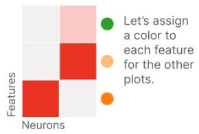  
W as Stack Plot  
Instead of showing a matrix, we can map features to colors and stack the weights per neuron.

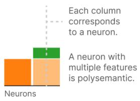  
We can also visualize weights as the edges of a graph, as is often done for neural nets.

## W as Graph

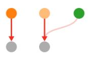

Let's look at what happens when we train a model with $n = 3$ features to perform absolute value on $m = 6$ hidden layer neurons. Without superposition, the model needs two hidden layer neurons to implement absolute value on one feature.

The resulting model – modulo a subtle issue about rescaling input and output weights – performs15 absolute value exactly as one might expect. For each input feature $x _ { i }$ , it constructs a "positive side" neuron $\mathrm { R e L U } ( x _ { i } )$ and a "negative side" neuron ReL $\boldsymbol { \mathrm { { I U } } } ( - \boldsymbol { x } _ { i } )$ . It then adds these together to compute absolute value:

Raw Weights Visualization

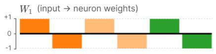  
Graph Visualization

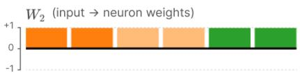

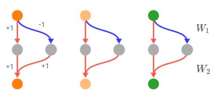

## Superposition vs Sparsity

We've seen that – as expected – our toy model can learn to implement absolute value. But can it use superposition to compute absolute value for more features? To test this, we train models with $n = 1 0 0$ features and $m = 4 0$ neurons and a feature importance curve $I _ { i } = 0 . 8 ^ { i }$ , varying feature sparsity.16

A couple of notes on visualization: Since we're primarily interested in understanding superposition and polysemantic neurons, we'll show a stacked weight plot of the absolute values of weights. The features are colored by superposition. To make the diagrams easier to read, neurons are faintly colored based on how polysemantic they are (as judged by eye based on the plots). Neuron order is sorted by the importance of the largest feature.

ReLU Hidden Layer Toy Model on Absolute Value Task  
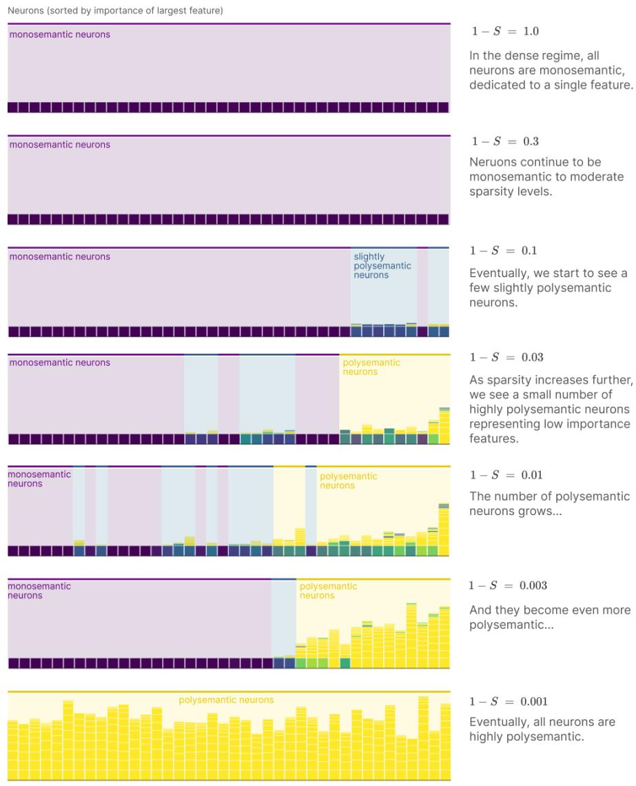

Much like we saw in the ReLU hidden layer models, these results demonstrate that activation functions, under the right circumstances, create a privileged basis and cause features to align with basis dimensions. In the dense regime, we end up with each neuron representing a single feature, and we can read feature values directly off of neuron activations.

However, once the features become sufficiently sparse, this model, too, uses superposition to represent more features than it has neurons. This result is notable because it demonstrates the ability of neural networks to perform computation even on data that is represented in superposition. Remember that the model is required to use the hidden layer ReLU in order to17 compute an absolute value; gradient descent manages to find solutions that usefully approximate the computation even when each neuron encodes a mix of multiple features.

Focusing on the intermediate sparsity regimes, we find several additional qualitative behaviors that we find fascinatingly reminiscent of behavior that has been observed in real, full-scale neural networks:

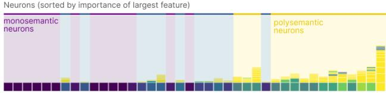  
Neurons can be monosemantic and polysemantic in the same model.

To begin, we find that in some regimes, many of the model's neurons will encode pure features, but a subset of them will be highly polysemantic. This is similar to the phase change we saw earlier in the Relu output model. However, in that case, the phase change was with respect to features, with more important features not being put in superposition. In this experiment, the neurons don't have any intrinsic importance, but we see that the neurons representing the most important features (on the left) tend to be monosemantic.

We find this to bear a suggestive resemblance to some previous work in vision models, which found some layers that contained "mostly pure" feature neurons, but with some neurons representing additional features on a different scale.

We also note that many neurons appear to be associated with a single "primary" feature – encoded by a relatively large weight – coupled with one or more "secondary" features encoded with smallermagnitude weights to that neuron. If we were to observe the activations of such a neuron over a range of input examples, we would find that the largest activations of that neuron were all or nearlyall associated with the presence of the "primary" feature, but that the lower-magnitude activations were much more polysemantic.

Intriguingly, that description closely matches what researchers have found in previous work on language models – many neurons appear interpretable when we examine their strongest[2] activations over a dataset, but can be shown on further investigation to activate for other meanings or patterns, often at a lower magnitude. While only suggestive, the ability of our toy model to reproduce these qualitative features of larger neural networks offers an exciting hint that these models are illuminating general phenomena.

## The Asymmetric Superposition Motif

If neural networks can perform computation in superposition, a natural question is to ask how exactly they're doing so. What does that look like mechanically, in terms of the weights? In this subsection, we'll (mostly) work through one such model and see an interesting motif of asymmetric superposition. (We use the term "motif" in the sense of the original circuit thread, inspired by its use in systems biology .)[36]

The model we're trying to understand is shown below on the left, visualized as a neuron weight stack plot, with features corresponding to colors. The model is only doing a limited amount of superposition, and many of the weights can be understood as simply implementing absolute value in the expected way.

However, there are a few neurons doing something else…

At first glance, this model is quite complicated and tricky to understand However, we can (mostly) decompose it into two pieces...

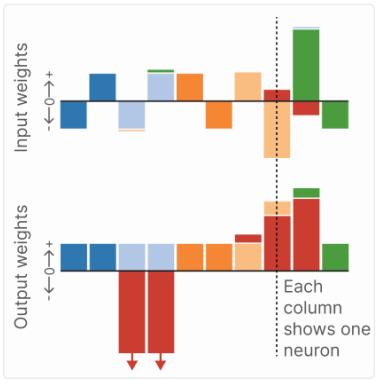  
Many weights are simply implementing absolute value, or a single side of absolute value, in the expected way

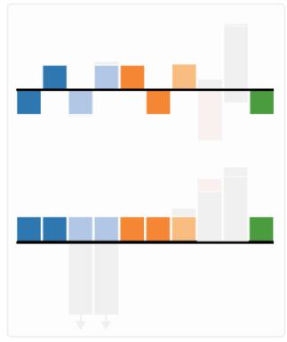  
The main other thing is asymmetric superposition with inhibition. The model has two instances of this motif.

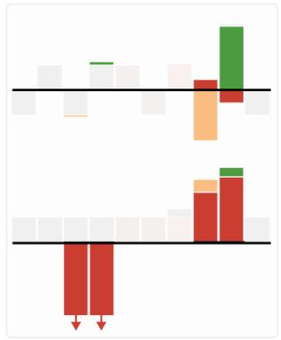  
These other neurons implement two instances of asymmetric superposition and inhibition. Each instance consists of two neurons:  
Asymmetric Superposition with Inhibition Instance 1

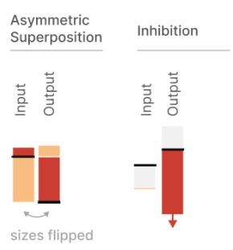  
Asymmetric Superposition with Inhibition Instance 2

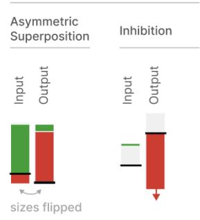

One neuron does asymmetric superposition. In normal superposition, one might store features with equal weights (eg. $W = [ 1 , - 1 ] ;$ ) and then have equal output weights $( W = [ 1 , 1 ] )$ . In asymmetric superposition, one stores the features with different magnitudes (eg. $W = [ 2 , - \frac { 1 } { 2 } ] )$ and then has reciprocal output weights (eg. $\begin{array} { r } { W = [ \frac { 1 } { 2 } , 2 ] ) } \end{array}$ . This causes one feature to heavily interfere with the other, but avoid the other interfering with the first!

To avoid the consequences of that interference, the model has another neuron heavily inhibit the feature in the case where there would have been positive interference. This essentially converts positive interference (which could greatly increase the loss) into negative interference (which has limited consequences due to the output ReLU).

One neuron represents two featuresandwith asymetric superposition. This causesto heavily interfere with, but not the reverse.

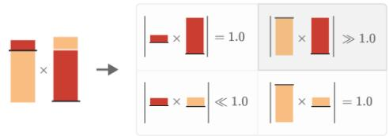  
Large amounts of positive interference are bad, so the model then puts a small amount ofinto a neuron and uses it to massively inhibit. This also forces the main feature the neuron is oparting on () to inhibit

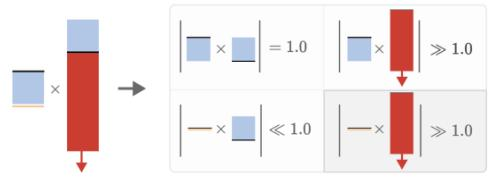  
There are a few other weights this doesn't explain. (We believe they're effectively small conditional biases.) But this asymmetric superposition and inhibition pattern appears to be the primary story.

