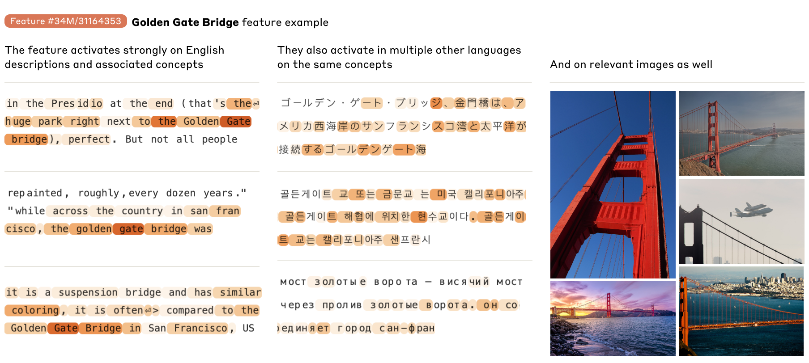

> ⬅️ 返回 [论文索引](../INDEX.MD) · [引言](../introduction/introduction.md)

# Figure 002 — Examples of features in Claude 3 Sonnet

This introductory panel accompanies the examples of abstract, multilingual and multimodal features.
