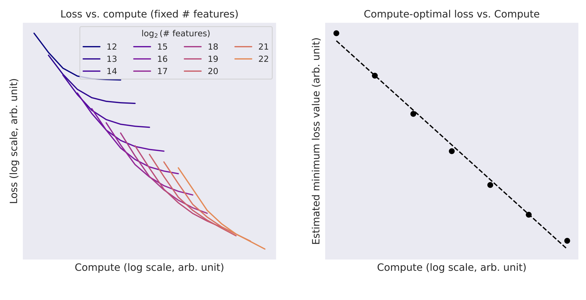

> ⬅️ 返回 [论文索引](../INDEX.MD) · [缩放规律](../results/1-scaling-laws.md)

# Figure 003 — Compute and training loss

Over the tested range, the best loss at a given compute budget falls approximately as a power law.
