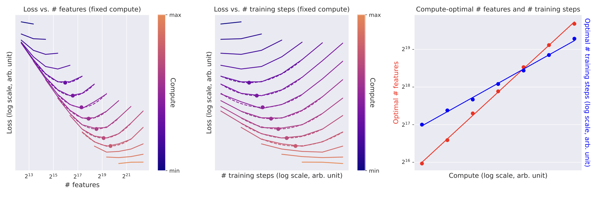

> ⬅️ 返回 [论文索引](../INDEX.MD) · [缩放规律](../results/1-scaling-laws.md)

# Figure 004 — Compute-optimal allocation

Both the preferred dictionary width and step count rise as compute increases in the tested range.
