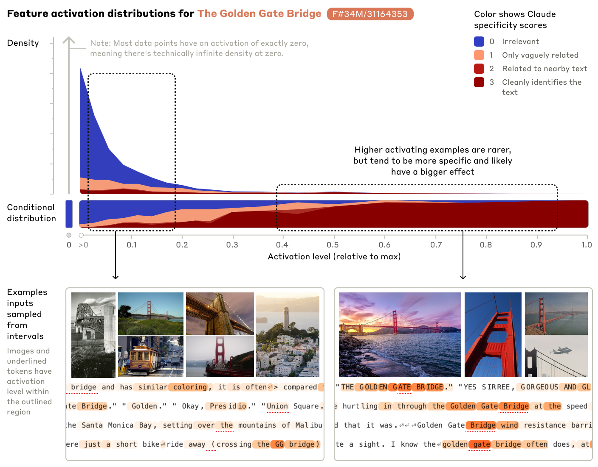

> ⬅️ 返回 [论文索引](../INDEX.MD) · [特异性](../results/2-specificity.md)

# Figure 005 — Feature specificity, panel 1 of 4

The tour compares activation strength with relevance ratings and provides text and image examples. Zero activations are excluded from the plotted distribution.
