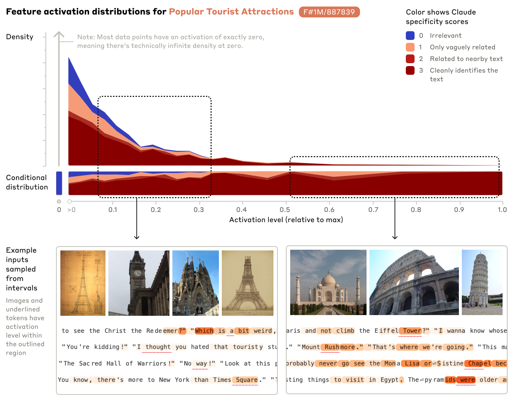

> ⬅️ 返回 [论文索引](../INDEX.MD) · [特异性](../results/2-specificity.md)

# Figure 006 — Feature specificity, panel 2 of 4

Examples across activation strengths help distinguish central examples of the proposed feature from looser matches.
