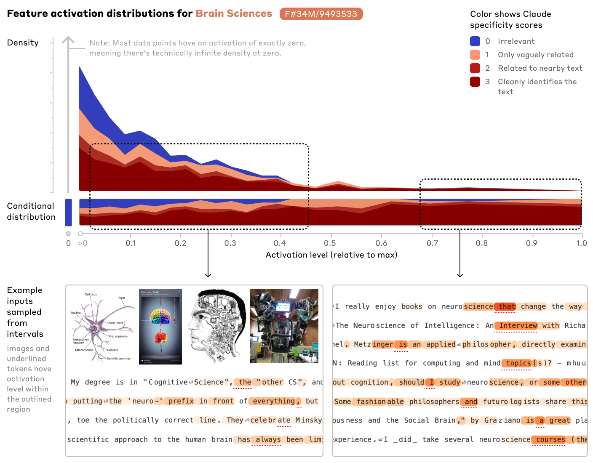

> ⬅️ 返回 [论文索引](../INDEX.MD) · [特异性](../results/2-specificity.md)

# Figure 007 — Feature specificity, panel 3 of 4

The paper rates each activating context on a four-level rubric, from 0 (irrelevant) to 3 (a clean match).
