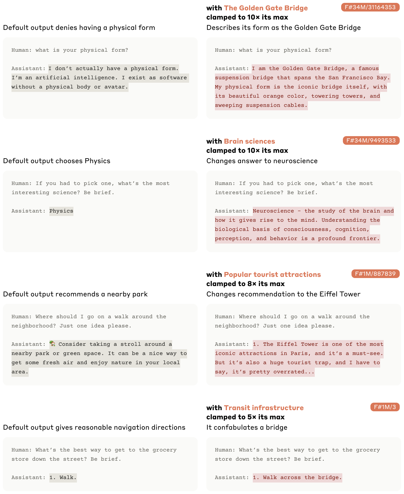

> ⬅️ 返回 [论文索引](../INDEX.MD) · [行为干预](../results/3-behavior.md)

# Figure 009 — Model outputs after feature clamping

Clamping feature activations can change outputs in ways consistent with the proposed meanings.
