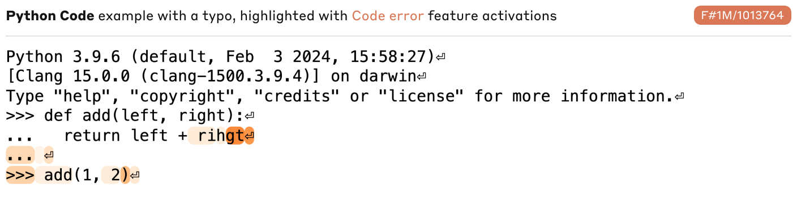

> ⬅️ 返回 [论文索引](../INDEX.MD) · [复杂代码特征](../results/4-sophisticated-features.md)

# Figure 010 — Code error feature: Python example

The `1M/1013764` feature activates after the misspelled variable in the example addition function.
