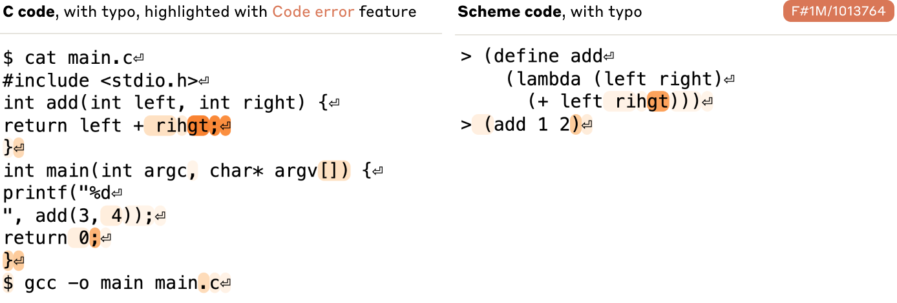

> ⬅️ 返回 [论文索引](../INDEX.MD) · [复杂代码特征](../results/4-sophisticated-features.md)

# Figure 011 — Code error feature: cross-language test

The section compares related errors across Python, C and Scheme.
