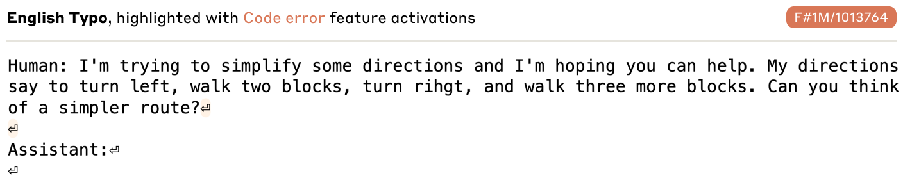

> ⬅️ 返回 [论文索引](../INDEX.MD) · [复杂代码特征](../results/4-sophisticated-features.md)

# Figure 012 — Code error feature: control examples

The comparison tests whether the feature responds to errors in programs rather than misspelling in prose.
