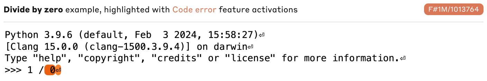

> ⬅️ 返回 [论文索引](../INDEX.MD) · [复杂代码特征](../results/4-sophisticated-features.md)

# Figure 013 — Code error feature: dataset example 1

A naturally occurring example illustrates the interpretation of the feature beyond the controlled prompts.
